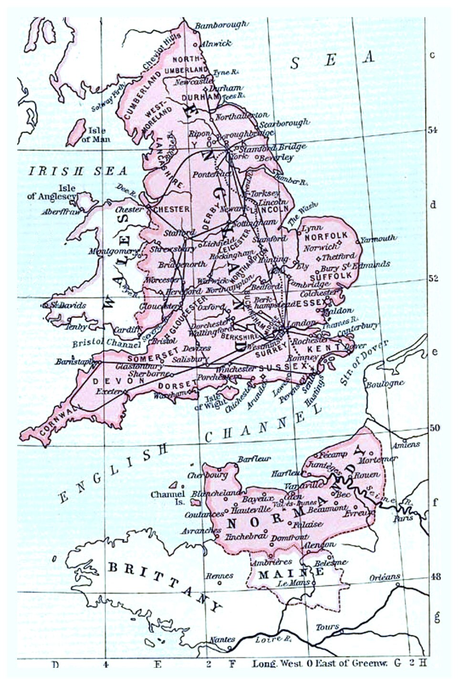
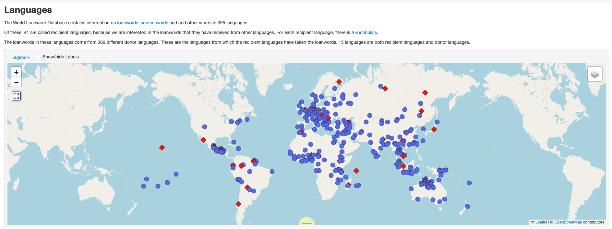

## Journal (5 min)

Choose one and write silently.

::: {.columns}
::: {.column width="50%"}
**Option A**

Pick a word you use every day that you know (or suspect) came from **another language**. What language? Why do you think it came in?
:::
::: {.column width="50%"}
**Option B**

Do you ever mix languages when you talk with family or friends? What does it sound like? Is it the same as using a **borrowed word**?
:::
:::

::: {.notes}
~5 min: 4 min writing, then 1-2 volunteers. Option B is a setup for the borrowing vs. code-switching distinction (Geraghty, p. 165). Students who speak Pidgin, Hawaiian, or another language at home are experts here; don't cold-call.

ANSWERS / SAMPLE RESPONSES: Option A: common answers are food and everyday words (*ketchup*, *sushi*, *kimchi*, *taboo*, *tsunami*, *aloha*, *mahalo*, *shoyu*); they usually came in with a new thing, a new food, or contact through trade, migration, or colonization. Option B: mixing languages mid-conversation is code-switching, which requires both speakers to know both languages; a borrowed word is a word that has become part of one language and is used even by people who don't speak the donor language (see the code-switching slide).
:::

## Reminders

**Writing Assignment 1 Final** is due **Friday, October 23 at 11:59pm**.

**Quiz #4** opens Friday, October 23 and closes Monday, October 26 at 11:55pm.

**Thursday, October 22**: Midterm review. Bring questions and your notes.

  - Review sheet uploaded to this week's module in Lamakū

**Midterm Exam**: **Tuesday, October 27**, in class, open notes (no laptops). Covers Weeks 1-8. **Today's material is not on the midterm.**

::: {.notes}
Confirm the review sheet is posted. Today's chapter is Week 9, so it is excluded from the midterm per the syllabus ("through Week 8"). It will be on Quiz #4 (opens Friday), so tell them.
:::

## Today's Plan

1. What counts as borrowing?
2. Why languages borrow: the story of English
3. Borrowing into Hawaiian: sounds and missionaries
4. **Activity:** exploring the World Loanword Database
5. Who decides? The Hawaiian Lexicon Committee

# What Counts as Borrowing?

## Borrowing: Language Features Move {.smaller}

Languages change from the **inside** (natural change) and by **acquiring features from other languages**. The second way is **borrowing** (also called "copying"). Borrowed features are **loans**.

| Type | Example | Source |
|---|---|---|
| **Sound** | [ʒ] in *pleasure*, *beige*, *rouge* | French (Middle English period) |
| **Word** | *Honolulu* in English; *pipi* 'cattle' in Hawaiian | Hawaiian; English *beef* |
| **Word ending** | *-s* in *he sits*, replacing *-eth* | Old Norse |
| **Sentence structure** | Hawaiian *i luna o **ke** Kīnaʻu* ('on board **the** Kinau') | English |
| **Meaning (calque)** | Fijian *raica cake* ('look upwards at') now means 'respect' | English *look up to* |

> **Clue to a loan:** [ʒ] is rare in English and never starts a word. Odd sounds can give away outside origin.

::: {.notes}
Geraghty, pp. 165-166. Borrowing can occur in all domains: phonological, lexical, morphological, syntactic, semantic, and pragmatic. Footnote 1: Lynch, Ross, and Crowley (2002) prefer "copying." French loans also made [v] and [z] full phonemes of English. Also in the chapter: the missionaries tried to add /b d r s t/ to Hawaiian; speakers did not accept them (*raisi* 'rice' is pronounced /laiki/). Ship names: *Kīnaʻu* went from a proper noun to a common noun with the article *ke*.
:::

## Borrowing or Code-Switching? {.smaller}

**Code-switching** = bilinguals switching languages when talking to other bilinguals. It is **not** borrowing.

> *Ua hana mākou me ka wikiwiki **real fast kind**.*
> 'We did it very quickly without much care.' (Hawaiian with English)

**In pairs.** For each, decide: **loan** or **code-switch**? What's your evidence?

1. English speakers say *Honolulu* in an English sentence
2. Two bilinguals switch to Spanish for a whole sentence
3. A Pidgin speaker says *Pau hana, we go kaukau*
4. A Hawaiian speaker says *kelepona* ('telephone')

> **Test ideas:** Do monolinguals use it? Is it adapted to the recipient language's sounds and grammar? Is it used consistently?

::: {.notes}
Geraghty, p. 165, footnote 2 gives the Hawaiian-English example. The tests are my addition (standard in contact linguistics). Answers: 1 loan (monolingual English speakers use it); 2 code-switch; 3 *pau hana* and *kaukau* are established loans in Pidgin; the sentence is Pidgin; 4 loan (adapted to Hawaiian sounds; *kelepona* is one of the chapter's direct loans, p. 169). Accept debate: the line is a continuum.
:::

# Why Languages Borrow

## Layers of English {.smaller visibility="hidden"}

Over **50%** of English words are borrowed (estimate), mostly from French. Each wave reflects who English speakers **met**:

| Period | Donor | What came in |
|---|---|---|
| ~6th c. onward | **Latin** (Christianity) | *bishop*, *monk*, *priest* |
| 9th c. onward | **Old Norse** (Viking settlement) | *they*, *egg*, *sky*, *skin*, *take*, *want*, *ugly* |
| 11th c. onward | **French** (Norman conquest) | law, government, education, commerce |
| Later | **Italian, Dutch, French** | *piano, opera*; *yacht, deck, easel*; *cuisine, chiffon* |
| Ongoing | **Latin and Greek** | *television*, *botany*, *vegetarian* |

**Pattern:** Old English and Norse words tend to be **short, common, everyday** (*we, have, that*). Borrowings tend to be **longer and more technical** (*language, phonology, feature*).

::: {.notes}
Geraghty, pp. 166-167. Norse loans are "intimate": the languages were closely related, partly mutually intelligible, and speakers lived side by side.
:::

## Why Does English Have Both *Cow* and *Beef*? {.smaller}

Look at the **animal** and the **meat**:

::: {.columns}
::: {.column width="50%"}
**On the farm**

- *cow*
- *pig*
- *sheep*
- *calf*
- *deer*
:::
::: {.column width="50%" .fragment}
**On the plate**

- *beef*
- *pork*
- *mutton*
- *veal*
- *venison*
:::
:::

> **Think first:** Why would one language have **two different sets of words** for the same animals? And what about *chicken*?

::: {.notes}
Click once to reveal the "on the plate" column. Let students guess before revealing. Pair them: cow/beef, pig/pork, sheep/mutton, calf/veal, deer/venison. Geraghty, p. 167 lists pork, beef, mutton as the example. The extra pairs (calf/veal, deer/venison) are standard English etymology, from French *veau* and *venaison*. Do not tell them the answer yet: ask where the "meat" words look like they come from.

ANSWER (reveal on the next slide): English has two sets because two languages and two social classes met after the Norman conquest of 1066. English-speaking peasants tended the animals and kept the English words; the French-speaking elite ate the meat and used French-derived words. Chicken is not a French/English pair: *chicken* is English for both the bird and the meat, and French-derived *poultry* names the group.
:::

## The Answer: 1066 and Two Classes {.smaller}

::: {.columns}
::: {.column width="36%"}
**Who did what after the Norman conquest**

- **English speakers** (peasants) **raised** the animals, using English words: *cow, pig, sheep*
- **French speakers** (the Norman elite) **ate** the meat, using French words: *boeuf* → *beef*, *porc* → *pork*, *mouton* → *mutton*, *veau* → *veal*
:::
::: {.column width="36%" .fragment}
**The echo of power in today's menu**

- Same animals, two languages, two **social classes**
- The animal word stayed English; the meat word came from French
- Prestige: French *commence*, *reside*, *purchase* beside English *begin*, *live*, *buy*

> **What about *chicken*?** It's the English word for both bird and meat. The French-derived word *poultry* names the category.
:::
::: {.column width="28%"}
{fig-alt="Historical map of England and Normandy across the English Channel" width="100%"}
:::
:::

::: {.notes}
Geraghty, p. 167. Click once to reveal the right column. Chicken is an exception to the pattern: *chicken* (Old English *cicen*) stays for both, and *poultry* (from French *poulet*, *poule*) names the group. Ask what other pairs students can think of ("pig/pork" ~ Māori *poaka*, see the Pacific examples slide). The pattern is a tendency, not a law; mention that eating habits differ and nuance exists (for example, "lamb" is Old English and the meat is also "lamb"). Body-part pairs for extension: eye/ocular, heart/cardiac, mouth/oral, nose/nasal, tooth/dental.

Map: England and Normandy across the Channel. Point to Normandy (bottom right) as where the new ruling class came from, and to the Channel as the short distance between the two. If you want a caption, add the map's source and date; save the image as images/norman-conquest-map.jpg.
:::

## Needed vs. Intimate Borrowing {.smaller}

::: {.columns}
::: {.column width="50%"}
**Needed ("cultural") borrowing**

A new thing or idea arrives; the language needs a name for it.

- Latin: *bishop*, *monk*
- Hawaiian: *kelekalama* 'telegram', *lekiō* 'radio'
- English: *ʻukulele*, *hula*
:::
::: {.column width="50%"}
**Intimate borrowing**

Constant close contact and **bilingualism**. Even sounds, particles, and constructions are borrowed. Over time the languages can **converge**, or the weaker one can be **lost**.

- Norse: *they*, *egg*, *take*
:::
:::

**What's borrowed depends on how close the contact is:** nouns first; then verbs and adjectives; grammatical particles (prepositions, conjunctions, affixes) last.

> **Counterexample:** Germany ruled Western Samoa 1890-1914 with business interests since the 1850s. Samoan borrowed only a **handful** of rarely-used German words. Why?

::: {.notes}
Geraghty, p. 170 (Lynch 2004:197-199: little close contact, so little borrowing; Lynch's chapter title, 'Don't take my word for it,' plays on Schütz's). Answer: contact alone is no guarantee; what matters is the closeness of contact and bilingualism. Ask students to compare with Palauan and Japanese schooling (Oct 6): schooling created close contact and many loans.

ANSWER to the Samoa/Germany question: contact alone does not produce borrowing. Germany had commercial interests from the 1850s and ruled 1890-1914, but there was little close, everyday contact and little bilingualism in German among Samoans, so only a handful of rarely used words were borrowed. Closeness of contact and bilingualism, not just political control, predict how much is borrowed. Contrast with Norse in English (intimate) and Japanese schooling in Palau (many loans).
:::

## Other Ways to Make a New Word {.smaller visibility="hidden"}

Borrowing is **not the only option**. Early English Christians often **built** words:

| Strategy | Example |
|---|---|
| **Compounding** | *weofod* 'altar' ('idol table') |
| **Semantic expansion** | *Eastron* (spring festival) → 'Easter'; *bletsian* 'sprinkle with blood' → 'bless' |
| **Calque** (loan translation) | *gōdspell* 'good story' ← Greek *evaggelion* |
| **Direct borrowing** | *biscop* ← Latin *episcopus* |

> **Activity (3 min):** In pairs, brainstorm **three ways** a language could name a *smartphone*. Label each strategy.

::: {.notes}
Geraghty, pp. 166-167. Sample answers: borrow (*phone*, *smart*), compound ('pocket computer'), semantic expansion ('cell'), calque. Footnote 9 of the chapter notes that 'ship-fly' for airplane and 'lightning' for electricity are found across the Pacific (Fijian *waqavuka*, *livaliva*; Tongan *vakapuna*, *ʻuhila*).

ANSWER (sample): borrow (a *smart phone*, 'smartfone'); compound ('pocket computer', 'brain phone'); semantic expansion (*cell*, *mobile*); calque (translate 'smart phone' word-for-word into the language). Accept any reasonable set, as long as each strategy is labeled correctly.
:::

## "Unnecessary" Borrowing {.smaller visibility="hidden"}

Sometimes languages borrow words they **already have**. A common reason is **prestige**.

- English: French *commence* beside native *begin*
- Tongan *sokisoki* 'porcupine fish' ← Fijian, **replacing** Tongan *toutu*. The fish was always in Tongan waters. Why? Perhaps war-related Fijian words came in as a set, or perhaps Tongans simply liked the word
- Extreme cases: the **entire language** is replaced (Niuatoputapu → Tongan; many languages of French Polynesia → Tahitian)
- Some linguists see **pidgins** as massive unnecessary borrowing (though *necessary* for communication)

> **Discuss:** Is Pidgin's English vocabulary "unnecessary borrowing"? What would the Hawaiian speakers of the 1800s say?

::: {.notes}
Geraghty, pp. 172-173 (Clark 2004 on necessary vs. unnecessary borrowing). Link to Thursday's Pidgin lecture: the lexifier supplies most vocabulary, but the grammar is shaped by the substrate. Also link to Pidgin Hawaiian first (Hawaiian vocabulary, then English). Keep this discussion short.

ANSWER: Pidgin's vocabulary is largely English-derived, so some linguists do call pidgins massive unnecessary borrowing. But the speakers had no shared language, so it was necessary for communication; the first plantation pidgin was based on Hawaiian, which was the dominant local language. Hawaiian speakers in the 1800s might say: English words came with power (schools, government, business), not just need, and they replaced Hawaiian in more and more domains. Both views are reasonable; the point is that 'necessary' depends on the social situation.
:::

# Borrowing into Hawaiian

## Before Cook: What Was Borrowed? {.smaller visibility="hidden"}

Little is known about borrowing into Hawaiian before 1778.

- ***ʻuala*** 'sweet potato': a plant of **American** origin. Rensch (1991) argues the name came from northern **Colombia**; *kumara* (elsewhere in Polynesia) from **Peru/Ecuador**
- ***ʻumeke*** 'bowl' and ***kope*** 'rake, shovel': possibly from **Dutch** *kommetje* and *schop*, perhaps carried by visitors from the **Tuamotus** or elsewhere in Eastern Polynesia in the 1600s-early 1700s (speculative)

> **Discuss:** No Dutch ship is known to have reached Hawaiʻi. What does it mean if these words really are Dutch?

::: {.notes}
Geraghty, p. 168 (Geraghty and Tent 2004:127-131: "From lowlands to islands: Dutch loans in Polynesia"). Callback to Drager (2012): sweet potato and the words *kumara*, *ʻuala*, and Ecuadorian *comal*. Answer: words travel with people and goods through chains of contact, so a loan can reveal contact that left no other record.
:::

## After Cook: Build or Borrow? {.smaller}

New things arrived and needed names. At first, Hawaiians mostly **built** words:

| Strategy | Hawaiian example |
|---|---|
| **Compound** | *ʻīlio-nui* 'horse' ('dog-big'), later *lio*; *mokulele* 'airplane' ('ship-fly') |
| **Semantic expansion** | *pūpū* 'shell' → 'buttons'; *moku* 'island' → 'ship'; *uila* 'lightning' → 'electricity' |
| **Borrowing** | *pipi* 'cattle' (*beef*), *ʻaila* 'oil', *kākini* 'stocking' (before 1810); *kelekalama*, *kelepona*, *lekiō* |

Hawaiians were among the **most literate** people in the world then, avid readers of newspapers.

> **Discuss:** Why might speakers prefer a compound like *mokulele* over borrowing the English word?

::: {.notes}
Geraghty, pp. 168-169. The chapter says borrowings in the 20th and 21st centuries are discussed in the language planning section (see "Who Decides?" below). Answer: transparency, fits the sound system, signals identity; but borrowing is faster.

ANSWER: building words from existing parts is transparent (*mokulele* explains itself), fits Hawaiian sounds without changing them, keeps the language's own resources in use, and signals identity; borrowing is faster and easier when many new things arrive at once. Hawaiians did both.
:::

## Taking In the Sounds {.smaller visibility="hidden"}

Almost no loanword is pronounced the same in the donor and the recipient language. Each language "presses" words **through its own sound system**.

**Hawaiian → English:** *ʻukulele* [ʔukulele] → [yūkhәleylī]

1. English has no phonemic glottal stop: the first consonant disappears
2. English words don't begin with /ū/: add /y/
3. English /k/ is aspirated
4. The second /u/ becomes schwa
5. Stressed /e/ becomes a diphthong /ey/
6. Final /e/ doesn't occur in English: replaced with /ī/

**English → Hawaiian:** *beef* /bīf/ → ***pipi***

- /b/ → /p/ (no /b/ in Hawaiian) · /f/ → /p/ (no /f/) · add a **vowel** to the end (no final consonants)

::: {.notes}
Geraghty, pp. 170-171. Footnote 11: pronouncing Hawaiian words "correctly" in English (e.g., the ʻokina in Hawaiʻi) is laudable but not what usually happens in borrowing. The final vowel in pipi may be the default /i/ or an "echo vowel" (footnote 13). The ʻukulele was introduced by the Portuguese and popularized by a man nicknamed ʻUkulele, 'leaping flea.'
:::

## Activity: Whose Rule? (6 min) {.smaller}

Hawaiian borrowed English words in **two periods**. Compare the sets:

| Before the missionaries | English | After the missionaries | English |
|---|---|---|---|
| *kāpiki* | cabbage | *kula* | school |
| *lami* | rum | *pela* | spell |
| *puke* | book | *kopa* | soap |
| *pele* | bell | *hipa* | sheep |
| *pine* | pin | *Pokekona* | Boston |
| *huelopoki* | whaleboat | *Kenemaka* | Denmark |

**In pairs:** (1) What vowel is added after a **final consonant** in each set? (2) What happens in **clusters**? (3) Who was in control of the form?

::: {.notes}
Geraghty, p. 171 (Schütz 1976:88, 1994:202). Before: the vowel added after a final consonant is usually /i/ or /e/ (with /u/ after the bilabials /m/ and /b/, as in *kapu* 'tub' and *ukamu* 'oakum'); in *huelopoki* an /o/ breaks up a cluster. After: the missionaries decided /e/ goes between clustered consonants and /a/ goes after a final consonant. Exceptions: *ʻapokolo* 'apostle', *ʻepikekolo* 'epistle'. Takeaway: early loans were shaped by Hawaiian speakers; later ones by missionaries, who wanted consistency and perhaps to exert authority. *Pele* 'bell' vs. *pela* 'spell' shows the two systems side by side.

ANSWERS: (1) Before the missionaries: a final vowel is added after a final consonant, usually /i/ or /e/ (*kāpiki*, *lami*, *puke*, *pele*, *pine*), sometimes /u/ after /m/ or /b/. After the missionaries: always /a/ after a final consonant (*pela*, *kopa*, *hipa*, *Kenemaka*). (2) Before: a vowel breaks up a cluster, e.g., /o/ in *huelopoki*. After: /e/ goes between clustered consonants (*Pokekona*, *Kenemaka*). (3) Before: Hawaiian speakers shaped the forms; after: the missionaries decided the pattern, to be consistent and probably to exert authority.
:::

## "Take My Word for It": Words Imposed {.smaller}

Missionaries (1820s on) taught religion and school subjects **in Hawaiian**, so **they**, not Hawaiian speakers, chose the new words. Schütz (1976): **"Take my word for it."**

::: {.columns}
::: {.column width="50%"}
**Built from Hawaiian**

- *kāhikolu* 'trinity' ('one-three')
- *alahou* 'resurrection' ('rise again')
- *akua* 'god' → the Christian God
- *keʻa* 'crossed wood' → 'cross'
:::
::: {.column width="50%"}
**Borrowed**

- *hīmeni* 'hymn', *kāpaki* 'sabbath', *papakema* 'baptism', *ʻānela* 'angel'
- **"Eye borrowings"** (from spelling, not sound): *hīmeni*; *ʻeuanelio* 'gospel' (Latin/Greek); *ʻaeko* 'eagle' and *meli* 'honey' (Greek); *kinola* 'lyre' and *naheka* 'snake' (Hebrew)
:::
:::

> **Discuss:** Compare with Honiara last week: who decides which words and which languages count?

::: {.notes}
Geraghty, pp. 168 and 171. Eye borrowings are similar to the learned coinages from classical languages in English (*television*). Contrast with the earlier "Before the missionaries" loans, which Hawaiian speakers shaped. Tie to Jourdan & Angeli's colonial hierarchy.

ANSWER to the Honiara question: in Honiara, English sat at the top of a colonial hierarchy and Pijin was called 'broken English'; in Hawaiʻi, the missionaries decided which words the language would take. In both cases, people with institutional power (colonial authorities, missionaries, schools) decided what counted as a proper word or language, and speakers' own preferences often came second. Differences: Hawaiian speakers had a very high literacy rate and still resisted some forms (the sounds /b d r s t/ never caught on).
:::

## Meaning and Structure Change {.smaller visibility="hidden"}

**Semantic shift:** a borrowed word's meaning can change.

- ***pipi*** (*beef*) → the meat **and the animal**. Hawaiians may have known beef before cattle (introduced by Vancouver, 1793) and called the animal *puaʻa pipi*, 'pig that gives beef', later shortened
- ***kao*** 'goat' (from *cow*), ***palaka*** a kind of shirt (from *frock*), ***palaoa*** 'flour' → also 'bread'

**Reanalysis (recutting):** speakers re-divide the word.

- Hawaiian *tapaka* 'tobacco' → *ta* (article) + ***paka***
- Bislama *l'oto* 'the car' → ***loto***; *la fête* → ***lafet*** (French article absorbed)
- Fiji Hindi *na qiō* 'the shark' → ***nagio***

> **Discuss:** Which of these shows that borrowing is **creative**, not just copying?

::: {.notes}
Geraghty, p. 172 (sections 7-8). Fijian *napikini* 'diaper' (from *napkin*) was reanalyzed as the article *na* + base *pikini*. The Bislama examples tie to Thursday's lecture on Bislama vocabulary and to the French/English colonial history of Vanuatu.

ANSWER: both show speakers creatively reshaping loans instead of copying them. *Pipi* gained a meaning (the animal) by an inference about how Hawaiians first encountered beef; *tapaka* was re-divided into article + noun (*paka*); Bislama *loto* and *lafet* absorbed the French article into the word; Fiji Hindi *nagio* absorbed the Fijian article. Reanalysis is the clearest case, because speakers decided how to carve up a foreign word using their own grammar.
:::

# Explore the Data: The World Loanword Database

## Where Are WOLD's Languages? {.smaller}

{fig-alt="World map of WOLD languages: red diamonds for the 41 recipient languages, blue dots for donor languages, clustered in Europe, the Middle East, Central America and Southeast Asia" width="100%"}

> **Look:** Where are the donor languages (blue) clustered? Where are the Pacific languages?

::: {.notes}
Map from wold.clld.org/language (Languages page). The site says WOLD has information on 395 languages: 41 recipient languages (each with a vocabulary; red diamonds) and 369 donor languages, with 15 languages in both groups. ANSWER: donors cluster in Europe, the Middle East, South Asia, Central America, and Southeast Asia/New Guinea, where many languages and long histories of contact meet. The Pacific has few points: Hawaiian is the lone red diamond in the North Pacific, and Takia (New Guinea) and Indonesian are in the west. Link to today's lab: our five languages are five of the red diamonds. Check the legend on the site if a student asks exactly what each color means.
:::

## The World Loanword Database (WOLD) {.smaller}

**WOLD** (Haspelmath & Tadmor 2009) is a free online database: word lists for **41 languages**, each with **1,000-2,000 entries**, written by experts. Every entry is coded for borrowing:

| Code | Meaning |
|---|---|
| **1** | clearly borrowed |
| **2** | probably borrowed |
| **3** | perhaps borrowed |
| **4** | very little evidence for borrowing |
| **5** | no evidence for borrowing |

Each loan lists its **source word** and **donor language**.

**Austronesian languages in WOLD:** Hawaiian, Takia (Papua New Guinea), Indonesian, Malagasy (Madagascar). Plus **Ceq Wong**, an Austroasiatic language of Malaysia, for contrast. We'll practice on **English**.

> **Example row (Hawaiian):** ***pipi*** · 'the cattle' · 1. clearly borrowed · source word *beef* (English)

> **Predict:** What percent of English words do you think are clearly borrowed?

::: {.notes}
Live demo (see the next slide for the English demo): you can also show wold.clld.org/vocabulary/30 (Hawaiian). Show (1) the Borrowed status filter above the table (choose "1. clearly borrowed"), (2) the line "Showing 1 to 100 of 188 entries," (3) the Meaning box for typing "cattle," and (4) the language page wold.clld.org/language/30, where the Donor languoid column lists every loan by donor (230 entries). By default the Core list filter is set to True, which is what students will see. Question to ask the class: what do you think we'll find? Sample prediction answers: more loans in nouns than verbs; mostly English as donor; more loans in technology and religion than in body parts. Four of the five lab languages are Austronesian (Hawaiian, Takia, Indonesian, Malagasy), which ties back to Week 2 (Blust); Ceq Wong (Austroasiatic, Malaysia) is the contrast, and its main donor, Malay, is itself Austronesian. Citation: Haspelmath, Martin and Uri Tadmor (eds.) 2009. World Loanword Database. Leipzig: Max Planck Institute for Evolutionary Anthropology. wold.clld.org
:::

## Demo: English in WOLD (4 min) {.smaller}

Open **wold.clld.org/vocabulary/13** (English). Set **Borrowed status** to *1. clearly borrowed*.

**Before we look, predict** which of these English words are borrowed:

::: {.columns}
::: {.column width="50%"}
*cattle · money · school · tea*
:::
::: {.column width="50%" .fragment}
**All four are borrowed.**

- *cattle* ← Latin *capitāle*
- *money* ← Anglo-Norman French
- *school* ← Greek *skholē*
- *tea* ← Min Chinese *tiä*
:::
:::

*bread · mother · hand · eat* are **native** (no evidence for borrowing).

> **Then:** *they*, *sky*, *egg* ← Old Norse; *tattoo* ← Tahitian *tātau*. Which donor is biggest overall?

::: {.notes}
Live demo on English so no group's language is spoiled. Steps to model for the class: (1) open the vocabulary page; (2) filter Borrowed status to "1. clearly borrowed" and read "Showing 1 to 100 of 585 entries" (of 1,515 core entries, 38.6%); (3) remove the filter to read the total; (4) type "cattle" in the Meaning box and read the row; (5) open the language page (wold.clld.org/language/13) and sort by donor. ANSWERS: *cattle* is from Latin *capitāle* (a surprise: the English word for the animal is itself a loan, while *cow* is native; this links to the cow/beef slides), *money* from Anglo-Norman French, *school* from Greek *skholē* (via Latin), *tea* from Min Chinese *tiä*. Native (coded 5): *bread*, *mother*, *hand*, *eat*, also *cow*, *pig*, *sheep*, *chicken*. Donors among clearly borrowed English words: Latin 263, French 61, Old Norse 43, Anglo-Norman 40, Greek 39, Late Latin 35. Norse examples from the chapter: *they*, *sky*, *egg* (all in WOLD). *Tattoo* ← Tahitian *tātau* is in WOLD as a loan. Note that the Meaning box searches WOLD's meaning labels (e.g., "the cow"), not English words. Prediction answer for the previous slide: 38.6% of core entries are clearly borrowed (about 41% counting probable loans, as in Tadmor et al.).
:::

## Activity: Loanword Lab (22 min) {.smaller}

**Groups of 3-4.** Each group takes **one language**. Open the worksheet, then make a copy.

::: {.columns}
::: {.column width="72%"}
| Language | Word list | Donors |
|---|---|---|
| Hawaiian | wold.clld.org/vocabulary/**30** | wold.clld.org/language/**30** |
| Takia | wold.clld.org/vocabulary/**29** | wold.clld.org/language/**29** |
| Ceq Wong | wold.clld.org/vocabulary/**26** | wold.clld.org/language/**26** |
| Indonesian | wold.clld.org/vocabulary/**27** | wold.clld.org/language/**27** |
| Malagasy | wold.clld.org/vocabulary/**28** | wold.clld.org/language/**28** |

1. **Count** the clearly borrowed words, and work out the percentage (3 min)
2. **Donors:** biggest three, two examples each, and *why* (5 min)
3. **What kinds** of words are borrowed? (5 min)
4. **Compare** eight meanings: *cattle, bread, money, school, tea, mother, hand, to eat* (5 min)
5. **Find a surprise** (2 min)
:::
::: {.column width="28%"}
{fig-alt="QR code linking to the Loanword Lab worksheet" width="100%"}

**go.hawaii.edu/NfS**
:::
:::

::: {.notes}
Share the worksheet as a Google Doc (LING 150C Loanword Lab (WOLD) - Student Worksheet: students make a copy and fill it in as a group; links are on the Doc). The instructor key is a separate Google Doc. Circulate. Common issues: (1) the page loads in two steps; wait a few seconds for the table; (2) the default Core list = True filter is what the counts assume; (3) Ceq Wong has no cattle entry in WOLD; tell that group to note this and move on, or use "the pig" (native); (4) some meanings (mother, and) have several words. Expected numbers: Hawaiian 188 of 1,483 core entries (12.7%), Takia 306 of 1,327 (23.1%), Ceq Wong 318 of 947 (33.6%), Indonesian 617 of 2,046 (30.2%), Malagasy 210 of 1,680 (12.5%). Biggest donors: Hawaiian English (also Greek, Māori); Takia English and Tok Pisin; Ceq Wong almost entirely Malay (302 of 318); Indonesian Sanskrit, Dutch, Arabic; Malagasy French (89), Malay (45), English (26), and Bantu languages (17). Two groups can share a language if the class is large. Timing: stop at 22 minutes even if some groups are not finished.
:::

## Report-Out: What Patterns Do We See? {.smaller}

| Language | % clearly borrowed | Top donor and why | Surprise |
|---|---|---|---|
| Hawaiian | | | |
| Takia | | | |
| Ceq Wong | | | |
| Indonesian | | | |
| Malagasy | | | |

> **Discuss:** Which language borrowed the most? Which donor languages are **not** European? What do the eight comparison meanings have in common?

::: {.notes}
Fill in the table on the board as groups report (about 1 minute each). ANSWERS / TALKING POINTS: Hawaiian 12.7% (English, plus Greek and Hebrew via missionary translation, Māori and others via the Lexicon Committee); Takia 23.1% (English, Tok Pisin, neighboring Bargam and Gedaged); Ceq Wong 33.6%, with about 95% of its loans from Malay (302 of 318); Indonesian 30.2% (Sanskrit, Dutch, Arabic, Javanese); Malagasy 12.5% (French 89, Malay 45, English 26, Bantu 17). Which borrowed the most? Indonesian, with a long history of trade contact. Non-European donors: Sanskrit, Arabic, and Javanese for Indonesian; Malay and Bantu languages (Comorian, Swahili-area) for Malagasy; Malay for Ceq Wong, a language of a different family, so its borrowing shows what intense contact with one neighbor does (even verbs and function words are borrowed: about 31% of its verbs); Bargam, Waskia, and Tok Pisin for Takia. Malagasy is the Austronesian language farthest west; WOLD lists "before the migrations to East Africa" as the contact situation for about 60 of its loans, a possible link to Week 2. Common pattern of the eight meanings: cattle, bread, money, school, and tea (introduced things) are borrowed nearly everywhere; mother, hand, and to eat (body, kin, basic verbs) mostly are not. Surprises students may find: Hawaiian words from Ute (kokeiʻa 'prairie dog'), Takia makao 'cattle' from Pacific Pidgin English "bulmakau," Indonesian sapi 'cattle' from Javanese, Malagasy kisoa 'pig' from French cochon, Malagasy akoho 'chicken' from Comorian (Bantu), and Malagasy tanana 'hand' (probably from Malay).
:::

## What the Database Shows {.smaller}

| Language | Clearly borrowed | Biggest donors |
|---|---|---|
| Hawaiian | 12.7% | English, Greek, Māori |
| Takia | 23.1% | English, Tok Pisin, Bargam |
| Ceq Wong | 33.6% | Malay (95%) |
| Indonesian | 30.2% | Sanskrit, Dutch, Arabic |
| Malagasy | 12.5% | French, Malay, English |

| Meaning | Hawaiian | Takia | Indonesian | Malagasy | Ceq Wong |
|---|---|---|---|---|---|
| cattle | *pipi* (beef) | *makao* (bull-cow) | *sapi* (Javanese) | *biby fiompy* (native) | (no entry) |
| money | *kālā* (dollar) | *moni* (Tok Pisin) | *duit* (Dutch) | *vola* (native) | *dwet* (Malay) |
| school | *kula* (English) | *skul* (Tok Pisin) | *sekolah* (Portuguese) | *sekoly* (English) | *kolah* (Malay) |
| mother | *makuahine* | *tna-* | *ibu* | *reny* | *mɔ̃y* |
| hand | *lima* | *bani-* | *tangan* | *tanana* (probably Malay) | *cɑs* |

> **Patterns:** introduced things are borrowed; **body parts and kin words mostly are not**; the donor depends on **who the language was in contact with**.

::: {.notes}
Use as a summary after the report-out. Source: WOLD (checked against the online site for Hawaiian; other values from the downloaded database). Nouns first: in the full word lists, about 23% of Hawaiian nouns are loans compared with about 6% of verbs and 2% of function words; Takia about 36% of nouns and 3% of verbs. This agrees with Geraghty's (p. 170) claim and Tadmor et al. (2010). Cattle: Hawaiian pipi (English beef), Takia makao (Pacific Pidgin English bulmakau), WOLD Gurindji puliki (English bullock; Gurindji is in WOLD but not in the lab), plus Fijian bulumakau (English bull and cow, possibly via Tongan pulu mo kau; Tent & Geraghty 2004, p. 257, citing Nawadra). Link back to the cow-and-beef slides: the animal word and meat word again. Malagasy has native words for cattle, money, and mother, but kisoa 'pig' is French cochon, ondry 'sheep' is Bantu, and sekoly 'school' is English, a reminder that the Austronesian core vocabulary of a language can sit beside many loans.
:::

<!-- Thursday group: Hawaiian Words on the Move (section title removed: an all-hidden section leaves blank slides) -->

## Loans from Hawaiian {.smaller visibility="hidden"}

::: {.columns}
::: {.column width="50%"}
**Into English worldwide**

*hula*, *aloha*, *ʻukulele*, *mahimahi*, *kanaka*

**Into Hawaiʻi English and Pidgin**

*hālau*, *haole*, *keiki*, *kōkua*, *lei*, *mahalo*, *mauka*, *makai*, *pau*, *pilikia*, *ʻono*, *wikiwiki*...

Local words from **Japanese** (*shoyu*, *tempura*), **Portuguese** (*malassada*), **Chinese** (*mui*, *wun tun*), and **Korean** (*kimchee*) too
:::
::: {.column width="50%"}
**Not borrowed in Hawaiian form**

*taboo*, *tapa*, *taro*, *tattoo*, *tī* came into English from **Tahiti or Tonga** (Cook's voyages), not Hawaiian *kapu*, *kapa*, *kalo*, *kākau*, *kī*

**Into other Pacific languages**

Kiribati *momi* 'pearl'; Kiribati *bakaukau* 'business, to trade' (Hawaiian *pākaukau* 'to sell'); Tongan *ʻōhai* (Hawaiian *ʻohai*); 'jew's harp' *ʻūkēkē* → Tongan *ʻūtete*
:::
:::

> ***Kanaka*** spread through the early 1800s trade jargon to mean 'Pacific islander' and survives in **Kanak** and **Kanaky** (New Caledonia).

::: {.notes}
Geraghty, p. 169 (section 4), footnote 10 (Carr 1972). Hawaiian speakers were among the crews on whalers and trading ships, and some missionaries elsewhere knew Hawaiian, so Hawaiian words traveled. Question to ask: which of these words do students use? Which are "local" and which are "global"? The chapter's point that borrowed words mostly refer to uniquely Hawaiian things: flora (*koa*, *kukui*), fauna (*nēnē*, *humuhumu*), practices (*hālau*, *heiau*, *lomilomi*, *mele*).

ANSWER to the question in the notes: 'local' words (e.g., *pau*, *pilikia*, *mahalo*, *keiki*) are used by people in Hawaiʻi in everyday speech, while 'global' words (*aloha*, *hula*, *ʻukulele*) are used by English speakers worldwide. Most of the loans refer to uniquely Hawaiian things, which is cultural (needed) borrowing: flora (*koa*, *kukui*), fauna (*nēnē*, *humuhumu*), practices and artefacts (*hālau*, *heiau*, *lomilomi*, *mele*).
:::

## Activity: Where Did It Come From? (5 min) {.smaller visibility="hidden"}

**In pairs.** Sort these words found in Hawaiʻi by donor language. Then tell us: **needed** borrowing or something else?

*mahalo · shoyu · malassada · kimchee · haole · wun tun · tempura · kukui · mui · pau*

| Donor | Words |
|---|---|
| Hawaiian | |
| Japanese | |
| Portuguese | |
| Chinese | |
| Korean | |

> **Think about:** Which donor language gave **food** words? Which gave **plants and places**? What does that say about each group's history in Hawaiʻi?

::: {.notes}
Geraghty, p. 169 footnote 10. Answers: Hawaiian: mahalo, haole, kukui, pau; Japanese: shoyu, tempura; Portuguese: malassada; Chinese: mui, wun tun; Korean: kimchee. Link to Thursday's Pidgin vocabulary and to plantation labor history. Students from Hawaiʻi can add more.

ANSWERS to the Think-about questions: Food words came mostly from Japanese (*shoyu*, *tempura*), Portuguese (*malassada*), Chinese (*mui*, *wun tun*), and Korean (*kimchee*), reflecting immigrant groups who brought their foods and cooking to Hawaiʻi through plantation labor and settlement. Plants, places, and practices came mostly from Hawaiian (*kukui*, *mahalo*), reflecting that Hawaiian is the language of the land, and English speakers adopted words for things that were uniquely Hawaiian. Most are 'needed' (cultural) borrowings: names for things the recipient didn't have a word for; *mahalo* and *pau* are everyday words adopted by social belonging (identity), which makes them closer to prestige or solidarity borrowing.
:::

<!-- Thursday group: Beyond the Chapter: More Examples -->

## The Same English Word, Across Polynesia {.smaller visibility="hidden"}

English words entered many Pacific languages, and each language fitted them to its own sounds:

| English | Hawaiian | Samoan | Māori / Fijian |
|---|---|---|---|
| *flour* | ***palaoa*** (also 'bread') | ***falaoa*** 'bread' | |
| *dollar* | ***kālā*** 'money' | ***tālā*** 'money' | |
| *beef* | ***pipi*** 'cattle' | | |
| *pork* | | | Māori ***poaka*** 'pig' |
| *bull + cow* | | | Fijian ***bulumakau*** 'cattle' |
| *September* | ***Kepakemapa*** | | |
| *Christmas* | ***Kalikimaka*** | | |

> **Notice:** *kālā* and *tālā* differ in exactly the way Hawaiian and Samoan **inherited** words do (*k* vs. *t*). Both are loans from English. What does this say about the **comparative method**?

::: {.notes}
Beyond-chapter examples, from general knowledge of Pacific etymologies (Hawaiian *palaoa* is in Geraghty p. 172; the others are not). Now verified in your sources: *kālā* < dollar and *palaoa* < flour (WOLD Hawaiian), and *bulumakau* < English *bull and cow*, possibly via Tongan *pulu mo kau* (Tent & Geraghty 2004, p. 257). Still unverified from your sources: Samoan *falaoa* and *tālā*, Māori *poaka* < *pork*, and the Hawaiian month names and *Kalikimaka*; check Pukui & Elbert or a Māori/Samoan dictionary before using them. Hawaiian month names are all loans (*Ianuali*, *Pepeluali*, ... *ʻOkakopa*, *Nowemapa*, *Kekemapa*). Points: (1) the meat theme repeats: English meat words became animal names in Hawaiian (*pipi*) and Māori (*poaka*), the reverse of English's own farm-to-plate split; (2) the same loan spreads across a related language family and can be adapted regularly (k/t), which is exactly the etymological-borrowing problem from the next section.

ANSWER to the comparative-method question: *kālā* and *tālā* show the same k/t difference that inherited words show (Hawaiian *kapu* / Samoan *tapu*), but both come from English *dollar*; they're loans adapted to each language's sounds, not inherited. So a regular correspondence alone doesn't prove a word is inherited from Proto-Polynesian; you also need to ask whether the meaning is a recent introduction (money, flour, months) and whether the word is outside basic, culture-free vocabulary. This leads directly to the etymological-borrowing slide.
:::

## Everyday English Loans from Pacific-Region Languages {.smaller visibility="hidden"}

| English | Source | Original meaning |
|---|---|---|
| *cockatoo, orangutan, sarong, gong, amok* | **Malay** (Austronesian) | bird, 'forest person', wrap, gong, 'attacking in rage' |
| *kangaroo* | **Guugu Yimithirr** (Australia) | a large kangaroo species |
| *boondocks* | **Tagalog** *bundok* | mountain |
| *ketchup* | **Hokkien** (via Malay) | fish sauce |
| *tsunami* | **Japanese** | 'harbor wave' |
| *tattoo, taboo* | **Tahitian/Samoan, Tongan** | (see chapter) |

> **Activity (3 min):** In pairs, guess the **source language** for each: *shampoo · sofa · karaoke · yoga*. Which came with a **new thing**? Which replaced a word English already had?

::: {.notes}
Beyond-chapter, from standard English etymologies (verify with the OED or Wiktionary): Malay *kakatua*, *orang hutan*, *sarung*, *gong*, *amuk*; Guugu Yimithirr *gangurru* (recorded on Cook's voyage in 1770); Tagalog *bundok* (US military in the Philippines); *ketchup* from Hokkien *kê-tsiap* via Malay *kicap*; *tsunami* from Japanese. Answers to the activity: shampoo (Hindi *chāmpo*), sofa (Arabic *ṣuffa*), karaoke (Japanese), yoga (Sanskrit). Austronesian link (Week 2): Malay is Austronesian, so some Austronesian words are in English through colonial trade. Ask whether these loans were "necessary" (cultural borrowing: new animals, new foods) or not.

ANSWERS to the activity: *shampoo* (Hindi *chāmpo* 'to press, massage'), *sofa* (Arabic *ṣuffa*), *karaoke* (Japanese), *yoga* (Sanskrit). All four came with a new thing or practice (needed borrowing). *Sofa* and *shampoo* arrived with new objects and customs; *karaoke* and *yoga* arrived with new activities. Words that replaced an existing English word are rarer (e.g., *tsunami* is often used instead of 'tidal wave', although it names a different thing).
:::

## Loans Inside Pacific Languages: Tok Pisin and Fijian {.smaller visibility="hidden"}

| Language | Loan | Source |
|---|---|---|
| **Tok Pisin** | ***raus*** 'get out' | German *heraus* |
| **Tok Pisin** | ***haus*** 'house' | English (Bislama *haus*, too) |
| **Bislama** | ***lafet*** 'feast' | French *la fête* (chapter) |
| **Fijian** | ***ti*** 'tea', ***bulumakau*** 'cattle' | English *tea*, *bull and cow* |
| **Kiribati** | ***momi*** 'pearl' | Hawaiian (chapter) |

> **Discuss:** Papua New Guinea had German colonial rule (northern New Guinea, 1884-1914). Why did Tok Pisin borrow a few German words while Samoan borrowed almost none (Geraghty)?

::: {.notes}
Tok Pisin *raus* (and *rausim* 'throw out') from German is a well-known example; verify spelling. German rule in northeast New Guinea (1884-1914) was mostly plantation-based and the lingua franca became Tok Pisin. Use this to reinforce the chapter's point that the **kind of contact** matters (schooling, plantations, trade), not just the fact of contact. Optional (skip if short on time).

SUGGESTED ANSWER (my reasoning; verify the history before class): in northern New Guinea, German-run plantations brought German-speaking overseers into daily, repeated contact with laborers who spoke Tok Pisin, so some German words entered through that setting. In Samoa, Geraghty reports little close contact, so very little was borrowed. The type and closeness of contact, not just the fact of rule, matters.
:::

<!-- Thursday group: Borrowing as Evidence -->

## When Loans Hide: Etymological Borrowing {.smaller visibility="hidden"}

When two related languages have **regular sound correspondences** that speakers know, they can borrow words **by applying the rules**.

| English | Tahitian | Tongan | Samoan |
|---|---|---|---|
| *hammer* | hāmara | hāmala | **sāmala** |

Samoans who knew that Tongan and Tahitian **/h/ = Samoan /s/** made *hāmala* into *sāmala*. The loan looks perfectly **native**.

> **Problem:** Tongan *lagakali* and Samoan *laga‘ali* ('kind of fragrant tree') correspond regularly. **Inherited from Proto-Polynesian** *\*lagakali*, or a recent borrowing?

**Activity (3 min):** Why does this threaten the **comparative method** (Weeks 3 and 5)? What could you check?

::: {.notes}
Geraghty, p. 173 (section 10). The chapter's point: loans can become "linguistically invisible." Where Tonga-Samoa contact is known or likely, regular correspondence alone doesn't prove inheritance. Possible checks: whether the word fits a pattern of culturally-borrowed items, whether the word is outside basic vocabulary, whether the word appears in more distant Polynesian languages and Outliers, plus non-linguistic evidence (history, archaeology, plant origins). Ties to Tadmor et al. (2010), who open with this concern: borrowing is "a confounding factor in assessing genealogical relatedness."

ANSWERS: (1) The lagakali question cannot be settled from the correspondence alone: both outcomes (inheritance from Proto-Polynesian *lagakali, or recent borrowing between Tonga and Samoa) predict a regular match. (2) Why this threatens the comparative method: the method uses regular correspondences as evidence of inheritance, but etymological borrowing produces regular correspondences too. (3) What to check: whether the word is outside basic vocabulary; whether it is found in other Polynesian languages, including distant ones and the Outliers; whether the meaning (a tree) is a cultural item that could spread by contact; and non-linguistic evidence of contact or plant introductions.
:::

## Beyond the Chapter: Testing "Nouns First" {.smaller visibility="hidden"}

Geraghty says **nouns** are borrowed most, then verbs and adjectives, then grammatical words. Tadmor, Haspelmath & Taylor (2010) tested this on **41 languages**:

| Word class | % of words that are loans |
|---|---|
| **Nouns** | 31% |
| Adjectives and adverbs | 15% |
| Verbs | 14% |
| **Function words** | 12% |

| Meaning field | % loans |
|---|---|
| Religion and belief | 41% |
| Clothing and grooming | 39% |
| Kinship | 15% |
| The body | 14% |

> **Activity (3 min):** Predict the most and least borrowed meanings among *church · shirt · mother · hand · eat · and*. Then compare with Hawaiian's *hīmeni*, *palaka*, *keiki*...

::: {.notes}
Beyond-chapter (Tadmor et al. 2010, Diachronica 27(2): 226-246, in your Zotero library; percentages are from their Tables 1-3 as I read them). The sample averages 24% loanwords but is biased toward heavily-borrowing languages. Their Leipzig-Jakarta list (100 meanings) is a borrowing-aware alternative to the Swadesh list. Note the chapter's claim holds up: religion and clothing (the missionary-era domains in Hawaiian!) are most borrowed. Exceptions: Norse *they* (pronoun) and *-s* (ending) in English came through intimate contact, as the chapter says.

ANSWER to the prediction activity: most borrowed: *church* (religion) and *shirt* (clothing); middle: *eat* (verb); least: *mother* and *hand* (kinship and body, culture-free), and *and* (function word). Compare with Hawaiian: *hīmeni* (religion), *palaka* (clothing, from 'frock'), and *keiki* (an inherited Hawaiian word 'child' now borrowed into Hawaiʻi English, a counterexample of a kin word being borrowed in the other direction, via intimate contact in Hawaiʻi). These match the pattern: religion and clothing are borrowed most.
:::

## Layers of Contact in the Pacific {.smaller visibility="hidden"}

| Language | Layer | Why |
|---|---|---|
| **Chamorro** | Spanish: numbers, days, Catholic vocabulary | Spanish rule 1600s-1898; the church |
| **Palauan** | Japanese: *denwa*, *shinbun*, *bento* | Japanese administration 1914-1944; schools |
| **Hawaiian** | English; maybe Dutch | Missionaries; Cook-era contact |
| **Pidgin** | Hawaiian, Japanese, Portuguese, Chinese | Plantation labor |
| **Fiji Hindi** | Fijian | Indentured labor and contact |

> **Discuss:** What does the **type of word** borrowed tell us about the relationship between the groups?

::: {.notes}
Hidden recap; unhide if time. All rows drawn from earlier lectures (Oct 6, Oct 15) and from Geraghty's Fiji Hindi example (Mugler 2004).

ANSWER: the type of word shows the type of relationship. Chamorro's Spanish numbers, days, and church words show church and colonial administration; Palauan's Japanese words for technology and institutions (*denwa*, *shinbun*) show schooling and administration; Pidgin's food and plantation words show labor migration; Fiji Hindi's Fijian words show everyday contact with the host community. Many of the words are nouns for new things, consistent with Geraghty's scale.
:::

# Who Decides? Borrowing and Language Planning

## Language Nests and the Purist Turn {.smaller}

**Language planning** = making and enforcing decisions on language use: education, writing systems, translators, and **which words to use for new concepts**.

- In the 1800s, nearly all Pacific language planning was done by **religious organizations**
- Hawaiian and Māori seemed headed for extinction ~50 years ago. Activists set up immersion preschools, **language nests**: *kōhanga reo* (Aotearoa, 1982) and **pūnana leo** (Hawaiʻi, 1983), which grew into schools and universities
- Adults wanted to use the language at **home and work**, so they needed **thousands of new words**. The **Polynesian Languages Forum** (1991) coordinated this
- Most activists wanted to **distance** the language from colonial languages: avoid loans as much as possible, build words by **compounding and expansion**

**Computer:** *kamepiula* (loan) or ***lolouila*** (*lolo* 'brain' + *uila* 'electricity')? **Māori:** ***rorohiko*** (*roro* 'brain' + *hiko* 'spark').

> **Debate:** Is a "purist" policy good for a small language, when borrowing is a **natural** process?

::: {.notes}
Geraghty, pp. 173-174 (section 11); also see Schütz (1994:361-377) for Hawaiian and Holmes (2001), Harlow (2004) for Aotearoa. Verified in your uploads: Māmaka Kaiao lists *lolouila* ('computer', lolo + uila) alongside *kamepiula*, and Harlow's chapter in Tent & Geraghty (2004) lists Māori *rorohiko* ('computer', roro 'brain' + hiko 'spark, electricity'). DISCUSSION POINTS (no single answer): for purism: identity, distance from colonialism, transparency (*lolouila* explains itself), and learnable vocabulary for children in immersion schools. Against purism: borrowing is natural, speeds up coining, and keeps the language connected to everyday life of speakers who also use English. Next slide: the Hawaiian Lexicon Committee's own guidelines show a practical middle path that does both.
:::

## How Does a Committee Make a Word? {.smaller}

The **Hawaiian Lexicon Committee** (founded **1987**; kūpuna and native speakers from the start) meets 4-6 times a year. Every word must be approved at **two meetings**. Their dictionary, *Māmaka Kaiao*, records ten strategies:

| Strategy | Example |
|---|---|
| Describe the concept in Hawaiian words | *uila mahu pele* 'geothermal electricity' ('electricity-steam-volcano') |
| Combine words | *poelele* 'satellite'; *hamulau* 'herbivore' |
| Shorten and combine | *ikehu* 'energy' (*ika* + *ehu*) |
| Add affixes | *kalaianiau* 'climatology' (*kalai-* 'study of') |
| Extend an old word | *haumia* 'pollution'; *hoʻoili* 'download' (also 'transplant') |
| **Borrow from another Polynesian language** | *pounamu* 'jade' (Māori); *makahiʻo* 'explore' (*maka* + Tahitian *hiʻo*) |
| **Hawaiianize a foreign word** | *naelona* 'nylon'; *kaimine* 'saimin' (Japanese); *kokeiʻa* 'prairie dog' (Ute); *ʻōmā* 'lobster' (French *homard*) |

> **Discuss:** The committee **builds first** but still **borrows**. Is that purism? What would you call it?

::: {.notes}
From the English introduction to *Māmaka Kaiao* (Hawaiian Lexicon Committee; 2003 edition, with the vocabulary created 1987-2000; ʻAha Pūnana Leo and Hale Kuamoʻo). The introduction lists ten guidelines; the table above gives seven. Others: make minor changes to an existing word (adding a kahakō), record words native speakers already use, and use reduplication (*ulialia* 'coincidence'). Also in the book: *Pūnaewele Puni Honua* is the World Wide Web; *uea makika* ('mosquito wire') is a window screen. ANSWER / TALKING POINT: it is a pragmatic mix, not strict purism. The committee prefers Hawaiian resources, then other Polynesian languages, and only then Hawaiianizes non-Polynesian words, and the book itself uses *kamepiula* in an example sentence. This is the "build or borrow" choice from earlier, made by a community committee instead of missionaries ("Take my word for it"). WOLD's Hawaiian list includes many of these committee words as loans (the source is "Kōmike Huaʻōlelo 2003"), e.g., *puolo* 'music' from Māori *puoro*, and the Lexicon Committee's Ute loans. Whether you call it purism is a matter of degree; students will have different views.
:::

## Activity: You Are the Lexicon Committee (10 min) {.smaller visibility="hidden"}

**Groups of 4.** Choose **one** language you know (or Hawaiian, Pidgin, or Samoan) and **one** new concept:

*smartphone · WiFi · podcast · social media · ghost pepper*

1. **Decide:** borrow, compound, extend an old word, or calque?
2. **Propose** the word and why it works
3. **Predict** who will use it, and who will resist
4. **Policy:** would you allow loanwords in your language? Why?

**Report out (2 min):** each group shares its word and strategy.

> **Think about:** Is a word "real" if the community doesn't accept it? What happened to the missionaries' attempt to add *b, d, r, s, t* to Hawaiian?

::: {.notes}
Connects Geraghty's points that some imposed forms fail (p. 165) and that policies about loanwords are a live debate (p. 174). Students who don't speak another language can use Pidgin, English slang, or a made-up language. Allow 8-10 minutes.

SAMPLE ANSWERS: smartphone: borrow (*smartphone*, adapted to the language's sounds, or a calque of 'smart phone'), compound ('pocket brain'); WiFi: borrow (*waifai*), or compound ('air connection'); podcast: calque/compound ('sound show'); ghost pepper: semantic expansion or compound. 'Is a word real if the community doesn't accept it?': a coinage becomes a word only if speakers use it; many committee-coined words never catch on, and some borrowed forms win despite purist efforts (e.g., Hawaiian *kamepiula* vs. *lolouila* are both listed). The missionaries' attempt to add /b d r s t/ to Hawaiian failed: speakers did not accept them, and those letters remain only in occasional spellings (*raisi* is pronounced /laiki/).
:::

# Wrapping Up

## Putting It Together {.smaller}

| Question | Answer from today |
|---|---|
| What is borrowing? | Sounds, words, endings, structures, meanings copied from another language; not code-switching |
| Why borrow? | **Needed** (new things) or **intimate** (close contact); also **prestige** ("unnecessary") |
| What are the alternatives? | Compounding, semantic expansion, calques |
| What happens to loans? | Sound adaptation, **semantic shift**, **reanalysis** |
| Hawaiian history | Early builds, speaker-shaped loans, missionary-imposed forms, Hawaiian words that travel |
| Why linguists care | **Etymological borrowing** can disguise loans as inherited words |
| What gets borrowed? | Nouns > verbs/adjectives > function words; introduced things (WOLD data); body and kin words mostly not |
| Who decides? | Missionaries, communities, language planners: borrow or build? |

> **Exit ticket (3 min):** Pick one loanword from today (or one you use). What does it tell us about the relationship between the two languages, and how was it adapted?

::: {.notes}
Collect or use as the next Journal prompt. Terms that could appear on Quiz #4: borrowing, loanword, calque, code-switching, semantic expansion, compounding, semantic shift, reanalysis, etymological borrowing, intimate vs. cultural borrowing.

SAMPLE EXIT-TICKET ANSWERS: (a) *pipi* (Hawaiian) from English *beef*: shows cattle were introduced through contact with English speakers (Cook, Vancouver); adapted by changing /b f/ to /p p/ and adding a final vowel; later extended from meat to animal. (b) *Kula* 'school': a missionary-era loan; the vowel /a/ was added after the final consonant, showing the missionaries' influence. (c) *Pork* in English: French-derived, showing French-speaking elites ate the meat. Accept any loan with a reasonable claim about the contact and a sound or meaning change.
:::

## For Thursday

- **Midterm review** (Oct 22): bring your notes and questions (review sheet on Lamākū)
- **WA1 Final** due **Friday, October 23 at 11:59pm**
- **Quiz #4** opens Friday, October 23 (includes today's material)
- **Midterm Exam:** Tuesday, October 27
- Read **Ch. 17 - Hawaiian Literacy** (Schütz) for the following week

::: {.notes}
Per the syllabus, Week 10 (Oct 27/29) reading: Ch. 17 (Schütz), plus Discussion Post #6. Review-session plan: group practice on data problems (cognates, Bislama sentence, Pidgin Hawaiian sentence), essay outlining, Q&A.

HIDDEN SLIDES to use later if time allows: Layers of English; Other Ways to Make a New Word; "Unnecessary" Borrowing; Before Cook: What Was Borrowed?; Taking In the Sounds; Meaning and Structure Change; Loans from Hawaiian and its activity; The Same English Word, Across Polynesia; Everyday English Loans; Tok Pisin and Fijian; When Loans Hide (etymological borrowing); Testing "Nouns First" (Tadmor et al.); Layers of Contact; the Lexicon Committee activity. Section-title slides for these groups are also hidden.
:::
