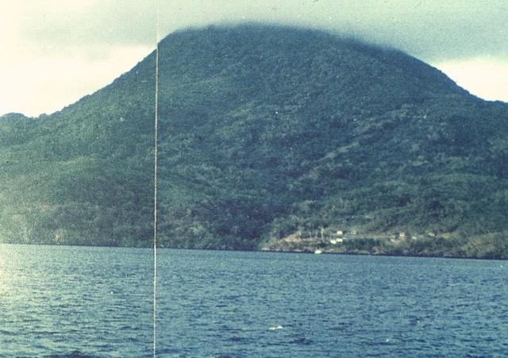
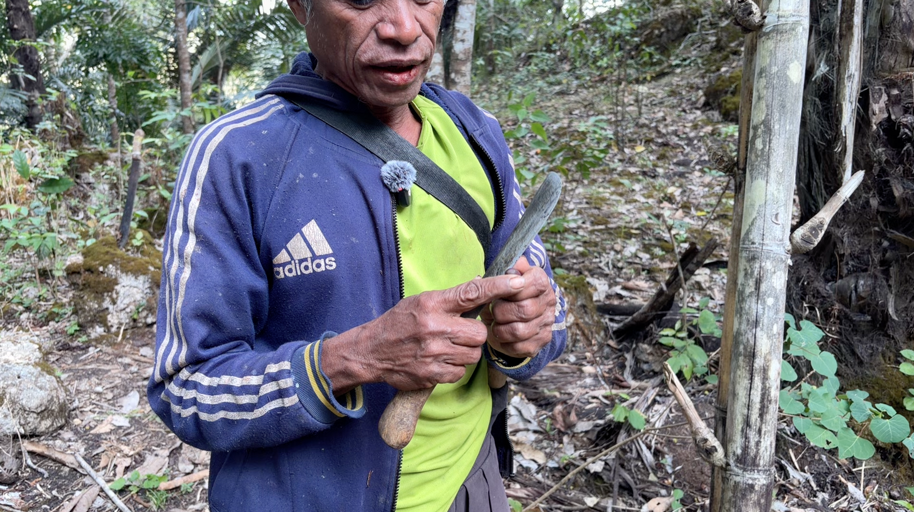
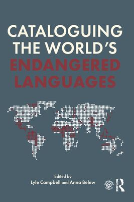
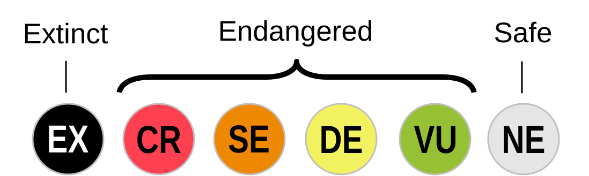

## Reminders

[**Preliminary Sources and Initial Research Question**](https://lamaku.hawaii.edu/d2l/lms/dropbox/user/folder_submit_files.d2l?ou=176107&db=456599) is due ~~**tomorrow, Friday, November 6**~~, now **Monday, November 9 at 11:59pm**

  - **3 academic sources** that might be appropriate, with **why each one fits**
  - Your **initial research question(s)**
  - A short explanation of **what you expect to learn**

**Week 12 (Nov 10 and 12):** No class next Thursday, November 12; I will give you an activity to do at home instead.

**Draft** (at least 1,750 words) is due **Friday, November 20**.

::: {.notes}
Tomorrow's submission is the preliminary sources and initial research question (15% of the paper), not the final paper. Say that out loud, because students may think the whole paper is due Friday. Point to the sample proposal (Rapa Nui) and the Final Paper guide on Lamākū. The second half of class is a workshop on finding sources, so tell students to bring a laptop (or phone) and, if they have one, their topic idea feedback.
:::

## Today's Plan

**Part 1: Language endangerment (about 40 min)**

1. Why bother? Wouldn't we be better off with one language?
2. What makes a language endangered, and what causes it?
3. What it looks like: borrowing and lost knowledge
4. How many, how fast, and what predicts it? (checking the numbers)
5. How do we measure vitality?
6. Should we care? And who documents?

**Part 2: Finding academic sources (about 30 min)**

6. What counts as an academic source
7. Four ways to find them

::: {.notes}
Roughly 75 minutes. This deck is long (the ELP activity adds about 8 minutes, so plan on cutting several of the slides named below), and the slides built from the supplementary articles are the easiest to cut. Keep: definitions, causes, signs, the Mavea scoring activity, the debate, and the whole of Part 2 (the source hunt feeds tomorrow's submission). Cut first: "Pacific Diversity: Three Countries," "What Predicts Endangerment?", "Another Scale: LEI," and "Documentation: How Far Have We Come?" (each has a note you can say aloud instead). The extra readings (Krauss 1992, Hale et al. 1992, Ladefoged 1992, Lee and Van Way 2016, Belew and Simpson 2018, Seifart et al. 2018, Bromham et al. 2022, Boissonneault and Hammarström 2026) are listed on the "Sources Behind Today's Slides" slide.
:::

# Part 1: Language Endangerment

## Warm-Up: Why Bother? (3 min) {.smaller}

> "After all, wouldn't we all be better off if we spoke a single language?" (Guérin and Yourupi, p. 209)

**With a neighbor:** Give **one reason** for yes and **one reason** for no.

::: {.notes}
This is the chapter's own opening question. Collect a few answers on the board, in two columns (benefits of a single language, costs), and leave them up; we return to them on the slide "Should We Care?" Likely answers for yes: easier communication, trade, education, less misunderstanding. Likely for no: identity, culture, knowledge, fairness (who picks the language?), and the practical point that a single language would split again over time (p. 215). Do not resolve it now.
:::

## What Is an Endangered Language? {.smaller}

A language is **endangered** when it is **not passed on to younger generations**.

1. Parents stop using their language regularly and **shift** to a dominant language
2. Their children become native speakers of the dominant language, **non-fluent** in the parents' language
3. The grandchildren are even less proficient
4. When transmission stops across the whole community: the language is **gone in a few generations** (extinct)

> **The chief cause is language shift.**

*Krauss (1992):* **moribund** = no longer learned by children (doomed unless reversed); **endangered** = still learned, but will stop if conditions continue; **safe** = neither.

::: {.notes}
Guérin and Yourupi p. 209. Krauss (1992, p. 4) defines "moribund" as languages no longer learned as a mother tongue by children, "already doomed to extinction, like species lacking reproductive capacity," and notes the important difference from biology: a language can potentially be revived (his example is Hebrew). "Endangered" for Krauss means languages still learned by children that will cease to be if present conditions continue (p. 6); "safe" is the third category (p. 6-7). Note that Boissonneault and Hammarström (2026) mention that some Indigenous scholars and communities prefer terms like dormant, sleeping, or reawakening instead of extinct, which matters for how we talk about revival (next week). Make it concrete with a family tree on the board: Generation 1 (fluent), Generation 2 (understands, replies in the dominant language), Generation 3 (knows a few words). Ask students to place a language they know (heritage languages, Hawaiian, Pidgin) on this sequence without making claims about particular families. Terms: endangered (transmission interrupted), extinct (no speakers). Note that this is a process over generations, not an event. Callback to Week 6 (multilingualism) and Ch. 7: shift happens in multilingual communities when a dominant language gains over the others.
:::

## Why Do Parents Stop? Causes {.smaller}

::: {.columns}

::: {.column}

| Pressure | Example in the chapter |
|---|---|
| **Economic** | A cash economy rewards a language of wider communication: **Bislama** lets you trade anywhere in Vanuatu (about 100 languages); a local language confines you to your dialect chain |
| **Attitudes** | The ancestral language is seen as **worthless for jobs**; the national language is seen as **unifying and prestigious** |
| **Political** | Monolingual policies; **no funding** for vernacular schools (Vanuatu cannot support schooling in 100 languages) |
| **Sudden events** | Typhoon on **Pingelap**: most of the population moved to Pohnpei |

> **Which of these apply to Hawaiʻi? To a language you know?**

:::

::: {.column}

{fig-alt="Bar chart of the number of Hawaiian-language titles printed per decade: 1830s 149, 1840s 107, 1850s 65, 1860s 79, 1870s 37" fig-align="right" height="480px"}


:::

:::


::: {.notes}
Source: pp. 209-210. Points to draw out. (1) The chapter says the reasons parents stop speaking their language to children are "almost always social and economic," not that the language is bad or hard; link to Sasse 1992. (2) Bislama is both a success (national identity, mutually intelligible with Solomon Islands Pijin and PNG Tok Pisin, so it also supports a Melanesian identity) and a pressure on the local languages: callback to Week 8 (pidgins and creoles) and to Rucella's topic idea, whether Bislama is changing how indigenous languages are passed on. (3) Hawaiʻi: students may bring up the 1896 ban on Hawaiian-medium schooling (general knowledge, not in the chapter, so confirm before stating a date), English-medium schools, Pidgin; do not pre-empt Ch. 19 next week, just collect the ideas. Other causes in the chapter: reduction in speakers and loss of habitat (urban development, colonization, warfare, epidemics, cyclones).
:::

## What It Looks Like: Borrowing {.smaller}

**Pollapese** (Chuuk State, Micronesia). Paulina Yourupi, a native speaker, reports that speakers mix in **English** or **Lagoon Chuukese** words **even when a Pollapese word exists**. Why?

1. **Prestige:** English signals intelligence; Lagoon Chuukese signals being well-travelled
2. To show knowledge of a second or third language
3. For fun
4. The word comes to mind more easily (especially for multilinguals)

**Mavea** (Vanuatu): of about **30** speakers left, only **2 elders** had a robust knowledge of the counting system; younger speakers count past 10 using **Bislama numbers**.

> **Borrowing is normal in healthy languages (Ch. 15). What makes this different?**

::: {.notes}
Source: p. 210. Answer: in Ch. 15 and the WOLD lab, borrowing filled gaps (introduced things like cattle, tea, money). Here, speakers borrow where the language already has its own word, and the borrowing spreads into core areas (numbers), so the original system is no longer used or known. It is the pattern and the direction (always toward the dominant language, with prestige as the driver), not the borrowing itself. Mavea: the chapter calls the counting system "fairly complex" (Guérin 2011). This is also a point about prestige: link to Ch. 17 (English was the language "more closely connected with the tangible signs of power and wealth").
:::

## What It Looks Like: Lost Knowledge and Changed Grammar {.smaller}


::: {.columns}

::: {.column}

- **Specialized vocabulary** fades when practices fade: ritual terms, **avoidance (mother-in-law) speech**, words for native plants, animals, fishing and hunting
- Registers that reflect **social structure** disappear when the social structure changes
- **Grammar** of non-fluent speakers shifts: changes that appear **within one generation** (not over centuries) are a sign of attrition

:::

::: {.column}

{fig-alt="Bar chart of the number of Hawaiian-language titles printed per decade: 1830s 149, 1840s 107, 1850s 65, 1860s 79, 1870s 37" fig-align="right"}

:::

:::


> **Why does losing the practice mean losing the words?**

::: {.notes}
Source: p. 211. Answer: vocabulary and registers are tied to the situations where they are used; if the ritual is not performed, the fishing practice is not done, or the taboo relationship is no longer observed, there is no occasion to use or learn the words. The chapter's example of migration to a different ecological environment, where fauna and flora vocabulary becomes irrelevant, links to the readings on language and ethnobiological knowledge (Kik et al. 2021 on Papua New Guinea; Gardner; Bulmer) and to Kale's final paper idea. Grammar: some changes resemble normal change in healthy languages (Ch. 3 and 6), but the speed is the signal (Aikhenvald 2012; Campbell and Muntzel 1989; Sasse 2001). No need to go deeper.
:::

## How Many Languages? {.smaller}

| Area | Languages | % of world's languages |
|---|---|---|
| Asia | 2,296 | 32.4 |
| Africa | 2,139 | 30.1 |
| **Pacific** | **1,313** | **18.5** |
| Americas | 1,062 | 15.0 |
| Europe | 287 | 4.0 |
| **Total** | **7,097** | 100 |

> The Pacific has **18.5%** of the world's languages but far fewer of its people. What does that mean for **speakers per language**?

::: {.notes}
Source: Table 1, p. 211 (Lewis et al. 2016; Ethnologue). The chapter does not give the Pacific's share of the world's population, so do not quote a percentage; just say it is a small share, which is why the average language here is small. The chapter says an average language in Europe has about six million speakers, while an average-size Pacific language has fewer than 5,000 (p. 212). Counts are estimates: the chapter notes that it is often hard to separate a language from a dialect (Ellis 2007; Lynch 1998) and that we lack data on some languages (note 7).
:::

## Pacific Diversity: Three Countries {.smaller}

| Country | Languages | % of world's languages | Average speakers per language |
|---|---|---|---|
| Papua New Guinea | 840 | 11.84 | 4,992 |
| Vanuatu | 117 | 1.65 | 1,666 |
| Solomon Islands | 71 | 1.0 | 5,334 |

**Languages at risk (UNESCO Atlas, Moseley 2010):** PNG **98**, Vanuatu **46**, Solomon Islands **17**

> **Krauss (1992):** a language is "safe" with at least **100,000 speakers**. How many of these countries' languages reach that?

::: {.notes}
Source: Table 2, p. 212, and p. 212. Answer: very few, if any, given the averages (under 5,500 per language), so by Krauss's threshold nearly all are "unsafe"; yet that is the point of the next slide. Two cautions for you. The chapter says three of the four most linguistically diverse countries are in the Pacific, with PNG far ahead; that claim appears to rest on a diversity index (footnote 3 refers to Greenberg 1956 and Harmon and Loh 2010) and not on raw language counts, so do not present it as a ranking by number of languages. The percentage for the Solomon Islands is shown as "1" in the table. Also: ELCat estimates that about 40% of the world's languages are now endangered, and Krauss (1992) predicted 90% dead or doomed by the end of the 21st century (p. 212).
:::

## Endangered Languages in the Pacific {.smaller}


::: {.columns}

::: {.column}

**Catalogue of Endangered Languages (ELCat), as of 2016**

- **492** Pacific languages rated endangered: second only to **Africa (606)**
- About **72%** sit in the **middle** of the scale ("Threatened" or "Endangered")
- **4** Pacific languages have lost their last speaker **since 1960**
- **1** is being revived: **Sishëë** (New Caledonia)

*Here "Pacific" means Melanesia, Polynesia, and Micronesia; Hawaiʻi is counted with the United States.*

:::

::: {.column}


{fig-alt="Bar chart of the number of Hawaiian-language titles printed per decade: 1830s 149, 1840s 107, 1850s 65, 1860s 79, 1870s 37" fig-align="right"}

:::

:::


> **Why might the Pacific have so many endangered languages? (Look back at the last slides.)**


::: {.notes}
Source: Belew and Simpson 2018, section 4.9 (ELCat data accurate as of June 2016; the Catalogue is based at UH Mānoa). Answer: partly because the Pacific has so many languages, most with small populations (average under 5,000 speakers, p. 212 of the chapter); a lot of languages means a lot of endangered languages, which is a point Bromham et al. (2022) also make about New Guinea. The percentages come from the article's Table 1.9: 135 "Threatened" and 222 "Endangered" of 492, which is about 72.6%; the article's text says 72.5%. The Pacific numbers exclude Hawaiian, which the article files under the United States, so do not use this slide to say anything about Hawaiian. Note that the chapter and this article use different counts and dates (Ethnologue 2016 vs. ELCat 2016), so the numbers will not match exactly. Dormant languages that are being revived are called "awakening" in ELCat.
:::

## Are All Small Languages Doomed? {.smaller}

- **398 languages** (about 6%) have 1 million or more speakers, and they serve **94%** of the world's people
- **6,699 languages** (about 94%) are spoken by about **6%** of people

But the **raw number of speakers is not a good measure** of vitality.

> **Chamorro** (Guam) has the **largest number of speakers in Micronesia (about 60,000)** and is **still endangered**. Why? Some languages spoken in Vanuatu and PNG with only 100 speakers are quite vital and not endangered? How can that be?

::: {.notes}
Source: Table 3, p. 213, and p. 215. Answer: size alone does not determine vitality; what matters is transmission to children and use across domains, and the social, political, and economic setting (Crowley 1995). The chapter calls for looking at "linguistic ecology": the complex interplay of languages, speakers, ideologies, policies, and social practices (François 2012, Landweer 2012, Mühlhäusler 2002). In the Pacific, Rehg (1998) sums up the ecology as five forces: erosion of traditional culture, alienation of land, the ideology of English, swamping of indigenous populations, and the move to a money economy. The chapter lists Chamorro, Hawaiian, and Māori as examples that need this ecological view. Also: it is "too simplistic to reduce complex social dynamics to a single number" (Grenoble 2016). A big statistical study agrees with both halves: Bromham et al. (2022) find that the number of first-language speakers is the single strongest predictor of endangerment, but they stress that "not all small languages are endangered" and that loss often happens when people shift to a different language, not just when numbers fall. Krauss himself (1992) used 100,000 speakers as a rough "safety in numbers" line, but warned with Breton and Navajo that even large languages can decline.
:::

## What Predicts Endangerment? {.smaller}

**Bromham et al. (2022):** 6,511 languages, 51 predictors, one statistical model

| Finding | |
|---|---|
| **Number of first-language speakers** | Strongest predictor |
| **Contact with neighboring languages** | **Not** a driver by itself (more contact, **less** endangerment on average) |
| **Road density** | **More** roads, more endangerment |
| **Years of schooling** | **More** schooling, more endangerment |

Without intervention: loss could **triple within 40 years**; at least **1,500 languages** could stop being spoken by 2100.

> **Is Bislama a threat to Vanuatu's languages? What would this study say?**

::: {.notes}
Source: Bromham et al. 2022, Nature Ecology & Evolution (the file is labelled Meakins et al., but Lindell Bromham and Xia Hua are the lead authors and Felicity Meakins is a co-author, so cite it as Bromham et al. 2022). Results: 37% of 6,511 languages are rated threatened or above; the best model explains 34% of the variation in endangerment. Contact: languages in contact with more other Indigenous languages are on average less endangered (multilingual communities keep their language), so contact itself is not the problem; it is the social, economic, and political dynamics that sometimes come with it. Roads may reflect connection to towns, commerce, and centralized government, and the authors note that lack of roads has been cited as a protective factor because it may limit the spread of lingua francas such as Tok Pisin in Papua New Guinea. Schooling is a stronger predictor than other socioeconomic indicators, consistent with studies of schooling that is not bilingual; having a minority-language education policy was not associated with lower endangerment, perhaps because provision varies. Predictions: language loss at least triples in 40 years, and without intervention there could be nearly five times as many "Sleeping" languages by 2100, at least 1,500 ceasing to be spoken; hotspots include the north coast of New Guinea, and Papua New Guinea is among the countries with the greatest predicted road increase and highest potential loss. The authors stress that these predictions are "not death knells," and give the example of Alutiiq, where the community's revitalization program may counter the predicted trend. Answer to the question: the study would say contact with Bislama in itself does not predict loss, but the things that spread with a lingua franca (roads, commerce, schooling, government) are associated with it; this is a hypothesis for Rucella's paper idea, not a finding about Vanuatu. The data are coarse (national schooling averages, for example), so treat the findings as patterns, not explanations for any one language.
:::

## "A Language Dies Every Two Weeks"? {.smaller}

Where does that number come from?

1. **Krauss (1992):** a rough guess that about **3,000 of 6,000** languages could stop being spoken **during the 21st century**
2. **Crystal (2000):** spread evenly over a century, that is **about one every two weeks**
3. The claim spread through news and reports as a **current rate**

| Estimate of languages **not** being passed to children | |
|---|---|
| Krauss's guess (early 1990s) | about **50%** |
| UNESCO Atlas (2010) | about **24%** |
| Ethnologue (2014-2025) | about **16-17%** |

Newer estimates: one language every **3 months** (ELCat) or every **6-13 weeks**.

> **Why does it matter where a number comes from?**

::: {.notes}
Sources: Boissonneault and Hammarström 2026 (Cambridge Prisms: Extinction; the file name and year in the metadata say 2007, but the article itself is dated 2026); Belew and Simpson 2018; Krauss 1992. Boissonneault and Hammarström trace the "two weeks" figure to Crystal's 2000 book, which was an illustration of Krauss's projection spread over a century, not a measurement. Krauss's 50% was based on regional counts he or colleagues knew (624 of 1,252 languages) and expert guesses; the global data he cited (Ethnologue) pointed to as much as 20%, and he went with 50%. The 90% "dead or doomed" figure was a longer-term projection for languages he thought were not "safe." Newer data: UNESCO's 2010 Atlas lists 1,663 of 2,471 languages as definitely, severely or critically endangered (about 24% of the world's languages); Ethnologue's 17th edition (2014) had 1,192 languages in the equivalent categories of 7,106 (about 17%), and its 28th edition (2025) had 1,164 of 7,159 (about 16%). Rates from documented disappearances: about one language every three months (Campbell et al. 2013, ELCat, per Belew and Simpson), or every 6 to 13 weeks; the authors say these methods probably underestimate. Important message for students: the authors and Belew and Simpson both stress that milder numbers do not mean there is no crisis. Roughly 220 languages are known to have lost their last speaker in the last 50 years (Belew and Simpson, citing Campbell et al. 2013), and ELCat counts nearly half of languages as endangered. The lesson for this class: statistics get repeated, so go back to the original source. We use this again in Part 2. The chapter itself uses Krauss's 90% figure and ELCat's 40%, so you can point out that both are in today's reading and now have been revised.
:::

## Measuring Vitality: UNESCO's Nine Factors {.smaller}

::: {.columns}

::: {.column}

| | |
|---|---|
| **F1** | Intergenerational transmission (**most crucial**) |
| **F2** | Absolute number of speakers |
| **F3** | Proportion of speakers in the population |
| **F4** | Trends in existing language domains |
| **F5** | Response to new domains and media |
| **F6** | Materials for education and literacy |
| **F7** | Government and institutional policies |
| **F8** | Community members' attitudes toward their language |
| **F9** | Type, amount, and quality of documentation |

*Other scales: Fishman's GIDS, Expanded GIDS, Language Endangerment Index*

:::

::: {.column}

{fig-alt="Bar chart of the number of Hawaiian-language titles printed per decade: 1830s 149, 1840s 107, 1850s 65, 1860s 79, 1870s 37" fig-align="right" height="480px"}


:::

:::


::: {.notes}
Source: pp. 213-214 (UNESCO framework, Brenzinger et al. 2003). Except for F2, the factors are graded from 0 to 5. F1 is the most crucial. F4 and F5 are about domains: a healthy language is used in all domains, at all times, by all segments of the population, and expands to new domains (new terms for new technologies). A language used only in church or only at home is under serious threat. F7 and F8 bear on the causes. F6 is the amount of material, F9 is what is known about the language. Other scales named in the chapter: Graded Intergenerational Disruption Scale (Fishman 1991), Expanded GIDS (Lewis and Simons 2010), and the Language Endangerment Index (reviewed in Lee and Van Way 2016). Next slide: apply it.
:::

## Apply It: Mavea (Vanuatu) {.smaller}

| Factor | Rating | Comment |
|---|---|---|
| F1 Transmission | 2 | No longer transmitted |
| F2 Speakers | 30 | Fluent population aging |
| F3 Proportion | 1/2 | 15% of population speaks Mavea |
| F4 Domains | 2 | Some households, private conversation |
| F5 New domains | 0 | Language is inactive |
| F6 Education | 0 | Not used in school |
| F7 Policy | 0 | Supportive policy exists but not implemented |
| F8 Attitudes | 1 | Few speakers worry about loss |
| F9 Documentation | 3 | Dictionary, ABC book, grammar, annotated texts with audio |

> **Discuss:** Which factor would you work on first? Which is **good news**? What does the table **miss**?

::: {.notes}
Source: Table 4, p. 214 (Guérin 2008). Give groups 3 minutes. Likely answers. First: F1 (transmission), because without it nothing else matters; but nobody is transmitting, so a realistic start might be F6 and F8 (school materials and attitudes) to create reasons to use the language. Good news: F9, documentation is strongest (a grammar, trilingual dictionary, ABC book, audio texts), which would help any future revitalization. What it misses: a single score hides why: the community shifted to Bislama; the table says nothing about prestige, the economy, or the speakers' own goals (the chapter warns against reducing complex dynamics to numbers). Also note F7: the constitution of Vanuatu says the Republic "shall protect the different local languages which are part of the national heritage," yet the policy is not implemented. Preview for next week: students can think about how Hawaiian would score; do not give scores, since the chapter does not.
:::

## Another Scale: ELCat's LEI {.smaller}

The **Language Endangerment Index** (University of Hawaiʻi at Mānoa) uses **four factors**, each scored 0-5:

1. **Intergenerational transmission** (counts **double**)
2. **Absolute number of speakers**
3. **Speaker number trends**
4. **Domains of use**

It can work with **limited information**, and reports how **certain** the rating is (1 factor = 20% certain; all 4 = 100%).

> **Careful:** a score is an **approximation**. Monolingualism signals vitality in some places, but tells you **nothing** in the highlands of Papua New Guinea, where **multilingualism is the norm**.

::: {.notes}
Sources: Lee and Van Way 2016 (Van Way is at UH Mānoa); Belew and Simpson 2018. Scales: transmission runs from 0 (safe: all members including children speak it) to 5 (critically endangered: only a few elderly speakers); speakers from 0 (100,000 or more) to 5 (1-9 speakers). The LEI direction is the reverse of the chapter's Mavea table, where lower F1 means worse (a language no longer transmitted scored 2); check the direction before comparing numbers across scales. LEI formula: transmission x 2 plus the other scores, divided by the maximum possible for the factors used, as a percentage; 81-100% critically endangered, 61-80 severely, 41-60 endangered, 21-40 threatened, 1-20 vulnerable. Why quantify (Lee and Van Way): it lets a lay audience see the scope, raises awareness, helps prioritize, allows comparison for funders, and lets researchers test links between linguistic diversity and biodiversity. Caution from Belew and Simpson (p. 24-26): any category scheme is approximate and every language has its own sociocultural niche; and enumeration itself is difficult. Example: Hawaiʻi Sign Language was assumed to be a dialect of ASL until 2013, when research showed that it is a distinct language not even in the same family (Lambrecht et al. 2013). That is a good local example for the "what counts as a language?" problem and for "how many languages are there?"
:::

## Should We Care? The 1992 Debate {.smaller}

| **"Don't assume it's worth saving"** | **"Care"** |
|---|---|
| **Ladefoged:** it is **paternalistic** to assume communities want their language kept; Tanzania promotes **Swahili for national unity**; a Dahalo speaker **did not regret** that his sons speak only Swahili | **Krauss:** extinction of a language diminishes the world like the loss of a **panda or condor**; linguists are far **quieter** than biologists |
| **Newman:** a **hopeless cause** | **Hale:** a language embodies a people's **intellectual wealth**; losing it is **irretrievable** loss |
| **McWhorter:** **diversity impedes** communication | For many speakers: **identity, equality, social justice** (Guérin and Yourupi) |

> **Return to the board:** whose reasons are on which side? **Who gets to ask this question?**

::: {.notes}
Sources: Ladefoged 1992 (Language 68:809-811, a reply to Hale et al. 1992); Krauss 1992 (p. 8); Hale 1992 (Language 68:35-42, in Hale et al.); Guérin and Yourupi pp. 215-218. Ladefoged: "I have nothing but praise for the work that these linguists do," but he argues that language preservation is a multifaceted topic. Points he makes: in Tanzania spreading Swahili is seen as a force for national unity and "tribalism" as a threat; some speakers regard being a language consultant as just another job, and the Toda, who have fewer than 1,000 speakers, accept that the cost of being part of modern India is giving up their language in daily life ("surely, this is a view to which they are entitled"); a Dahalo speaker (Kenya) said his sons could hear but not speak Dahalo, and "Who am I to say that he was wrong?" He challenges the assumption that languages and cultures always ought to be preserved, says it is paternalistic of linguists to assume they know what is best for the community, and calls the species analogy (Hale et al.'s "just as the extinction of any animal species diminishes our world, so does the extinction of any language") "appeals to our emotions, not to our reason." But he agrees that the case for studying endangered languages is very strong on linguistic grounds, often on humanitarian grounds, and that linguists should respect speakers' wishes. Note the class differences: Ladefoged is not saying the languages are unimportant; he is saying it is the community's choice. Krauss: asks "Should we mourn the loss of Eyak or Ubykh any less than the loss of the panda or California condor?" and says linguists risk presiding "obliviously over the disappearance of 90% of the very field to which it is dedicated." Hale's essay (Language 68:35-42) argues that a language and the intellectual productions of its speakers are often inseparable, and illustrates with Damin, the ritual auxiliary language of Lardil men on Mornington Island (Australia), which had click sounds and was learned in initiation; the mission had banned initiation, so almost nobody learned it. Link to Guérin and Yourupi's point that wondering whether to bother is a question only speakers of a dominant language would ask. Do not resolve the debate: ask which arguments depend on facts and which on values, and who is speaking for the community. Also connect: Ladefoged's view is about choices made freely; the chapter says language shift is rarely a voluntary action (p. 218). That disagreement is a good topic for a paper.
:::

## Reasons People Give for Caring {.smaller}

Lee and Van Way (2016) list **five** consequences of language loss:

1. Loss of **cultural or ethnic identity**
2. Loss of knowledge of **prehistory** (words are the only way to reconstruct a culture's past)
3. Loss of **linguistic diversity**
4. Loss of part of **human knowledge**, including **traditional ecological knowledge**
5. Loss of what languages can show us about **human language and cognition**

> **Which of these would a community member give? Which would a linguist give? Which could you use in a paper?**

::: {.notes}
Source: Lee and Van Way 2016, p. 272 (citing Tsunoda 2005; Evans 2010; Hale 1992; Crystal 2000). Hale's point about grammar: if English were the only language, we could only guess at what can vary in grammar (the Hopi number example, p. 35-36 of Language 68). Answer to the discussion: reasons 1 and 4 are most often given by community members; 5 and 2 by linguists; 3 and 4 connect to papers on biocultural diversity (Kale's idea, and the Kik et al. 2021 reading). Note a caveat from Lee and Van Way: the link between linguistic diversity and biodiversity has been questioned (Haspelmath 2012), who wonders whether the correlation is spurious because no clear explanations have been provided; so a paper on language and ecological knowledge should claim a connection carefully.
:::

::: {.notes}
Source: pp. 215-218. Quote to read: wondering why we should bother is "a question only speakers of a dominant language would ask" (p. 218); and the authors argue language shift is rarely voluntary and that forced loss violates basic human rights. Fair presentation: the chapter gives the "don't bother" side as views in the literature, not a straw man: the pre-Babel myth that one world language, preferably English, would speed economic development; the counterquestion of who decides (since one person in five is Chinese, why not Mandarin?). Ladefoged does not agree with Krauss's catastrophic scenario. Activity (5 min): pairs take one position and give their strongest argument, then switch. Connect to Ch. 17 (writing preserving knowledge) and the final paper: knowledge-loss papers (e.g., Kale's idea) belong on the right-hand side.
:::

## Documentation: How Far Have We Come? {.smaller}

**Seifart et al. (2018),** 25 years after the 1992 call to action:

- About **500 languages** now reasonably documented; archives, digital recording, and online catalogues
- Still, roughly **35-42%** of the world's languages are **substantially undocumented**
- About **2,750** languages have no real grammatical description; **over 1,400** of them are **endangered**
- The **"transcription bottleneck":** it takes far longer to transcribe than to record

> **Why would documentation matter *even if* a community decides not to keep using its language?**

::: {.notes}
Source: Seifart, Evans, Hammarström, and Levinson 2018 (Language; the discussion note on the 25th anniversary of Hale et al. 1992). The 1992 Hale et al. package is number one in the JSTOR download list for Language. Figures: basic word lists exist for about 89% of languages and substantial grammatical description for around 60%; 574 first-time descriptions of endangered languages since 1992; the proportion of descriptive effort on endangered languages rose only from 58% to 63%. The authors argue that leading departments still do not treat grammar writing as central. Archives: they note the Language Archive (MPI), ELAR, PARADISEC (with a Pacific focus), and AILLA (Latin America) and that archives themselves are potentially endangered because of maintenance costs. Local fact for students: footnote 18 ranks universities by the number of PhD grammars written (1954-2016); the University of Hawaiʻi is tenth in the world (39), and tenth again for 2000-2016 (17). That means a lot of Pacific grammars and dissertations are written here, a good place to find sources (see Part 2). Different numbers: the chapter's footnote 5 gives a lower documentation figure (less than 10% documented in any detail); the two sources use different definitions of "documented," so do not mix them. Answer to the discussion: Krauss (1992) argued that documentation is a national treasure for the people whose languages are preserved and, if the community later wants to revive its language, it makes revival feasible (the Hebrew and Cornish examples); Ladefoged also supports recording for linguistic reasons. Next week: how documentation supports revitalization.
:::

## Activity: Explore the Endangered Languages Project (8 min) {.smaller}

**endangeredlanguages.com** (ELCat, run from UH Mānoa) catalogues **3,000+ endangered languages**, with a **language map** and thousands of **resources**.

**In groups, one language each:** Mavea · Paluai · Chamorro · Kosraean · Boiken · Rapa Nui

1. **Find** your language (try **other spellings**). What is its **endangerment rating**? How many **speakers**, and **how certain** is the rating?
2. Which of the **LEI factors** does the entry actually give information on? What is **missing**?
3. On the **map**, zoom to the Pacific. Where do endangered languages **cluster**? Does your language fit the pattern?
4. Open the **resources** for your language. **Copy one academic reference** (author, year, title).

> **Report back:** one surprise, and one **source** you could cite.

::: {.notes}
I could not open the site's map page from my sandbox (it returned a bot-check page), so check the current layout yourself before class and adjust the steps. What I confirmed from the home page: it says the catalogue covers 3,466 languages with 7,729 resources, groups languages into At risk, Endangered, Severely endangered, Dormant, Awakening, and Vitality unknown, and has a "Language Map" link; resources are sorted into categories such as Language Research and Linguistics, Language Revitalization, and Language Materials. Language choices: Mavea and Pollapese are the chapter's examples; Chamorro is the chapter's "large but still endangered" case; Sishëë (New Caledonia) is the one Pacific language that Belew and Simpson 2018 report as being revived; Takia is from the WOLD lab; Māori previews next week. Not every language may be listed under the spelling students try (the chapter notes Pollapese was previously spelled Pullapese), so this is also a practice in searching with alternative names; if a language is missing, ask them to try a neighboring language or the country and report that too. Discussion (3 min after groups report): (a) the entry shows the LEI factors that someone found information for; Lee and Van Way's certainty score tells you how much evidence the rating rests on, so a rating based on one factor (for example only the number of speakers) is 20% certain. (b) Pattern on the map: Belew and Simpson 2018 report that the Pacific has 492 endangered languages (second only to Africa), and Bromham et al. 2022 flag the north coast of New Guinea as a future hotspot; ask whether students see a cluster in Melanesia, and remind them that more languages means more endangered languages. (c) Sources: the resource lists are a source finder, but each resource still has to meet the academic-source test in Part 2 (a user-uploaded presentation or website does not count). If time is short, assign only questions 1 and 4, or do this as a demo with one language projected. Also useful for the final paper: a student whose topic is a particular language can use its page to find sources and its alternative names. Sources for the numbers: Belew and Simpson 2018; Bromham et al. 2022; Lee and Van Way 2016.
:::

## Sources Behind Today's Slides {.smaller}

*Models of how to cite (Unified Style Sheet for Linguistics):*

- Bromham, Lindell, et al. 2022. Global predictors of language endangerment and the future of linguistic diversity. *Nature Ecology & Evolution* 6:163-174.
- Belew, Anna, and Sean Simpson. 2018. The status of the world's endangered languages. In *Cataloguing the world's endangered languages*.
- Boissonneault, Michaël, and Harald Hammarström. 2026. What do we know about the language extinction rate? *Cambridge Prisms: Extinction* 4:e14.
- Hale, Ken, et al. 1992. Endangered languages. *Language* 68(1):1-42.
- Krauss, Michael. 1992. The world's languages in crisis. *Language* 68(1):4-10.
- Ladefoged, Peter. 1992. Another view of endangered languages. *Language* 68(4):809-811.
- Lee, Nala Huiying, and John Van Way. 2016. Assessing levels of endangerment in the Catalogue of Endangered Languages (ELCat) using the Language Endangerment Index (LEI). *Language in Society* 45:271-292.
- Seifart, Frank, et al. 2018. Language documentation twenty-five years on. *Language* 94.

::: {.notes}
Belew and Simpson 2018 is a chapter in *Cataloguing the world's endangered languages*; I could not confirm the editors, publisher, and page range from the file, so add them from the book before students copy this format. The page ranges above come from the files: Bromham et al. (163-174 in the file; check the last page), Lee and Van Way (271-292), Krauss (4-10), Ladefoged (809-810). Seifart et al. appears as pp. e324-e345 in the file; volume 94 and the issue number are from memory, so check them. Boissonneault and Hammarström's own citation line gives the volume, article number, and DOI (10.1017/ext.2026.10019). Point out to students what these references teach: the author list in the original (et al. only in short forms), the journal name and volume, and page numbers. Note that Bromham et al. 2022 is the real citation for what the file calls "Meakins et al."; Meakins is a co-author, not the first author.
:::

## Wrap-Up: Part 1 (2 min) {.smaller}

**Write one sentence:** For **one Pacific language** (any), which **UNESCO factor** would you worry about first, and **why**?

*(This could be a Final Paper question. Endangerment, shift, and vitality all work as angles.)*

::: {.notes}
Quick check for understanding; do not collect. 2-3 volunteers. If a student names a language they plan to write about, that helps with the next part. Take a 3-5 minute break here if you want one; students will need to open laptops for Part 2.
:::

# Part 2: Finding Academic Sources

## Why This Matters {.smaller}

The Final Paper needs **at least 7 academic sources**, in **one consistent citation style**.

| Due | Component |
|---|---|
| **Fri Nov 6** | **3 sources** + why each fits + initial question |
| Fri Nov 20 | Draft (1,750+ words), citing sources |
| Dec 15 | Final paper (2,500+ words) and reference list |

**Today's goal:** leave knowing **where to look**, **how to tell if it counts**, and **how to keep track of it**.

::: {.notes}
Many students may not have done research writing before, so go slowly and normalize it: finding sources is a skill, and everyone starts by not knowing where to look. Ask: "Who has written a paper with sources like this before?" and "Who is not sure what counts?" Make clear that the early submission is only 3 sources, and that more will come from following the references of the first ones. Decide ahead of time whether Course Reader chapters count toward the 7 (the syllabus does not say), and tell the class.
:::

## What Counts as an Academic Source? {.smaller}

| **Usually counts** | **Usually does not** |
|---|---|
| Peer-reviewed **journal articles** | Wikipedia, blogs, personal websites |
| **Books** from academic publishers (e.g., university presses) | News and magazine articles |
| **Chapters** in edited books (like our Course Reader) | Tourism and cultural-center websites |
| **Reference grammars** and **dictionaries** | Social media, videos, AI summaries |
| **Dissertations and theses** | |

> **Test:** Who wrote it? Who published it? Does it cite its sources? Was it reviewed by other experts?

::: {.notes}
Wikipedia and news are useful for background and for finding leads, but they are not among the 7. Exceptions to discuss: Ethnologue and the Catalogue of Endangered Languages are databases that scholars cite (the chapter cites both) but should not be your main sources; WOLD, Glottolog, and WALS are databases you can cite for data. Reference grammars and dictionaries count. Tell students: if you are unsure, ask me before you build the paper on it. Peer review: experts in the field read and approve it before publication; journals like Oceanic Linguistics, Language Documentation and Conservation, and Language are examples that appear in the chapter's reference list. Books from university presses and respected academic publishers are also reviewed, though differently.
:::

## Method 1: Start With What You Have {.smaller}

**Mine the Course Reader.** Every chapter has a **reference list**.

- Find the chapter closest to your topic
- Read its section on your topic, then look at who it **cites**
- Those references are **already-vetted academic sources**

**Example from today's chapter:** a student interested in Vanuatu would find

- François (2012), *International Journal of the Sociology of Language*
- Crowley (1995), *Oceanic Linguistics*
- Guérin (2008), *Language Documentation & Conservation*

> **Which chapter will you start from?**

::: {.notes}
This is the easiest first step and it ties to the "mine the references" skill (citation chaining). All the example references are from Guérin and Yourupi's reference list: François 2012, "The dynamics of linguistic diversity: Egalitarian multilingualism and power imbalance among northern Vanuatu languages," IJSL 214:85-110; Crowley 1995, "Melanesian languages: Do they have a future?" Oceanic Linguistics 34:327-344; Guérin 2008, "Writing an endangered language," Language Documentation & Conservation 2:47-67. Also tell students: the Course Reader chapters are summaries by experts, so the reference lists are written for exactly this purpose. Have students open a chapter on their phone or laptop and find two promising references in 2 minutes.
:::

## Method 2: Search Smart {.smaller}

**Where:** the **UH Mānoa Library** website (databases and catalog), **Google Scholar**, and open-access journals

**What to type:** combine the **language or place** with the **topic**:

- *Mavea* **grammar**
- *Chamorro* **language shift**
- *Samoan* **borrowing**
- *Bislama* **multilingualism** Vanuatu

**Try alternative names and spellings.** Our chapter says Pollapese was **previously spelled Pullapese**, and sources may use either.

> **Tip:** if you get nothing, make the search **broader** (the language family, or the region); if you get too much, add a **topic word**.

**Language-specific starting points:** **Glottolog** (a bibliography of grammars and dictionaries for each language), the **Catalogue of Endangered Languages (ELCat)**, **WALS**, and archives such as **PARADISEC**.

::: {.notes}
Live demo (3-4 minutes) in a browser: (1) Search Google Scholar for a language plus topic (suggestion: "Mavea endangered language" or "Pollapese"). (2) Show how to read the result: authors, title, journal or publisher, year, "Cited by." (3) Show where the full text lives: library access links, and open-access journals. Language Documentation and Conservation is an open-access journal hosted by UH Mānoa (ScholarSpace) as far as I know, so check before demonstrating. Library: the library website, databases, and "Ask a Librarian"; I did not verify the exact current names of the UH library's search tool and linguistics databases (LLBA and MLA are the usual ones in linguistics), so look at the library site before class and tell students the real names and how to get off-campus access with their UH login. Glottolog, ELCat, WALS, and PARADISEC are described in Seifart et al. 2018 and Belew and Simpson 2018: Glottolog gives full bibliographic information and language names for each language, which is the fastest way to see what has been written about a language; ELCat is based at UH Mānoa (Lee and Van Way 2016) and gives vitality ratings and resources; WALS is a database of structural features; PARADISEC is an archive with a focus on the Pacific. Seifart et al. note that Ethnologue has been placed behind a paywall (as of 2018, so check the current access before you recommend it). Wikipedia can be used to learn the language's alternative names and its basic facts, but cite the scholarly sources it points to, not Wikipedia.
:::

## Method 3: Follow the Chain {.smaller}

**Backward:** read a good source's **reference list** and find the sources it cites.

**Forward:** in **Google Scholar**, click **"Cited by"** to find newer work that cites it.

**Same author:** search the **author's name**. Specialists in a language write many papers about it.

```
          Guérin 2008
      ↙                ↘
Sources it cites    Newer work citing it
(backward)          (forward: "Cited by")
```

> **A good source leads to three more.**

::: {.notes}
This is the most useful research skill for a first-time writer: you do not need to find 7 sources from scratch, you need to find 2-3 good ones and follow the chain. Demo: take Guérin 2008 and show its reference list, then "Cited by" in Google Scholar. Also: look for the author's other work (Guérin on Mavea, Schütz on Hawaiian). For Pacific topics, series and journals worth searching by name: Oceanic Linguistics, Language Documentation & Conservation, Pacific Linguistics, and University of Hawaiʻi Press (this list is from general knowledge and the chapter's references; confirm what the library holds).
:::

## Method 4: Ask for Help {.smaller}

- **Me:** office hours **Wednesdays and Fridays, 1:30-2:30, Moore 574** (or Zoom)
- **A UH librarian:** librarians help with searching and databases
- **Classmates:** share what you find; several of you are on similar topics

**AI tools:** the syllabus (Section 3.3) allows them to support your thinking and polish writing, **not** to write drafts or summarize readings. They can **make up citations**: **verify that every source exists** before you use it, and **disclose** any use.

::: {.notes}
Section 3.3 of the syllabus: AI tools may support thinking and polishing, but not generate first drafts or summarize readings; if used in any assignment, include a brief statement at the top describing how. Undisclosed use is treated as academic dishonesty. Practical warning: AI tools can produce plausible-looking references that do not exist; a source only counts if you can find it and read it. Say: when in doubt, ask me. Do not demonstrate an AI tool for finding sources. Also remind students that I can give feedback on their source lists in office hours before Friday.
:::

## Is It a Good Source for *My* Question? {.smaller}

Before you add a source to your list, check:

1. **Who** wrote it, and are they an **expert** on this language or topic?
2. **Where** was it published (journal, university press)?
3. **When**? Older work can still be valuable (e.g., a grammar), but check for **newer** work on changing topics like **language vitality**
4. Does it **fit your question**? Skim the **abstract, introduction, and conclusion**
5. Does it **cite its evidence**?

**Reading efficiently:** abstract, then introduction, then conclusion, then the sections you need. You do **not** have to read every page.

::: {.notes}
Point 3 is a good tie to today's lesson: language vitality numbers change (the chapter's counts are from 2016 sources), so for a paper about a language's current status, students need recent sources. Older sources can be primary data (for example, 19th-century Hawaiian-language materials from Ch. 17, or an older grammar). Reading efficiently: students often think they must read every word; the aim for Friday is only to show that each source fits.
:::

## Case Study: Trace a Number to Its Source {.smaller}

**Claim:** "A language dies every two weeks."

1. **News and websites** repeat it
2. **Crystal (2000)** is cited for it
3. Crystal is **illustrating** a projection from **Krauss (1992)**
4. Krauss is **guessing** from regional counts and expert opinion
5. **Boissonneault and Hammarström (2026)** trace the whole chain

> **What would you have cited if you stopped at step 1? Step 2? What if you followed it to step 5?**

::: {.notes}
This is a worked example of citation chaining (Method 3) and of evaluating sources (the slide before). If you stop at the news article or website, you are citing a number that nobody measured. If you stop at Crystal, you miss that he was illustrating a projection. Krauss is a primary source for the projection, but his estimate was based on regional counts and informal expert judgment, and his own numbers from Ethnologue pointed lower (Boissonneault and Hammarström 2026). The best source for the current evidence is the review article that traces the history and weighs the newer data; Belew and Simpson (2018) also discuss the claim. Point to what the authors do not say: the milder numbers do not mean that the crisis is not real (about one language every three months is still a "frightful" rate, in Belew and Simpson's words, and about 220 languages have lost their last speaker in 50 years). Teaching point: academic sources show where their numbers come from, and a good source lets you follow its citations back. Suggested activity (3 minutes): ask students to pick a statistic from today's chapter (such as 7,097 languages or 40% endangered) and tell you which source the chapter cites for it (the chapter's tables cite the Ethnologue; ELCat for the 40%).
:::

## Keep Track From Day One {.smaller}

For **each source**, record:

| Field | Example |
|---|---|
| **Full reference** | Guérin, Valérie. 2008. Writing an endangered language. *Language Documentation & Conservation* 2:47-67. |
| **What it says** (2-3 sentences, in **your own words**) | |
| **How I will use it** | Background on Mavea; orthography decisions |

**Tools:** a free reference manager such as **Zotero**, or just a **spreadsheet**.

**Pick one citation style and stick to it.** Our chapters use the **Unified Style Sheet for Linguistics**; APA or MLA is fine too.

::: {.notes}
The reference shown is copied from Guérin and Yourupi's reference list (p. 218). This table is also what they need for Friday: the "why each source fits" sentence is the "how I will use it" cell. Paraphrase in your own words from the start; this helps avoid plagiarism later (syllabus Section 3.2). To cite a chapter in the Course Reader, use the chapter's author, title, and pages "in Languages of the Pacific Islands: Introductory Readings, ed. by Hiroko Sato and Joel Bradshaw"; check the title page of the reader for the year and publisher, because I could not confirm them. Zotero is free and has a browser extension; do not spend more than a minute on it unless students are interested. Whatever style they choose, they must use it consistently here and in the final paper.
:::

## Source Hunt (10 min) {.smaller}

**On your laptop or phone, find 2 academic sources for your topic.**

1. Start from a **Course Reader chapter** and its **reference list** (Method 1)
2. Then try **one search** (Method 2), **one "Cited by"** (Method 3), or the **resources** on your language's page at **endangeredlanguages.com**
3. For each source, write the **full reference** and **one sentence on why it fits**

**Stuck?** Raise your hand. If your topic is not set, pick the one you are leaning toward.

**Share:** one source you found, and how you found it.

::: {.notes}
Walk around and help. Common problems: (1) too broad a topic, so the search returns thousands of results; suggest adding a language name. (2) Only finding websites; send them to the reference lists. (3) Cannot get the full text; ask them to try the library link or tell you, and have them email you the citation anyway. (4) No topic at all: suggest picking a language from a Course Reader chapter they liked. At the end, have 3-4 students share one source and how they found it; this models the process for others. Remind them: whatever they find today goes straight into tomorrow's submission.
:::

## Tomorrow's Submission: Checklist {.smaller}

- [ ] **3 academic sources**, each with a **full reference** and **a few sentences on why it fits**
- [ ] **Initial research question(s)** (a **question**, not just a topic)
- [ ] A short explanation of **what you expect to learn**
- [ ] One **consistent citation style**
- [ ] If you listed several ideas, **choose one** (and tell me why)

*"How did Spanish contact and language shift affect Rapa Nui?" is a question. "Rapa Nui" is a topic.*

**Late work loses 5% per day.** Questions? Come to **office hours** (W/F 1:30-2:30, Moore 574).

::: {.notes}
Recap the format. The sample proposal (Rapa Nui, three sources) is on Lamākū; point out that the question does not have to be final and that it is fine to change it later. Remind students that the topic must be on one language, country, or island in the Pacific and connected to a course reading, and that comparisons or places outside the Pacific need approval. Late policy: Section 3.1 (5% per day). If the sample is not posted yet, post it before class.
:::

## Next Week {.smaller}

**Week 12 (Tuesday Nov 10 and Thursday Nov 12):**

- Ch. 19 (Wilson): **Hawaiian revitalization**
- Ch. 20 (Benton): **Māori revitalization**
- **Discussion Post #7**

**Friday, November 20:** Draft due

::: {.notes}
Check the exact dates against the syllabus: Week 12 is Nov 10 / 12, with Ch. 19 (Wilson) and Ch. 20 (Benton) as the readings and Discussion Post #7 that week. The syllabus lists both chapters for Week 12 without assigning a day; adjust the slide if you plan it differently. Today's chapter sets up next week: the chapter says national support like the Māori language nests practically ensures survival, so students can test that claim against Benton.
:::
