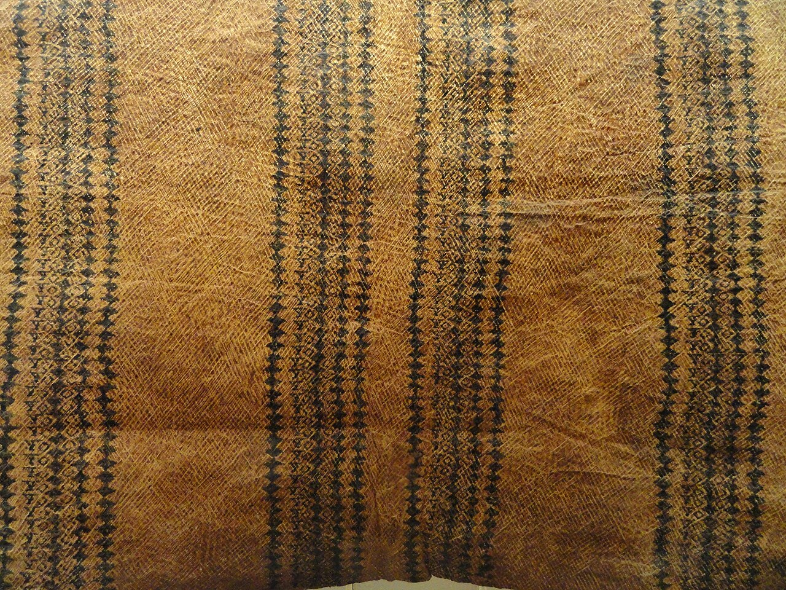
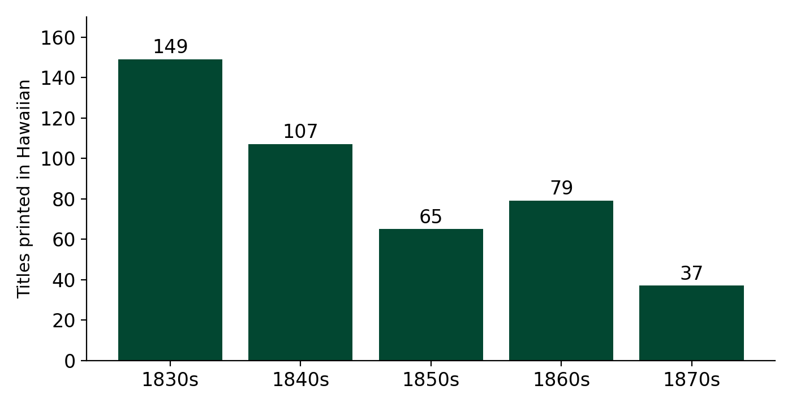
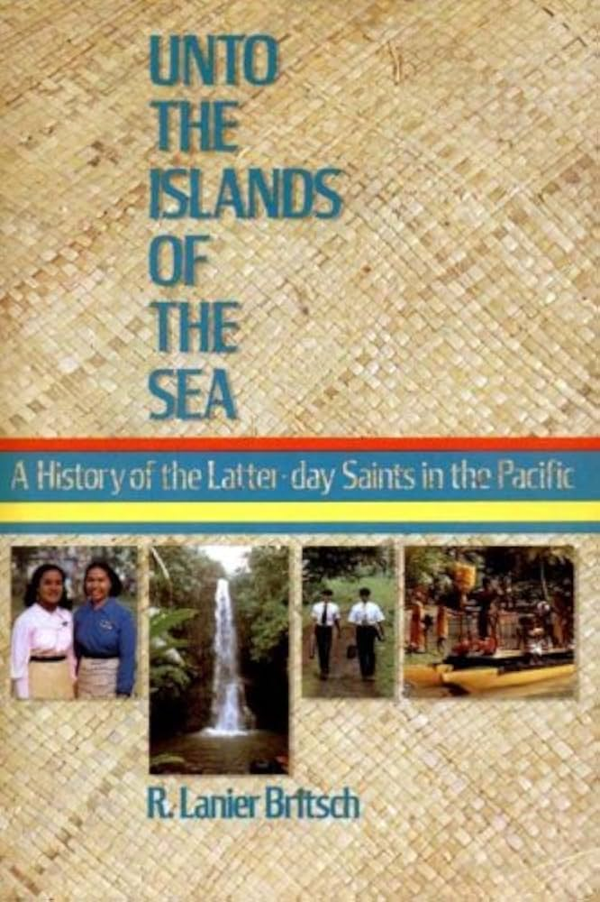
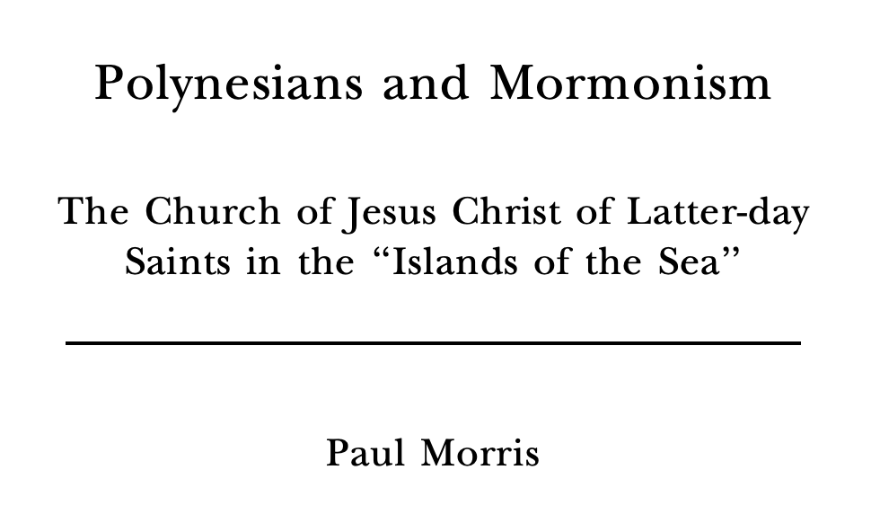
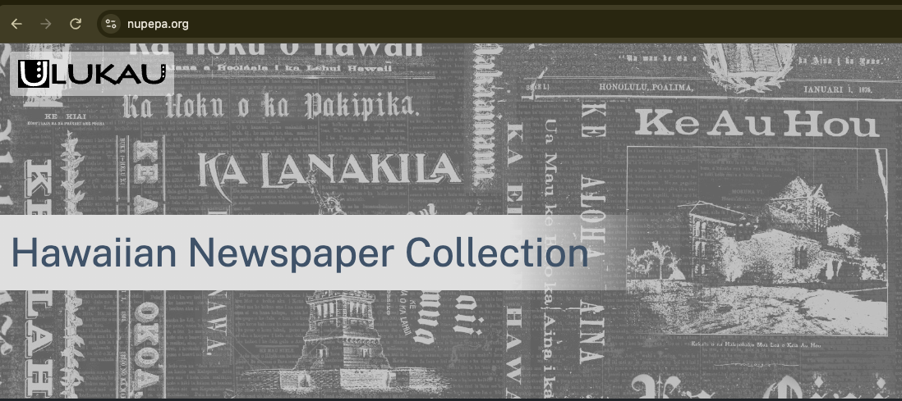

## Reminders

**Final Paper Topic Idea** is due **tomorrow, Friday, October 30**.

  - *~100-150 words identifying a topic or a few topics you would be interested in pursuing.*
  - Today's chapter is full of possible topics (see the last slides).

**Preliminary Sources and Initial Research Question** is due **Friday, November 6** (3 sources + initial question).

**No class Tuesday, November 3** (Election Day). Next class is **Thursday, November 5** (Ch. 18, language endangerment).

::: {.notes}
Final Paper guide and the sample proposal (Rapa Nui) are in the course folder; post both to Lamākū before class if you have not already. The syllabus says detailed instructions go up on Lamākū, so say out loud where students can find them. Discussion Post #6 closed at 8:00 am today; the posts used on these slides are from that thread. Quiz #4 is closed and there is no further quiz.
:::

## Today's Plan

**Part 1: Writing Hawaiian (about 30 min)**

1. How do you write a language that has never been written?
2. A word for "writing," an alphabet, and a vote
3. What the new spelling left out

**Part 2: Did Hawaiʻi become literate? (about 40 min)**

4. How fast, and how many?
5. What does "literate" mean? Reading versus reciting
6. What was there to read? Newspapers and knowledge
7. Putting it together, and your final paper

::: {.notes}
Roughly 75 minutes. If time runs short, cut slide "Relearning How to Spell" and the "Today: nūpepa" slide, and shorten "What Was There to Read?". The student-post slides are the core of the lesson; protect those.
:::

## Warm-Up: "Ua loaʻa iaʻu!" (3 min) {.smaller}

> "Having her eye directed to the first class of letters ... she followed me in enunciating the vowels, one by one ... Her countenance brightened ... the queen exclaimed, **'Ua loaʻa iaʻu!'** 'I've got it!'" (Bingham 1847, in Schütz p. 189)

Later, Kaʻahumanu wrote: *"Many are the people---few are the books."*

> **Discuss with a neighbor:** What does her reaction tell us about how Hawaiians first met writing? And what did Sheldon Dibble report about **other** reactions?

::: {.notes}
Answers. Kaʻahumanu: Hawaiʻi's most prominent citizen, learning in January 1822 within days of the first printing; she asked for forty more copies for her attendants. Her letter shows the demand was far larger than the supply, which is a theme for the whole lesson. Dibble (1831): "The people were amazed at the art of expressing thoughts on paper. They started back from it with dread, as though it were a sort of enchantment or sorcery." So reactions ranged from excitement to fear, and some people believed a wish for money or clothing written on paper would be granted (p. 190). Also point out that writing was not new to the world, only to Hawaiʻi: Hawaiians had seen writing before (Schütz: "not their first contact with writing in general"), but this was the first time they saw their own language written. Footnote 2: Bingham's Hawaiian was minimal at that time, so we do not know how faithfully he reproduced her words.
:::

# Part 1: Writing Hawaiian

## Timeline {.smaller}

| Date | Event |
|---|---|
| 1820 | First Company of missionaries (ABCFM) arrives |
| Jan 1822 | *The alphabet* (*Pīʻāpā*) printed: 8 pages, 500 copies |
| 1826 | Missionaries vote on the consonants; official orthography |
| Feb 1834 | *Ka Lama Hawaiʻi*, first newspaper, at Lahainaluna |
| 1835 | Peak year for the mission press: 25 titles, 73,200 books |
| 1822-1899 | Over 650 Hawaiian-language titles |
| 1834-1948 | 106 different Hawaiian-language newspapers |

::: {.notes}
Quick orientation, about 1 minute. Sources: Schütz pp. 190, 192-193, 196, 200-201. Note the missionary policy: the ABCFM aimed to make Hawaiians literate in Hawaiian, not English, a policy used in other Pacific missions too (esp. Tahiti, whose language was similar; the two missions corresponded). Ask students to notice the gap between 1822 and 1826: four years in which people learned a spelling that would then change. That is where we go next.
:::

## A Word for "Writing" (4 min) {.smaller}

There was no Hawaiian word for writing before contact. Which would **you** choose?

::: {.columns}
::: {.column width="60%"}
| Idea | Candidates |
|---|---|
| **Form** (what writing looks like) | *kiʻi* 'picture', *kākau* or *uhi* 'tattoo', *kaha* 'scratch', *helu* 'scratch, count, list', *heluhelu* 'chant words rhythmically' |
| **Function** (what writing does) | something based on *ʻōlelo* 'speech, language' |

> **Discuss:** Which would you pick, and why? What did Hawaiians actually choose?
:::
::: {.column width="40%"}
{fig-alt="Hawaiian kapa (tapa cloth) with printed patterns" fig-align="center"}
:::
:::

::: {.notes}
Give them 1 minute in pairs, then reveal: palapala. Answer: palapala originally referred to the printing of tapa designs (kapa), so it is a form-based choice: the new thing was like printing on cloth. It is already in Archibald Campbell's word list (1810-11), before the missionaries arrived, and in 1820 Bingham and Thurston recorded "Miti-palla-palla-hannah-hannah" (Maitaʻi palapala hana-hana 'Good to learn to read and work'), which Schütz calls pidgin Hawaiian. It also came to mean education in general, the outside kind (p. 190). Footnote 6: palapala is the "statistical favorite" with nearly 90 entries for compounds referring to documents (Pukui and Elbert 1986); kākau also appears for write. Link to Ch. 15 (borrowing and coinage): Hawaiians did not borrow "writing" from English; they extended an existing word (semantic extension), the same strategy the Lexicon Committee used later for many words.
:::

## Designing an Alphabet: Vowels First {.smaller}

The missionaries began with **English** spelling of vowels... and **scrapped it**.

| English | Hawaiian orthography |
|---|---|
| *a* in *cat*, *father*, *cake*, *all*... | **a** = one sound |
| 5 letters, 12+ vowel sounds | **a e i o u** = five vowels |

**Later addition: the macron (kahakō)** marks a **long vowel**: *a* vs. *ā*, *e* vs. *ē*, and so on.

| Short vowel | Long vowel |
|---|---|
| *kala* 'to loosen, forgive' | *kālā* 'money, dollar' |

> **Why would English spelling be a bad model for Hawaiian?** What does a good alphabet do? **Why does the macron matter?**

::: {.notes}
Answer: English letters map to many sounds and vice versa (the same letter a in cat, cake, father, all; the same sound spelled many ways), so it would take years to learn. A good alphabet for literacy ideally gives one letter for one phoneme. The missionaries discussed this among themselves and with other missionaries (Tahiti) and scholars in England and New England, and decided to discard the English vowel system and use the continental values (Schütz p. 190-191, citing Schütz 1994:102-105). This is the same principle as the phoneme (Ch. 4): the alphabet should represent contrastive sounds. Pause here to ask who has heard of "one letter, one sound" or "phonemic orthography" in other classes. Keep this slide to about 2 minutes. Macron: the 1826 orthography did not regularly write vowel length (or the ʻokina); both were added later, and Schütz says they are crucial today because most learners are not native speakers (p. 197). Minimal pair: kala 'to loosen, untie, forgive' vs. kālā 'money, dollar' differ only in vowel length, so length is contrastive (a phoneme-level difference, Ch. 4). Check both glosses in Pukui and Elbert before class; the pair is from general knowledge, not the chapter. Why it matters: without the macron, kala and kālā are written identically, which native readers resolve by context but learners cannot. This sets up the "What the Alphabet Left Out" slide.
:::

## The Consonant Problem (5 min) {.smaller}

Speakers pronounced these **differently without changing meaning**:

| Set | Example |
|---|---|
| p ~ b | *tapu*, *tabu* |
| l ~ d ~ r | *hale*, *hare* |
| t ~ k | *tapu*, *kapu* |
| v ~ w | *heva*, *hewa* |

> **Discuss:** What does it mean that *hale* and *hare* both meant 'house'? What would you have done as a missionary?

::: {.notes}
Answers. Because they do not change meaning, they are not contrastive: in modern terms, free variation or allophones of one phoneme, not separate phonemes (Ch. 4). The missionaries heard b where English speakers perceive an unaspirated or slightly aspirated [p]; the l/d/r sound was probably a tap [ɾ], as in Tahitian and Māori, closer to l than to American r; v/w was between the two, close to Spanish b between vowels [β] (this is Schütz's description, noting phonetics was in its infancy). Some variation was geographic, e.g. [t] predominated over [k] on Kauaʻi and Niʻihau. Native speakers were consulted and insisted the meaning was the same (p. 195). What the missionaries did: they voted (Schütz 1994:122-125) and kept p, l, k, w. Important: the choice of k over t, for example, was not a linguistic discovery; it was a decision, and speakers of the Kauaʻi dialect lost their preferred letter. Before moving on, plant the question that the next slides pick up: who made this decision, and what did it cost?
:::

## From Your Posts: Who Decides? {.smaller}

> "...it left me wondering if it was right (or respectful) to push a change to one letter or another back in 1826. Was it really best to have the missionaries vote ...? It feels like yet another negative impact of colonization, but then I wonder what it would have looked like for Hawaiians if they were not able to communicate with the rest of the world in writing." (**Nathan**)

> "...how much native Hawaiians actually got to say in how their own alphabet was made ... how did the first Hawaiian scholars feel when certain sounds were just left out or changed around?" (**Dakodah**)

> **Discuss in groups:** What evidence in the chapter speaks to Nathan's and Dakodah's questions? What *doesn't* the chapter tell us?

::: {.notes}
Both posts ask who had authority over the orthography. What the chapter does say: native speakers were consulted and insisted on no difference in meaning (p. 195); the missionaries voted among themselves (p. 196, citing Schütz 1994); Hawaiians quickly adopted literacy with enthusiasm (pp. 189-190, 197); Kamāmalu and other chiefs encouraged schools; the new orthography was efficient enough that people learned quickly (p. 197). What it does not say: how Hawaiians felt about specific letter choices, or whether any objected. Schütz himself notes (footnote on p. 190 and the introduction) that most sources are mission records in English and that Hawaiian-language sources are becoming available and searchable, which is exactly the research Dakodah proposes (journals, letters, newspapers). Good teaching move: affirm both questions as research questions, and note that Nathan's counterfactual (what if no writing at all?) is the chapter's own conclusion: the 19th-century writing left the records that the current revitalization rests on (p. 205). One check on Dakodah's claim: the missionaries did not simply apply Western grammar to Hawaiian; they redesigned the English vowel system and chose letters by sound, but they did design it from an English-speaking, print-focused background (Webster, Dilworth). On "deep, poetic meaning got lost": the chapter does not address poetry; what it does say is that the 'okina and kahakō went unwritten, which is the next topic. Also tell the class this is a good model for the final paper: a question like Dakodah's is a research question.
:::

## From Your Posts: Other Alphabets, Same Problem {.smaller}

> "In Vietnamese there is a phrase: **quốc ngữ** ... brought by Europeans ... the sound *k* can be spelled as *c*, *k*, or *q* depending on the vowel following it." (**Jolie**)

> "This reminds me of how indigenous languages in Ecuador, like **Kichwa**, were written down. Linguists in both places had to adapt a foreign alphabet to fit local sounds and regional dialects." (**Hanna**)

| Sound /k/ | Vietnamese (quốc ngữ) | Hawaiian (after 1826) |
|---|---|---|
| Spelling | *c*, *k*, *q* (depends on the next vowel) | **k** always |

> **Discuss:** Is Hawaiian's "one letter, one sound" better for learning to read? What does a writing system cost *you* if it is less regular?

::: {.notes}
Jolie's example: in quốc ngữ the sound /k/ is spelled c before a, o, u; k before i, e; and q in qu-, so the spelling depends on the following vowel. This is general knowledge, not in the chapter; check against your own sources before presenting it as fact. Her point that both scripts were introduced by Europeans and are now symbols of identity is a strong connection: Hawaiian is not the only Latin-script adaptation made by missionaries (Schütz mentions Tahiti, footnote 7). Her claim that quốc ngữ only became national due to colonial policy is roughly right in general terms but worth checking if you want to use it. Hanna's Kichwa connection: her comparison of adapting an alphabet to local sounds and dialects is exactly the chapter's problem (dialect variation in 1822-1826); do not claim details about Kichwa orthography beyond what she said. Answers to the discussion: efficiency matters because the chapter credits the regular alphabet as one of the two main reasons people learned so quickly (p. 197); English-speaking readers have an irregular system and take years. The cost of irregularity is time spent learning exceptions. The cost of regularity is that variation and dialects get flattened into one standard (as the Kauaʻi t~k case shows).
:::

## From *be-a-ba* to *pīʻāpā* {.smaller}

Webster's English speller taught spelling **aloud**, by syllable:

*ba be bi bo bu* ... → "**bi, a, ba**"

| Year | Hawaiian word for 'alphabet' |
|---|---|
| 1824 | *be-a-ba* (letter *b* was called *be*) |
| 1828 | *pi-a-pa* (after the 1826 vote: b became p) |
| Today | *pīʻāpā* (long vowels and ʻokina now written) |

> **What changed at each step, and why?**

::: {.notes}
Answers. Webster's Speller, the first line of the syllabarium: ba be bi bo bu by. To spell ba, an English student said the name of the first letter (bi), then a, then the syllable: bi, a, ba. Adapted to Hawaiian: the letter b was called be, so the result was be, a, ba. The word be-a-ba (like our alphabet, from alpha-beta) was the word for alphabet for about four years (Ka be-a-ba, 1824). Step 1 (1824 to 1828): the 1826 vote dropped b in favor of p, so the letter became pi and the word pi-a-pa. Step 2 (to today): later it was discovered that monosyllables in isolation have long vowels, and Hawaiians heard the glottal stop that precedes initial vowels in English words, giving pīʻāpā. Schütz calls the spellings "the linguistic equivalent of archaeological artifacts" spanning about 130 years. Optional follow-up question: why is this word itself a nice example of contact? It is a loan translation of an English teaching method (Webster), adapted to Hawaiian syllables.
:::

## Relearning How to Spell {.smaller}

Thousands learned from *The alphabet* (1822-1826), then had to **relearn**:

| Old spelling | Modern |
|---|---|
| tabu | kapu 'forbidden' |
| aore | ʻaʻole 'not' |
| heva | hewa 'mistake' |
| hidahida | hilahila 'ashamed' |
| maitai | maikaʻi 'good' |
| motu | moku 'island' |

Old books kept circulating, so **two spelling systems competed**.

> **What does this say about the cost of reforming an orthography?**

::: {.notes}
Between 1822 and 1826 the Mission Press printed twenty titles, some with print runs as high as 22,000 copies (p. 196), so many spellings were already fixed in thousands of readers' heads. Schütz notes that this reform's effect "seems to have gone unnoticed in treatments of Hawaiian literacy." Answer to the discussion: reform has a cost in relearning and in a period of competing systems; Catholic readers faced a slightly different spelling system for Catholic materials (footnote 18). Compare English spelling reform, which almost never succeeds because the cost of changing is shared by everyone (general knowledge). Connect to the Ch. 15 Lexicon Committee: deliberate planning of language is hard and has social costs.
:::

## What the Alphabet Left Out {.smaller}

The 1826 orthography did **not** regularly write the **ʻokina** (glottal stop) or **kahakō** (vowel length).

| Written | Could mean |
|---|---|
| *makau* | *makau* 'fishhook' **or** *makaʻu* 'fear' |
| *kou* | *kou* 'your' vs. *koʻu* 'my' |

*E makau kakou ia Iala*

> **How would a native speaker know which one?**

::: {.notes}
Answer: context. "We should fear Him" cannot be about fishhooks (p. 197). In The alphabet, pairs where context could not help, like kou and koʻu, were kept apart with apostrophes; ia'u shows a glottal stop; but in ola'i, hana'i, ike'a the apostrophe had a different function (footnote 19). For native speakers reading their own language, it was not much of an obstacle; today, with most learners not native speakers, writing the symbols is crucial (p. 197). Preview of the next slide: this is exactly what Cara described when modern readers use nūpepa.
:::

## From Your Posts: Reading the Old Newspapers Today {.smaller}

> "When reading 19th-century Hawaiian-language newspapers (nūpepa), the absence of explicit ʻokina and kahakō ... requires modern readers to rely heavily on context and traditional oral knowledge to deduce exact word meanings." (**Cara**)

> **Discuss:** Why is this harder for a *learner* than for a native speaker of 1850? What does that say about who the orthography was designed for?

::: {.notes}
Cara's observation matches Schütz p. 197: native speakers could resolve ambiguity through context; learners today cannot as easily. Answer: the orthography was designed for an audience that already knew the language, so it could leave out information they did not need. Today's readers include second-language learners who must supply the missing information from outside the text. This also raises the question of whether the orthography should be "updated" when transcribing: ʻIke Kūʻokoʻa (see the last section) involves transcribing nūpepa, and editors choose whether to add ʻokina and kahakō (do not claim details about their policy; check before class). One check on Cara's claim that Hawaiʻi "achieved one of the highest literacy rates in the world": that is Judd's 1880 estimate ("greater than in any other country in the world, except Scotland and New England"), and the chapter spends a whole section on whether it was true. We come back to this in Part 2.
:::

# Part 2: Did Hawaiʻi Become Literate?

## How Fast? How Many? {.smaller}

| Year | What was printed |
|---|---|
| 1822 | *The alphabet*: 500 copies, then 2,000 more |
| 1824 | 7,000 copies of a 4-page *Alphabet* |
| 1825 | 61,000 copies of various 8-page *Alphabets* |
| through 1826 | **about 1,626,000 pages** of Hawaiian |
| 1835 | 25 titles, 73,200 books, **about 7,960,000 pages** |
| Jan 1822 to mid-1845 | **149,911,383 pages** (cumulative) |

*An estimated 50,000 readers and learners (Bingham)*

::: {.notes}
Sources: Schütz pp. 193, 200, 197; Judd, Bell and Murdoch 1978. Caution on one point: Schütz writes that "in just ten years (from 1835 to 1845), the number of pages had increased from about 8 million to nearly 150 million," but the 8 million is the output of the single year 1835 and the 149.9 million is the cumulative total from January 1822 to June 1845, so the two figures are not directly comparable. Say this to the class: it is a good example of reading numbers carefully. The figure of 50,000 readers and learners is Bingham's estimate (p. 197), and the chapter later asks what such numbers mean. Also remind students that books were shared, so print runs do not equal numbers of readers (footnote 10).
:::

## Titles Per Decade {.smaller}

{fig-alt="Bar chart of the number of Hawaiian-language titles printed per decade: 1830s 149, 1840s 107, 1850s 65, 1860s 79, 1870s 37" fig-align="center" height="480px"}

> **What do you notice? What might explain the decline after the 1830s?**

::: {.notes}
Data from Schütz footnote 22 (Judd, Bell and Murdoch 1978). The 1830s were the most active period of the press. Answers: Schütz does not give a full explanation; he notes the mission was in debt, was forced to be more self-sufficient, and faced rising costs of living with Western goods (p. 199). Students may suggest: newspapers took over from books, the mission's role changed, or demand shifted; label these as hypotheses, not from the chapter. The pattern is itself a research question for the final paper.
:::

## Why Did People Learn So Fast? {.smaller}

1. **Eager learners:** books were intriguing; *mana* attached to books
2. **An efficient writing system:** one letter, one sound
3. **Chiefly support:** Kuakini, Kamāmalu, Liholiho, Kaʻahumanu asked for books and schools
4. **Monitors:** early students became teachers (Lancasterian method)
5. **Pressure:** Hoapili required children over 4 to attend, exempted teachers from labor, and **forbade marriage to couples who could not read**

> **Which of these do you think mattered most? What's missing from the list?**

::: {.notes}
Schütz names two main reasons (eagerness and the efficient system, p. 197); chiefly influence, monitor teaching, and Hoapili's decrees are in sections 6.1-6.2 (pp. 197-198). Hoapili was "viceroy of Maui"; the marriage rule was in 1835; Bingham explained it as "a spur to education." The Lancasterian system: older pupils train younger ones; large sheets hung on boards; sand-writing, though sand-writing was not adopted in Hawaiʻi because students preferred books (p. 191: "the mana attached to books enabled them to win over the economical but ephemeral sand-writing"). Ask for opinions and push on what is missing: motivations beyond religion (access to power and goods, which the chapter mentions for chiefs who wanted English), and the role of letters as a way news moved around the islands (Andrews 1836). Do not pre-answer; there is no single right ranking.
:::

## What Does "Literate" Mean? (4 min) {.smaller}

A literate person can...

1. recognize letters and recite the alphabet
2. associate letters with sounds
3. associate a whole written word with a spoken word (and idea)
4. read isolated common words aloud
5. read sentences aloud
6. develop a style of "oral interpretation"
7. read "silently"
8. understand the content of any written matter

> **Where would a student who can recite the *Pīʻāpā* from memory fall on this scale?**

::: {.notes}
This is Schütz's own scale (p. 202). Answer to the question: probably around levels 1-4, perhaps 5, and the memorization point (Andrews) is that someone could repeat the Pīʻāpā "from beginning to end" and still not be able to read a word (p. 204). The scale shows that "can read" is not a yes/no category. Footnote 25 notes that the debate over phonics versus whole-word reading continues today. The point of the activity is that when we see "30,000 readers" we should ask which levels the writer had in mind.
:::

## Two Views {.smaller}

| **Success** | **Doubt** |
|---|---|
| Judd (1880): literacy "greater than in any other country in the world, except Scotland and New England" | Andrews (1832): "probably one half of all the schools ... have at this day nothing to read but the Pia-pa" |
| Dibble (1839): "at least 30,000 readers," perhaps a third of the population | Andrews: many "think there is a kind of mystery, or perhaps magic, in reading" |
| Dana (1870s): implied the whole population could read and write | Andrews: memorizing "does not imply that they can read a word" |

> **Who is telling us this? What would they gain by exaggerating... or by doubting?**

::: {.notes}
Answers. The success reports are from the mission (Judd, Bingham, Dibble) and from outsiders echoing them (Dana). The missionaries had an interest in showing success to their funding board (the ABCFM) and in showing that their mission worked; the chapter notes that many glowing reports may have focused on students' ability to read aloud letters, syllables, words, and simple sentences from the Pīʻāpā, ignoring understanding (p. 203). Andrews was a teacher at Lahainaluna and a critic of the system as a whole: of teachers, materials, methods, and funding; in 1864 he softened (p. 204). So: positions depend on position. Also notice that nobody on either side was a Hawaiian reader describing their own experience; most sources are from mission records in English (introduction, footnote 1), which is why Schütz calls for more research in Hawaiian-language sources.
:::

## From Your Posts: Reading or Reciting? {.smaller}

> "Missionaries bragged about extremely high literacy numbers mostly based on students reading out loud, but critics like Lorrin Andrews pushed back ... This makes me wonder how much of early Hawaiian literacy was genuine reading comprehension as opposed to oral memorization." (**Kiana**)

> "How did missionaries really determine if Hawaiians truly understood what they were reading ... especially when memorization was already a big part of Hawaiian learning?" (**Dyllan**)

> "As a multilingual person, I know reading words aloud is different from true comprehension ... early books were poorly translated, so students often memorized texts without full understanding." (**Hanna**)

> **Discuss:** How *could* a historian tell the difference between reading and reciting?

::: {.notes}
Three posts raise this, so spend about 7 minutes here. What the chapter gives. (1) The primer: Schütz p. 194 and 203, footnote 28: the Pīʻāpā contained passages that were ungrammatical or nearly unintelligible Hawaiian, on topics foreign to Hawaiians; the compilers did not notice (the second edition left the sentences unchanged). So not understanding may have been partly the book's fault, not the students'. Hanna's point about poorly translated books is supported by that. (2) Andrews's report: students recite the Pīʻāpā in chorus, "fixed in the memory ... just as well without a book as with one" (p. 198), and a class where the teacher had only one copy and the students learned their letters upside down (p. 199). (3) Memory: Hawaiians' skill at memorizing genealogies and legends of "incredible length" (p. 204), so memorization was a strength, but it can hide non-reading. Dyllan's question: the chapter says the missionaries mostly counted heads (p. 201): "the answers to this question were usually based on head counts." There was no systematic test of comprehension that we know of. How a historian could tell: use independent evidence: letters written by Hawaiians (Kuakini's letter in Hawaiian within days of getting a speller, p. 197; Andrews's 1864 comment that people "got ideas from reading" and wrote letters, pp. 204-205); newspapers, where readers wrote in (footnote 33 and p. 201: letter writing spreading news by the 1830s); and Hawaiian-language sources. Wilson's suggestion (footnote 1, 33): letters by native speakers on familiar topics would have been easier to understand than the Mission Press products. Also note the limits: reading aloud and silent reading are different skills; levels 4-5 versus 7-8 on the scale.
:::

## From Your Posts: Why Read, If Not to Understand? {.smaller}

> "The idea that early on, Hawaiians valued writing for reasons other than understanding the content is very interesting to me ... maybe including things like **prestige or identity** associated with reading certain texts." (**Jinghao**)

*Bound books are in good demand, but pamphlets "have lost their value in the eyes of the people"* (Thurston and Bishop 1835).

> "...if there's any society that opposed writing when it was introduced to them?" (**Jinghao**)

> **Discuss:** What other purposes did books and writing serve in 1820s-1840s Hawaiʻi?

::: {.notes}
Evidence in the chapter for non-content value: the "mana" of books (p. 191) and the bound-versus-pamphlet comment; the belief that a wish written on paper would be granted (p. 190); the boy who loved the palapala "from the sole of my foot to the crown of my head" (p. 191); Andrews's remark that a table of logarithms would be as desired as any other book (p. 203) and that people thought reading had "mystery or perhaps magic" (p. 203); chiefs' status; letter writing as a way to move news (Andrews 1836). Jinghao's claim that Hawaiian literacy mattered for Kauikeaouli in getting Hawaiian sovereignty taken seriously by foreign powers (since writing = civilization in colonialist thinking) is not in Schütz's chapter; he said "I know" from elsewhere. Acknowledge it as a connection beyond the chapter, ask him where he learned it, and note that it fits Schütz's last statement that literacy "did not turn out to be a sure path to power and prosperity" (p. 205). Jinghao's second question, which societies opposed writing: within the chapter there was fear at first ("enchantment or sorcery," p. 189) and kahuna objections to publishing traditional knowledge (next slides). Outside the chapter, general knowledge: Plato's Phaedrus has Socrates worrying that writing weakens memory; check before class if you want to use it, and invite students with other examples. Do not claim more.
:::

## What Was There to Read? {.smaller}

::: {.columns}
::: {.column width="70%"}
- Mostly **religious**: Scripture, hymnals, catechisms, spellers
- Dibble: "everything connected with instruction was **inseparably connected** ... with Christianity"
- In nearly 50 years, the mission press printed only **three books on Hawaiian history and culture** (under 650 pages)
- *Ka Moʻolelo Hawaiʻi* (1838): written by students at **Lahainaluna**, edited by Dibble; the first book of Hawaiian literature in book form
- Censorship from Boston; one missionary resigned over it

> **Nadia asked about the role of religious institutions today. How does what was printed connect?**
:::
::: {.column width="30%"}
{fig-alt="Book cover: Unto the Islands of the Sea, A History of the Latter-day Saints in the Pacific, by R. Lanier Britsch" fig-align="center" height="330px"}

{fig-alt="Title page: Polynesians and Mormonism, The Church of Jesus Christ of Latter-day Saints in the Islands of the Sea, by Paul Morris" fig-align="center" height="140px"}
:::
:::

::: {.notes}
Sources: Schütz pp. 199-201. Nadia's post asked how the early focus on Christianity relates to the role of religious institutions today, and in particular how the Church of Jesus Christ of Latter-day Saints and BYU-Hawaiʻi became so affiliated with the Polynesian Cultural Center. That second part is outside the chapter, which is about the early Protestant (ABCFM) mission and its press; the chapter does say a Catholic mission used a slightly different spelling system (footnote 18). A good response: the chapter shows that for a generation almost everything to read was religious, so religious institutions shaped what counted as knowledge and what was written down. Whether that influences how Polynesian cultures are presented to visitors today is a good research question for the final paper (and a good topic idea for tomorrow), but we cannot answer it from today's reading. Do not make claims about the PCC without sources. The two images are starting points for that research: R. Lanier Britsch, *Unto the Islands of the Sea: A History of the Latter-day Saints in the Pacific*, and Paul Morris, *Polynesians and Mormonism: The Church of Jesus Christ of Latter-day Saints in the "Islands of the Sea"*. I have not read either, so present them as places to start looking (and check the Morris publication details before citing it), not as sources for any claim.
:::

## Newspapers {.smaller}

- *Ka Lama Hawaiʻi*, Lahainaluna, **February 1834**
- **106 different newspapers** in 114 years; as many as **14** at the peak (1896)
- Sacred **and** secular; Hawaiʻi **and** world news; sometimes a **different point of view** from the mission
- Last secular newspaper for native speakers: *Ka Hōkū o Hawaiʻi*, **1948**
- About **125,000 pages**

> **Should traditional knowledge be printed?** Some said yes (experts are dying out). Others said no (kahuna would lose prestige).

::: {.notes}
Sources: Schütz pp. 200-201, 205-206. Charlot 2005:499-500 for the internal debate. The two views on the subject matter (p. 201): ignore pre-Christian history as a "period of darkness," or write about it only to underscore how enlightened the new beliefs were. Whatever the consensus, a great amount of historical and cultural information reached the public through the newspapers. Newspapers are, in Schütz's words, "the chief source we have today of examining Hawaiian lives and thoughts, beginning in the 1830s and continuing for over a century" (p. 205). Do not pre-answer the question on the slide; it leads straight into the discussion posts on the next slide.
:::

## From Your Posts: Preserve or Change? {.smaller}

> "...we often think of literacy as a way to preserve language and culture, but I had never really considered how it could also **change the way knowledge is shared and valued**. ... does that strengthen cultural preservation, or does it risk weakening the traditions surrounding how that knowledge was originally shared?" (**Rucella**)

> "...in many Indigenous communities, the introduction of colonial influences, and subsequently written language, at first resulted in the loss of cultural knowledge ... yet Hawaiians were also able to use writing to **preserve aspects of their own culture**." (**Kale**)

> **Discuss:** Is Rucella's question an either/or? What does Schütz conclude?

::: {.notes}
Rucella's question is a real debate in the chapter: some Hawaiians favored transcribing traditional texts since experts were becoming fewer; others objected to making it public, foreseeing the loss of the prestige customarily due the traditional expert (kahuna) (Charlot 2005:499, in Schütz p. 201). Kale's answer is close to Schütz's conclusion (p. 205): "we can be grateful that nineteenth-century Hawaiians learned to write, leaving records of the language and culture in a period when both were in decline," and these records are the basis for the reference materials supporting the current Hawaiian renaissance. Both can be true: preservation and change are not opposites. Writing preserves content, but may change who has access, which is a change in the social structure of knowledge. Kale's comparison to what he learned in BOT 444, that colonial influences first caused loss of cultural knowledge in many Indigenous communities, is a good outside connection; ask him to say more if he wishes. Push the class to name who gains and who loses from each of the two choices. For the final paper: many Pacific languages have a similar history of missionary writing, so comparison is possible.
:::

## From Your Posts: "By and By" {.smaller}

> "...in Kaʻahumanu's writing she had said **'By and by, perhaps, we shall be Akamai'** which is really close to phrases that I and my friends use commonly in Pidgin ... **bumbai** ... and ... **akamai** to mean smart or skilled." (**Maria**)

> **Discuss:** What is happening in the sentence Kaʻahumanu wrote? Which word is Hawaiian and which is English? What does this connect to from Week 8?

::: {.notes}
Maria's connection to the pidgin unit is strong. What is happening: the quoted letter mixes English and Hawaiian (Bingham reported that it was common for Kaʻahumanu to mix them, footnote 2). Akamai is Hawaiian ʻakamai 'smart, skilled, clever'; the sentence also has English "by and by." Note the caveat in footnote 2: we do not know how faithfully Bingham represented her words, since his control of Hawaiian was minimal at that time. Connections: Hawaiian akamai is a loanword in Hawaiʻi Pidgin/Creole, which links back to Ch. 15 (borrowing) and Ch. 14 (Sakoda and Siegel); bumbai (from "by and by") is part of the Pacific Pidgin English stock and also appears in Tok Pisin and Bislama (bambai), as far as I know, so it did not originate on the plantations (general knowledge; check before presenting as fact). That fits Maria's observation that pidgin was forming much earlier than the plantation era, and also fits the chapter's own example from 1820: "Miti-palla-palla-hannah-hannah," called pidgin Hawaiian by Schütz (p. 190), which also shows early contact language. On her speculation that the merging of "by and by" into one word has to do with writing: the usual explanation is the opposite, that spoken phonological reduction came first and writing, much later, recorded it. She says herself that it may be speculative, so praise the connection and gently correct the direction.
:::

## Today: Nūpepa Online {.smaller}

- **Schütz (2012):** **125,000** pages originally published; **75,000** found and scanned
- **ʻIke Kūʻokoʻa (Liberating Knowledge):** volunteers transcribing the scans into searchable text
- Schütz's 2012 goal: roughly **1,000,000 pages** of text word-searchable
- Searchable: **topics, words, even grammatical constructions**
- **Now:** online at **nupepa.org**, newspapers from **1834 to 1948**, searchable by word, title, date, or place

{fig-alt="Screenshot of nupepa.org, the Ulukau Hawaiian Newspaper Collection home page" fig-align="center" height="260px"}

> **Why would linguists be especially interested in a searchable newspaper archive?**

::: {.notes}
Sources: Schütz pp. 205-206 (Epilogue). The figures are from 2012 and the chapter's own caveat is that the goal was to make the whole collection word-searchable by July 31, 2012. All counts on this slide are Schütz's 2012 figures; I could not find a newer status or page count, so do not say the goal was met. The only current facts I confirmed are from the nupepa.org home page (Oct 2026): historic Hawaiian-language newspapers, 1834-1948, retrievable by word search, title, date or place, with partners including OHA's Papakilo Database, Hoʻolaupaʻi, and the Bishop Museum, built on the Māori Niupepa Collection at the University of Waikato. One Maui library guide gives 11,934 issues, 58,612 pages and 379,918 articles for Papakilo, but its date and scope are unclear, so I left it off. Check nupepa.org and papakilodatabase.com before class if you want a live demo or search. Answer to the question: searchable text lets researchers study vocabulary, word frequency, changes over time, new words, borrowing, and grammar (the chapter says even grammatical constructions) in a record that spans over a century, and it is the best evidence we have for how Hawaiians wrote about their own lives. Link to Cara's post and the final paper: students interested in documentation might use these.
:::

## Putting It Together (5 min) {.smaller}

Schütz: there is **"no clear answer"** to how successful literacy was.

- **Success:** an efficient alphabet; fast spread; newspapers; records for today's revitalization
- **Limits:** few books; mostly religious; reading aloud versus understanding; "not a sure path to power and prosperity"

> **Write 3-4 sentences (3 min):** Was nineteenth-century Hawaiian literacy a success? Make **one claim** and support it with **one piece of evidence** from the chapter or from a classmate's post.

::: {.notes}
This doubles as practice for the final paper: a claim plus evidence. Collect responses or have 2-3 students read theirs. Acceptable positions: success (rapid spread, newspapers, records); mixed (depends on what literacy means: scale levels, comprehension); not a success in the sense of power (Schütz's last sentence: literacy did not turn out to be a sure path to power and prosperity). Look for a claim, a specific piece of evidence (a number, quote, or section), and an explicit link between them. Remind them that Schütz's own answer is "contradictions abound," and that disagreement among sources is a good starting point for a paper.
:::

## Your Final Paper: Topic Ideas {.smaller}

Today's chapter suggests questions that fit the assignment (language, country, or island in the Pacific; tied to a course reading):

- How was **another Pacific language** first written down, by whom, and who decided on the spelling?
- How did **missionary writing** compare in Tahiti, Samoa, or Aotearoa?
- What can **historical newspapers** tell us about language use in a community?
- How have **Hawaiian orthography** (ʻokina, kahakō) and its **standardization** changed since 1826?
- Does **writing preserve** or **change** knowledge in a particular community?

> **Topic Idea due tomorrow (Fri 10/30), ~100-150 words. Preliminary Sources and Research Question due Fri 11/6.**

::: {.notes}
These are prompts, not assigned topics. Remind students that a topic must be pre-approved and tied to a course reading, and that they need at least 7 academic sources by the end, so a topic with enough published sources matters. Mention the sample proposal (Rapa Nui) and the guide. The questions on the slide are intended to be answerable with academic sources; Tahiti, Samoa, and Aotearoa are suggestions, not claims about what has or has not been studied; students will have to find the sources.
:::

## Next Week {.smaller}

**Tuesday, November 3: no class** (Election Day)

**Thursday, November 5:** Ch. 18 (Guérin and Yourupi): language endangerment

**Friday, November 6:** Preliminary Sources and Initial Research Question due

**Friday, October 30 (tomorrow):** Final Paper Topic Idea due

::: {.notes}
Reading for Nov 5 is Ch. 18 in the Course Reader. Discussion Post #7 is Week 12 (not next week). Office hours Wednesday and Friday 1:30-2:30, Moore 574 (or Zoom); students working on a topic idea can drop in.
:::
