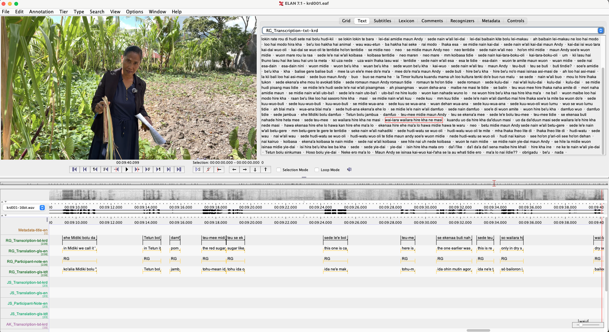
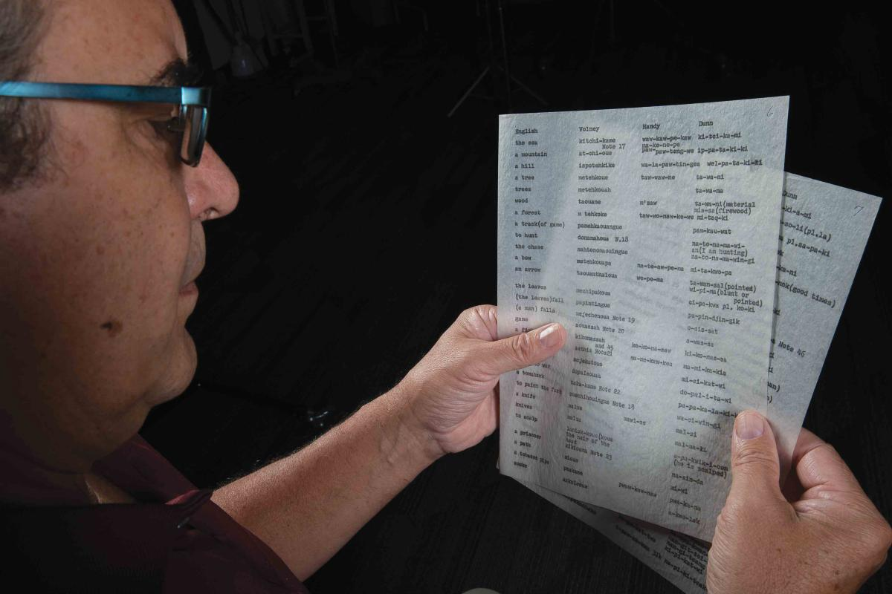
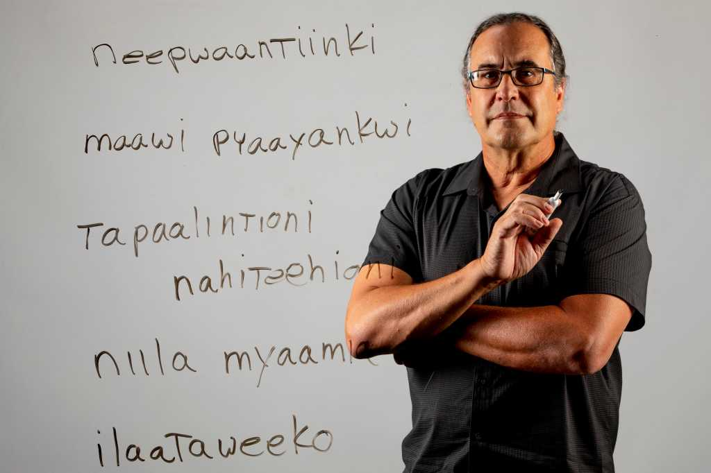
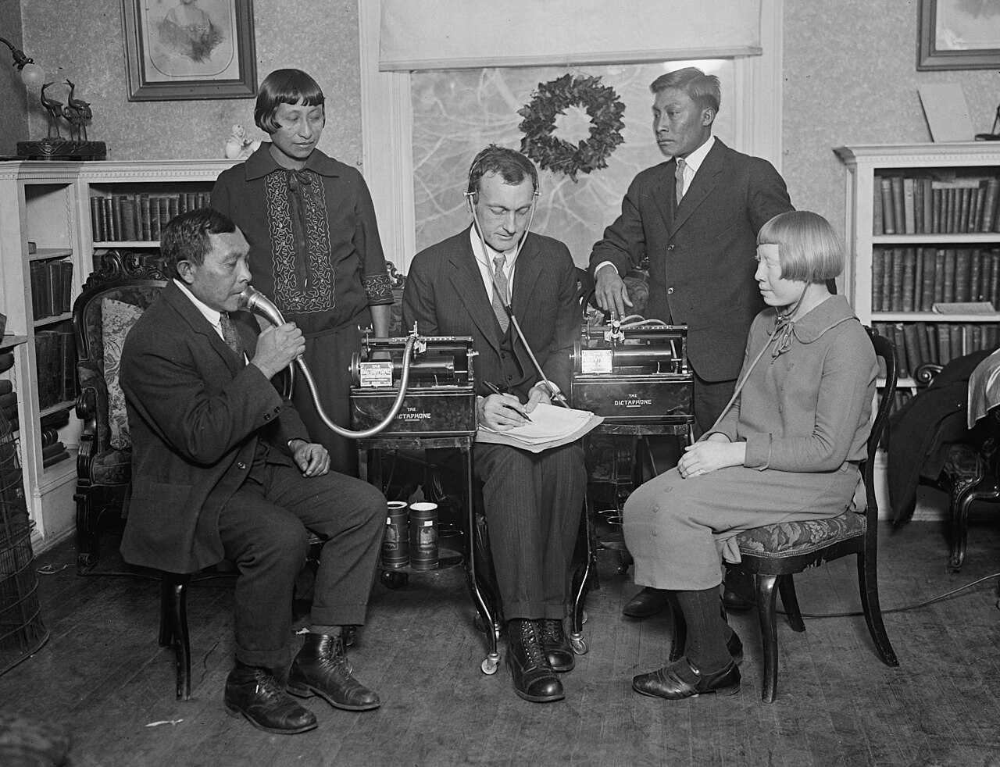
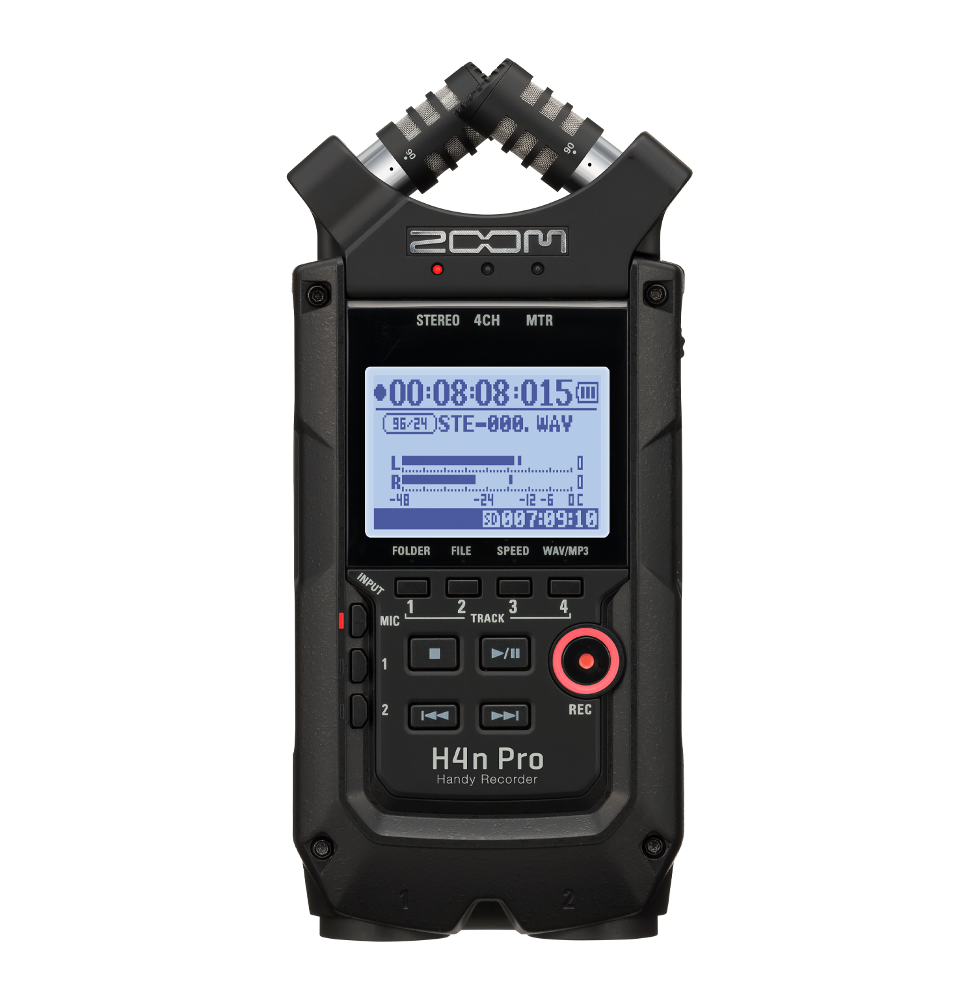
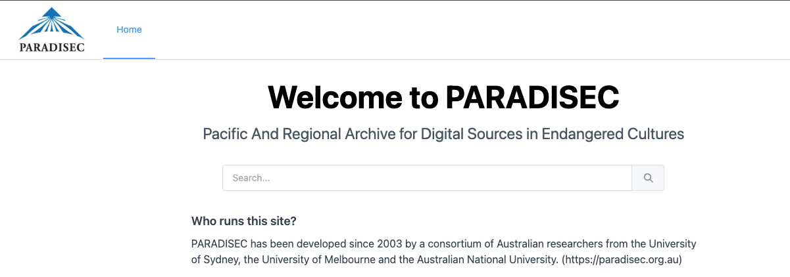
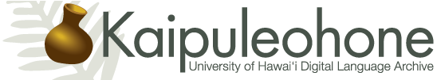
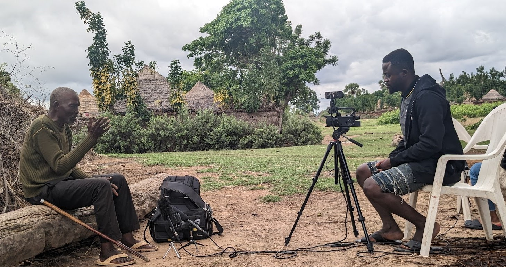

## Reminders {.smaller}

**Friday, November 20:** Draft due (at least 1,750 words).

- I'll give you time on Thursday to work on your drafts and talk them over with your classmates.

- If you plan to come to my office hours tomorrow, please let me know ahead of time and try to come for the first 30 minutes (1:30-2) if possible.

**Tuesday, November 24:** optional 1-on-1 meetings (extra credit).

- I'll let you know more about this on Thursday.

**Week 14 (next week):** sign up for a presentation slot.

::: {.notes}
Dates and chapters come from the syllabus and from last week's deck. Check the Discussion Post schedule on Lamākū and add it here if one is due this week; I did not have it. Remind them that the 7-source requirement and the draft deadline are the same as in the guide.
:::

## Today's Plan {.smaller}

**Part 1: What is language documentation?**

1. Warm-up: grammar or recordings?
2. Documentation vs. description
3. What goes into documentation

**Part 2: Why do it?**

4. Reasons from linguists and from communities
5. From archive back to the language
6. A Pacific case: Vanuatu

**Part 3: A short history**

7. From Boas to Himmelmann (1998) to today
8. Whose documentation?

**Part 4: Activity: Archive Detectives**

::: {.notes}
About 75 minutes, and this deck is long. Keep: the warm-up, "Documentation vs. Description," the Archive Detectives activity, and "Putting It Together." Cut first: "Documentation Is Old," "Timeline 1," "The Pacific Story," "Reconsidered," and "What Makes a Good Documentation?" (each has a note you can say aloud instead). Everything in the deck comes from the sources listed on the last slide, which I read directly; page numbers are in the notes.
:::

# Part 1: What Is Language Documentation?

## Warm-Up (3 min) {.smaller}

A language has about **100 speakers**, and no one has recorded it. You can leave **one** thing behind for people a century from now:

- **A.** A grammar book describing in great detail the sounds and grammatical structures of the language
- **C.** A printed dictionary
- **B.** 100 hours of recordings of people talking, with transcripts and translations

> **Which do you choose? Why?**

::: {.notes}
Take a quick show of hands, then 2-3 reasons. There is no single right answer, but the sources lean toward B, or at least toward "both." Thieberger (p. 258) notes that there are languages for which we have only grammatical analyses and no recordings, texts, or dictionary, which are the resources speakers typically want. Himmelmann (1998, pp. 163-164) says language descriptions are in general useful only to grammatically oriented and comparative linguists, while collections of primary data can serve a larger group, including the speech community itself. A grammar is an analysis; recordings let later people ask questions the original linguist never asked (Thieberger p. 258). But a recording with no transcript, translation, or information about who is speaking is hard to use (Woodbury 2011, §9.1), which is the next point.
:::

## What Is Language Documentation? {.smaller}

::: {.columns}

::: {.column}

- **Himmelmann (2006):** "a lasting, multipurpose record of a language"
- **Woodbury (2011):** the **creation, annotation, preservation, and dissemination** of **transparent** records of a language

> **Which of these activities / aspects from Woodbury's definition do you think linguists neglected for a long time?**

:::

::: {.column}

![DOBES researcher interviewing a coconut farmer on his work (Tatoli [Sulawesi, Indonesia]).](images/dobes.png){fig-alt="DOBES researcher interviewing a coconut farmer on his work."}

:::

:::

::: {.notes}
Himmelmann 2006, Chapter 1, p. 2 (the definition is a "preliminary answer" he then unpacks); Woodbury 2011, p. 159. Answer: preservation and dissemination, and the collection and presentation of primary data. Himmelmann (1998, pp. 163-164) says collecting data was never given the same attention as analysis in descriptive linguistics, and that in recent decades hardly any comprehensive collections of primary data have been published. Henke and Berez-Kroeker (2016, pp. 412-414) say that in the older period collections were deposited in physical repositories that were not easily accessible to many researchers or to speaker communities, and that only a fraction of recordings made it into dedicated archives. "Lasting" means for generations whose identity we do not know; "multipurpose" means for the speech community, educators, and researchers in many fields (Himmelmann 2006, pp. 2-3). "Transparent" means that a future user can interpret the record; this is Woodbury's term (p. 159).
:::

## Documentation vs. Description {.smaller}

| | **Documentation** (collecting) | **Description** (analyzing) |
|---|---|---|
| **Result** | A corpus of utterances, plus notes | Statements about the system, with examples |
| **Procedures** | Observation, elicitation, recording, transcription, translation | Phonetic, phonological, morphosyntactic, and semantic analysis |
| **Main issues** | Sampling, reliability, naturalness | Defining terms, justifying the analysis |

**Himmelmann (1998):** a documentation records the **linguistic practices and traditions of a speech community**; a description records **a language as a system**.

> **Where would you put: (a) a recorded conversation, (b) a grammar chapter on Hawaiian, (c) a transcript with a translation?**

::: {.notes}
Table adapted from Himmelmann 1998, Table 1, p. 163; the definitions are from p. 166 (he writes that the aim of a documentation is "the record of the linguistic practices and traditions of a speech community"). Answers: (a) documentation (primary data); (b) description; (c) in between. Himmelmann says the two activities overlap, especially in transcription and translation, because any transcription requires an orthographic representation and decisions about segmentation, and an interlinear translation presupposes some morphological analysis (p. 163). Also say: the 1998 paper's argument is that they should still be kept separate, because (1) there is no automatic procedure from data to analysis, (2) data can serve other fields such as sociolinguistics, anthropology, and oral history, and (3) if they are one project, collection gets neglected (pp. 163-164). Some authors objected that the two are inseparable in practice; McDonnell, Holton, and Berez-Kroeker (2018, p. 2) answer that the products have very different fates, with documentation more likely to have a lasting impact.
:::

## What Goes Into Documentation? {.smaller}

::: {.columns}
::: {.column width="25%"}
**Primary data**

- Audio or video of **communicative events** (stories, conversations, songs)
- Notes from **elicitation** sessions
- Texts written by speakers

**The "apparatus"**

- **Transcription**
- **Translation** (at least one language of wider communication)
- **Metadata:** who, when, where, what kind of event
- Annotation and commentary
:::
::: {.column width="75%"}
{fig-alt="Screenshot of the ELAN annotation program showing a video of a speaker, a transcript text pane, a waveform, and tiers of time-aligned transcription, English translation, participant notes, and a second translation."}
:::
:::

> **Why does a recording of a great story become nearly useless without the apparatus?**

::: {.notes}
Primary data and "apparatus": Himmelmann 2006, Chapter 1, Introduction (p. 1) and §3.1. Woodbury (2011, §9.1) lists records (writing, audio, video), a "transparent" record needs an apparatus: metadata about the creation and provenance of the record, and translation into at least one language of wider communication; nearly all linguists would add transcription, though Woodbury notes that other users may consider it expendable, as in a film with subtitles. Answer: without it no one can tell who spoke, when, or what was said, and the language itself cannot be understood by anyone who does not already know it. Thieberger (p. 258) makes a related point about archival recordings with little more information than the place where they were made, and says a table of filenames with dates, participants, and places makes the work much easier later (p. 259). Himmelmann (2006, p. 3) warns against "data graveyards": large heaps of data with little use to anyone. The screenshot is your own Midiki recording (krd001) in ELAN: the video and waveform are the primary data, and the tiers below are the apparatus, each time-aligned to the audio: a transcription tier, an English translation tier, a participant-notes tier, and a second translation tier (the last of these is labeled "tdt" in the tier name; say what language it is). Point out that one speaker's tiers are filled in and others are still empty, so this is a documentation in progress. Ask students to find: where is the transcription? the translation? who is speaking (the participant note)? Where a slide says "metadata," this file also has a metadata tab and a title tier (visible at the top of the tiers and in the tab bar).
:::

## Check Yourself: Primary Data? {.smaller}

**Which of these is primary data?**

1. A phone recording of a grandmother telling a story
2. A grammar chapter on a language
3. Notes from an elicitation session
4. A list of 100 words written down by a visitor in the 1800s
5. A recording with no information about who made it, or when

::: {.notes}
Discuss in pairs for 1 minute. Answers, with caveats: 1 yes, a recording of a communicative event is the core of primary data (Himmelmann 2006, Introduction). 2 no, it is an analysis (description). 3 yes; Himmelmann 2006 includes the notes taken in an elicitation session in primary data, and says the elicitation itself should be documented, including the questions asked (§3.1.1, "metalinguistic knowledge"). 4 it is a record of the language, and might be the earliest one, but it is a list of words and not connected speech; François (2018, p. 279) says earlier missionaries and pioneer linguists typically collected wordlists and grammar sketches and rarely samples of connected speech. Thieberger (p. 259) suggests asking who made the earliest record: an explorer's wordlist, a missionary's translation. 5 yes, it is primary data, but it lacks the apparatus, so its usefulness is limited. Students will disagree on 4; that is fine and is the point.
:::

# Part 2: Why Do It?

## Reasons From Linguists {.smaller}

Himmelmann (2006) gives three reasons:

1. **Language endangerment:** for an extinct language, you cannot check data with speakers or collect more
2. **Economy of research resources:** the next researcher can build on the full set of data, not just a grammar and a few texts
3. **Accountability:** claims about a language can be **checked** only if the data are accessible

> **Which of the three would matter most to a speaker's grandchild? Which do you think matters least?**

::: {.notes}
Source: Himmelmann 2006, Chapter 1, §2, pp. 5-7. His example for research economy: if someone worked on a minority language in the Philippines 50 years ago and someone else wants to continue, it is most useful to build on the complete primary data and not just a grammar sketch and a few texts. On accountability he includes replicability and falsifiability. No single answer to the discussion; the first is the closest to the grandchild's concern, and Himmelmann adds that documentations are also "important resources for supporting language maintenance" (p. 5). The other two are about research. His point is that all three have to do with strengthening the empirical basis of fields that depend on data from little-known speech communities, such as typology and cognitive anthropology (p. 5). Link to last week: Seifart et al. 2018 reported how much of the world's languages remain undocumented (see the endangerment deck).
:::

## Reasons Beyond Linguistics {.smaller}

Crystal (2000) gives five reasons to care when a language is lost:

| Because... | The argument |
|---|---|
| **We need diversity** | Ecosystems are strongest when most diverse; human success owes much to diverse cultures, and language is how cultures are passed on |
| **Languages express identity** | Language is the main index or symbol of who "we" are (a Welsh proverb: a nation without a language is a nation without a heart) |
| **Languages are repositories of history** | Samuel Johnson: languages are "the pedigree of nations"; words record past contact (the *OED* traces words from over 350 languages) |
| **Languages contribute to the sum of human knowledge** | Each is a unique interpretation of human experience; bilingual people have two perspectives on life |
| **Languages are interesting in themselves** | Linguistics needs evidence from as many languages as possible; each is a unique system, and none is "primitive" |

> **Pick one. How would you argue it to a skeptic who says "fewer languages is better"?**

::: {.notes}
Source: Crystal 2000 (*Language Death*), Chapter 2, "Why should we care?" The five section headings are as stated; by the page markers in my copy they run roughly pp. 33-35 (diversity), 39-41 (identity), 41-43 (history), 44-45 (knowledge), and 45 onward (interesting), so check the exact pages before quoting. Detail for each row. (1) Diversity: he extends the ecological frame: the strongest ecosystems are the most diverse, and he says our success in colonizing the planet has been due to our ability to develop diverse cultures suited to all kinds of environments; since cultures are chiefly transmitted through language, when transmission breaks down there is a loss of inherited knowledge. He cites the 1994 Linguistic Society of America statement that the loss of linguistic diversity is arguably greater than the loss of genetic diversity. He also adds a caution (note 14): the genetic analogy only goes so far, because the causes of language death are largely under human control. (2) Identity: he calls language the primary index, symbol, or register of identity, quoting Dixon ("the emblem of its speakers"). He adds, in a footnote, that people can keep an ethnicity without the language, and that the claim "people cannot save their culture without their language" is an overstatement. (3) History: Johnson's remark is from Boswell's account of the 1773 Scotland tour. Crystal says a language encapsulates its speakers' history through its grammar and lexicon, and gives the *OED* example: each etymology marks a point of contact. (4) Knowledge: he says this reason is "more self-serving than altruistic": we can learn a great deal from other languages; multilingual people have two or more different perspectives on large areas of life; he quotes proverbs such as "a man who knows two languages is worth two men." (5) Interesting: the aim of linguistics is to define the human language faculty, which needs evidence from as many languages as possible; he says many people are surprised that Indigenous communities' languages are as full and complex as English or French, and that colonial contempt was transferred to the languages. Before the five reasons he rejects the view that fewer languages would be better: sharing one language does not guarantee peace (he lists conflicts in largely monolingual countries), and people can speak two languages, one for identity and one for intelligibility. That is the answer to the skeptic. Tie: these are reasons to care; documentation is one response, not the only one (Woodbury 2011, §9.3, notes that language activism and revitalization need not involve documentation at all).
:::

## Reasons From Communities {.smaller}

**What communities do with documentation (François 2018):**

- **Hear the voices** of elders and relatives
- Recover **stories, songs, and cultural knowledge**
- Create **literacy materials** for schools and families

**What users ask the Alaska Native Language Archive for (Holton 2012, in Henke & Berez-Kroeker 2016):** plant knowledge, music, even a **nineteenth-century eulogy**

> **What might a community want from an archive that a linguist would not?**

::: {.notes}
François 2018, pp. 283-284 (the recordings preserve the memory of storytellers and singers and "encapsulate cultural knowledge, folk traditions, oral history"), and Henke and Berez-Kroeker 2016, p. 426, reporting Holton (2012): users of the Alaska Native Language Archive tend to be from Native communities and are often looking for information that is not primarily linguistic, such as ethnobotanical information, music, and a eulogy; Austin (2011), also cited there, found DOBES and ELAR were used mostly by linguists, while ANLA and the California Language Archive were used by speaker communities or descendants for cultural, historical, or language-learning purposes. Answers: a relative's voice, a story that had stopped being told, a placename, a song; content over structure. Say that this is one reason the metadata and the way people can search matter (François, p. 284).
:::

## From the Archive Back to the Language {.smaller}

::: {.columns}
::: {.column width="56%"}
- **Mutsun (California):** a grammar was produced in **1977**, more than 40 years **after the last speaker died**, from earlier records; revitalization followed
- **Breath of Life (1996):** community members visit the **Berkeley archives** to learn how to use archived materials
- **Myaamia (Miami, Oklahoma):** "sleeping" for about **30 years**, then **brought back into community use from archival records** (Leonard 2018)

> **In these cases, who could be asked a question about the language?**
:::
::: {.column width="44%"}
{fig-alt="A man in glasses reading two typed sheets of word lists with columns labeled English, Volney, Handy, and Dunn."}

{fig-alt="A man standing in front of a whiteboard with Myaamia words handwritten on it."}
:::
:::

::: {.notes}
Mutsun and Breath of Life: Henke and Berez-Kroeker 2016, p. 417 (they call Mutsun "oft-cited" and say the first Breath of Life workshop was held in 1996 by the Advocates for Indigenous California Language Survival, bringing community members to the Berkeley archives). Myaamia: Leonard 2018, p. 55, where he writes that the tribal language was sleeping for about 30 years and was brought back into community use from archival records; he also says legacy documentation, most of it created by linguists, was almost never created for pedagogical purposes. Answer: no one, or no first-language speaker, so the archive is the only source and the quality of the documentation decides what can be recovered. Hinton (cited there) says revitalization often begins with a search for existing documentation, large or small. Images: the first photo shows typed word lists with columns headed English, Volney, Handy, and Dunn, which look like archival vocabularies from different collectors compared side by side; the second shows Myaamia words handwritten on a whiteboard. I do not know who is pictured or where the photos come from, so add credits (and a caption naming the person and source if you want one). Penfield and Tucker (2011, p. 294) mention Daryl Baldwin and his family of the Miami tribe as an example of reviving a language largely from documentation, but I did not confirm that he is the person in these photos. Hawaiʻi link: our own archive, Kaipuleohone, is at UH Mānoa (we will use it later). Note: these are North American examples; Wilson (Ch. 19) did not describe Hawaiian revitalization in these terms.
:::

## A Pacific Case: Vanuatu {.smaller}

**Alexandre François** recorded 23 languages in Vanuatu and the Solomons.

- **504** recordings in Mwotlap (1997-2011), part of **962** across 23 languages
- Copies **returned** to the Vanuatu Cultural Centre and a new cultural centre on Motalava (2011)
- **Facebook pages** for communities to share recordings
- **21 booklets** (primers and story books) in local languages, after the spelling was agreed in **public meetings**

::: {.notes}
François 2018, pp. 282-288. Check the numbers on the slide: 504 Mwotlap recordings made 1997-2011 (about 52 hours; p. 282); 23 languages and 962 resources in total, 104 hours (p. 282); he repatriated recordings in 2011 to the Vanuatu Cultural Centre in Port Vila and to a new Torres-Banks cultural centre on Motalava (p. 285); Facebook pages for Araki, Mwotlap, Hiw, and Teanu communities 2014-2017 (p. 284); 21 books, 10 primers and 11 story books (p. 287). The orthography was discussed with community members at public meetings, and he describes this as a pivotal moment (p. 287). Answer: Teanu, because its five vowels /i e a o u/ are the same as the Roman script's, so speakers master the orthography very fast; Hiw (nine vowels) and Lemerig (eleven) take longer (p. 287). Link to Ch. 17: this is the same design problem as "Vowels First" in the Hawaiian alphabet. Also point out François's claim that this shows documentation and literacy materials can go together, and that after the internet arrived younger contributors showed more consistent spelling, as he reports (p. 288); that is his own observation, not a study.
:::

## Documentation Is Not Revitalization {.smaller}

**Penfield & Tucker (2011):** the two are often treated as separate "arms," a divide that **does not mirror reality**

| | **Documentation** | **Revitalization** |
|---|---|---|
| **Seen as** | The "scientific" arm | The "education" arm |
| **Defined by** | The research community | The speech community |
| **Produces** | Archived recordings, word lists, dictionaries, grammars, narratives | New speakers: classes, immersion, camps, Master-Apprentice pairs |
| **Challenge** | Often not made accessible to the community | Turning scientific records into **teachable materials** |

- Many revitalization teachers are **elders** with no training in language teaching, or **learners** themselves
- Programs often serve **children, parents, and grandparents** at once, so materials must fit different groups
- **Leonard (2018):** the split between documentation and reclamation is a **false dichotomy**

> **Can documentation alone keep a language alive? What else is needed?**

::: {.notes}
Penfield and Tucker 2011, pp. 291-296, whose argument is that applied linguists (specialists in language teaching and learning) are a "missing link" between the two. p. 291: documentation is seen as the more "scientific" arm and revitalization as the education arm; the divide serves to isolate activities for institutional disciplines and funding agencies but does not mirror reality. p. 292: documentation has been largely defined by the scientific community, which benefits from large archived corpora and cross-linguistic comparison; revitalization is largely defined by speech communities, who need access to the documentation but face the task of "interpreting" and "translating" it for a new generation of speakers and learners (citing Amery 2009). p. 293: the typical outcomes of documentation projects are word lists, dictionaries, academic grammars, and narratives, and how accessible they are to communities after a project ends varies a great deal; some linguists feel their responsibility ends when materials are archived, and the authors say the growing trend is to return materials to speakers. They note that materials may be community-friendly but rarely part of a larger plan that factors in rates and levels of acquisition. pp. 293-295: revitalization covers analysis, language policy and planning, curriculum, teaching methods, materials development, and activism; its main focus is to produce speakers; most of the work is left to community members (citing Krauss 1992); instructors are often elders who are fluent but not trained to teach a language, or heritage learners; programs often serve children, parents, and grandparents at the same time; formats include community classes, immersion camps, workshops, and Master-Apprentice pairs. p. 295: training institutes such as Breath of Life workshops help community members work with past documentation. p. 296: how strong the relationship is depends on the language's status; where there are speakers and both activities happen at once, the relationship should be strong; they cite Mutsun, dormant for over 60 years (their figure; Henke and Berez-Kroeker give "more than 40 years" after the last speaker's death for the 1977 grammar, which is a different count, so say only "dormant for decades"). Leonard 2018: the summary of the false dichotomy is from McDonnell, Holton, and Berez-Kroeker's introduction (2018, p. 5). Answer: no. Documentation produces a record; keeping a language in use requires speakers, teaching, policy, and spaces where the language is used (last class: Pūnana Leo, Kaiapuni, honua). Woodbury (2011, §9.3) adds that within language activism and revitalization, documentation need not play a central role or any role at all. François (p. 286) says revitalization projects such as kōhanga reo and pūnana leo are only tangentially related to documentary linguistics, though they can draw on recordings of fluent speech. So the two are related but distinct.
:::

# Part 3: A Short History

## Documentation Is Old {.smaller}

::: {.columns}
::: {.column width="55%"}
- Woodbury: documentation is "at least as old as writing"
- The spread of writing to **vernacular languages** and the practice of **manuscript curation** are documentation on an "enormous scale"
- **Franz Boas** (early 1900s): collect **texts**, and write **grammars** and **dictionaries** (the "Boasian trilogy")
- Boas trained **native speakers** as documenters: George Hunt, Ella Deloria

> **Is a missionary's Bible translation "language documentation"?**
:::
::: {.column width="45%"}
{fig-alt="Black-and-white photograph of a man seated between two dictaphone machines, taking notes while a man speaks into a horn and three other people look on."}
:::
:::

::: {.notes}
Woodbury 2011, §9.1 (his example is the Homeric poems, which began as verbal performances) and §9.2 (Boas 1911, 1917; George Hunt wrote volumes of text in Kwak'wala; Ella Deloria co-authored a Dakota grammar with Boas in 1941; Zora Neale Hurston collected texts in African-American communities). Boas complained that dictated texts have an unnatural simplicity of syntax and that there were hardly any records of everyday conversation (Woodbury quoting Boas 1917). Answer: partly. By Woodbury's broad definition, yes, it is a record. But it is only one kind of record and does not show how people talk: François (2018, p. 279) says that apart from translations of Scripture it was rare for missionaries and pioneer linguists to collect or publish texts or other connected speech. The photo is as you described it (Harrington in the center, recording speakers of Guna): it shows two Dictaphone machines, a speaker talking into a horn, and the recordist taking notes, so it is a good picture of what "documentation" meant in the early 20th century: audio plus handwritten notes. Add a credit. (Harrington's work comes up again on the Timeline 1 slide: Berez-Kroeker and Henke date his employment with the Bureau of American Ethnology 1915-1954, and Woodbury, citing Hinton 1994, says he left almost a million pages and many recordings on over ninety languages, which later became central to community projects in California.) Link to Ch. 17: Schütz's Hawaiian literacy story is a case where writing itself became the record. You will see this again in the OLAC listing for South Efate in the activity: its only primary text is a Bible translation.
:::

## Timeline 1: Before 1990 {.smaller}

::: {.columns}
::: {.column width="72%"}
| When | What |
|---|---|
| **1743** | American Philosophical Society founded; collects Native American manuscripts |
| **1915-1954** | J. P. Harrington employed by the Bureau of American Ethnology |
| **1930s** | Phonograph recordings (after wax cylinders) |
| **1945** | APS acquires the Boas collection |
| **1950s** | Tape recording |
| **1953** | Survey of California Indian Languages founded at Berkeley |
| **1972** | Alaska Native Language Center founded (Michael Krauss) |
| **1980s** | Video becomes widely available |

> **What problem do these early archives share?**
:::
::: {.column width="28%"}
{fig-alt="An Edison Gold Moulded Record wax cylinder and its cardboard box."}
:::
:::

::: {.notes}
Source: Henke and Berez-Kroeker 2016, §2 (pp. 413-414). The image is a wax cylinder record in its box; Henke and Berez-Kroeker say linguists archived sound with wax cylinders (for example, recordings of Native American music and language for the Bureau of American Ethnology) before the phonograph. Answer: access. These collections were available only to researchers with the inclination and capacity to travel to the archive, and traditional archives were not equipped to handle the volume of data (p. 413-414); only a fraction of recordings made it into dedicated archives. They note Indiana University's Archives of the Languages of the World (mid-1950s) was abandoned for lack of technical support (p. 414). The phonograph and tape entries use their wording ("the arrival of the phonograph in the 1930s"). Also note: Woodbury (2011, §9.2) says IJAL and university monograph series served as archiving mechanisms for texts, grammars, and dictionaries; the note about the "veritable factory" of Berkeley graduate students producing Boasian trilogies under Emeneau and Haas is in the same source.
:::

## Timeline 2: 1990 to Today {.smaller}

::: {.columns}
::: {.column width="72%"}
| When | What |
|---|---|
| **1991-92** | First digital archive for endangered languages (AIATSIS, "might be"); Krauss and Hale et al. sound the alarm |
| **1995** | Nijmegen workshop asks what the "best record" of a language would look like |
| **1996** | First online audio archive for endangered languages (Paris; later Pangloss) |
| **1998** | **Himmelmann** separates documentation from description |
| **2000-2005** | DOBES (2000), E-MELD and OLAC (c. 2001), ELDP and PARADISEC (2003), NSF/NEH DEL and ELAR (2005) |
| **2008** | **Kaipuleohone** (UH) opens |
| **2009 on** | Community-based research and participatory archives |

> **What made documentary linguistics possible in the 1990s?**
:::
::: {.column width="28%"}
{fig-alt="A black Zoom H4n Pro handheld audio recorder with two crossed microphones and a small display."}
:::
:::

::: {.notes}
Sources: Henke and Berez-Kroeker 2016, §§3-5 (AIATSIS ASEDA in 1991 "might be the first digital archive dealing with endangered languages"; DOBES 2000; ELDP 2003; DEL 2005; E-MELD 2001-2006; OLAC founded after a December 2000 NSF workshop; DELAMAN and PARADISEC 2003; ELAR 2005; Kaipuleohone 2008, modeled on PARADISEC; Czaykowska-Higgins's community-based research model 2009); Woodbury 2011, §9.2 (the October 1995 Nijmegen workshop organized by David Wilkins, which asked what the "best record" of a language would look like); François 2018, p. 280 (the first online audio archive in endangered languages, created at CNRS-LaCiTO in 1996, later the Pangloss Collection). The image is a handheld digital recorder (a Zoom H4n Pro), to contrast with the wax cylinder on the previous slide; Henke and Berez-Kroeker (p. 416) credit digital technology with enabling more efficient and higher-quality recording, processing, storage, and distribution. Answer, from Henke and Berez-Kroeker (pp. 415-416): attention to language endangerment, a big increase in funding (Volkswagen's DOBES, the UK's Arcadia fund, NSF and NEH), and digital technology. Krauss's 1992 warning: they quote him as saying that linguistics could "go down in history as the only science that presided obliviously over the disappearance of 90%" of its field; paraphrase it rather than reading it as a quote if you shorten.
:::

## The Counter-Current: Why 1998? {.smaller}

- Mid-century **structuralism** separated the **system** from **language use**; texts became "raw data" for the grammar
- Grammar-writing lost prestige: by the **1980s**, whether a grammar could be a dissertation was debated
- Himmelmann (1998): collection and preservation of multipurpose records is **its own task**
- But: documentation **was not new**; Boas, Sapir, and others valued primary texts

> **If it was not new, why does everyone cite 1998?**

**Answer:** Himmelmann **named** documentation as a field with its own methods and goals, and **clarified** a distinction that was already hidden in everyday fieldwork: the products of collecting and analyzing have **different fates**. It also arrived just as **endangerment**, **funding**, and **digital tools** were converging.

::: {.notes}
Woodbury 2011, §9.2: with structuralism, texts and elicited data became the "raw data" from which dictionary and grammar were extracted, leaving texts untheorized; by the 1980s there were debates in major departments about whether compiling a grammar could serve as a doctoral dissertation, and grammar writing was in significant measure left to missionary colleagues, especially SIL International; then, by the mid-1990s, an explicit ideology and set of practices for endangered-language documentation had emerged. McDonnell, Holton, and Berez-Kroeker (2018, p. 1): Himmelmann was not the first to argue for a data-grounded approach (Boas, Sapir, Goddard, Jacobs), and the call to arms had been issued earlier (Krauss 1992), but by articulating the distinction between documentation and description he "clarified a truth that had been hidden within the everyday work of linguistics." Answer: it named and justified the field; it came at a good time (Bowern's judgement, summarized on p. 8; François p. 280 says the turn was already underway in the 1970s in Pacific story collections). Henke and Berez-Kroeker (p. 415) add that some call this a homecoming to linguistics's fieldwork roots.
:::

## The Pacific Story {.smaller}

::: {.columns}
::: {.column width="55%"}
- **Then:** missionaries and pioneer linguists collected **wordlists and grammar sketches**, and Scripture translations; connected speech was rare
- **1970s on:** volumes of **stories** collected in Melanesia and Polynesia
- **Now:** about **1,500** languages in the region; about **half** have fewer than **1,000** speakers
- Archives: **PARADISEC, DOBES, Pangloss, Kaipuleohone**

> **Why is a wordlist a poor record of a language?**
:::
::: {.column width="45%"}
{fig-alt="Screenshot of the PARADISEC home page: Welcome to PARADISEC, Pacific And Regional Archive for Digital Sources in Endangered Cultures, with a search box."}

{fig-alt="Logo of Kaipuleohone, University of Hawaii Digital Language Archive."}
:::
:::

::: {.notes}
François 2018, pp. 276-281 (about 1,478 languages in his Table 1; "about half of Pacific languages are spoken by populations below the threshold of 1,000 speakers," p. 279; examples of earlier work: Codrington 1885, Leenhardt 1946, Tryon 1976; story volumes such as Ozanne-Rivierre 1975-79, Paton 1979). The two images are the PARADISEC home page (its text says it has been developed since 2003 by a consortium of Australian researchers from the Universities of Sydney and Melbourne and the Australian National University) and the Kaipuleohone logo; students will use both in the activity. Answer: a wordlist has no connected speech, so it shows no grammar in use, no genres, no conversation, and no cultural context; it also cannot be re-analyzed with new questions. Boas made the same point about vocabularies drawn from dictated texts being one-sided (Woodbury 2011, §9.2). Link to last week: Guérin and Yourupi and Seifart et al. (2018) on how much remains undocumented.
:::

## Documentation Reconsidered {.smaller}

::: {.columns}
::: {.column width="55%"}
**Twenty years after Himmelmann:**

- The "lone wolf" linguist who collects data and leaves is **no longer acceptable**
- Community members are included in **all aspects** of a project, including training
- Archives move from a **one-way** model to **participatory** ones

**Community-based research** (Czaykowska-Higgins 2009): research **on** a language, **for, with, and by** its speakers

> **What changes when speakers are partners, not "sources"?**
:::
::: {.column width="45%"}

{fig-alt="An older man gesturing as he speaks, facing a younger man seated beside a video camera on a tripod and a microphone, outdoors."}
:::
:::

::: {.notes}
McDonnell, Holton, and Berez-Kroeker 2018, pp. 5-6 (the "lone wolf" model; community training; ethics; funding; technology); Henke and Berez-Kroeker 2016, §5 (pp. 423-427): the definition of community-based language research quoted there (research on a language, conducted for, with, and by the language-speaking community), the shift from a "one-way" archive model to participatory ones, and Indigenous communities creating their own archives (e.g. Ahtna's C'ek'aedi Hwnax in 2009). The two photos show fieldwork: one with a notebook (elicitation), one with a camera on a tripod and microphones. I do not know where or by whom they were taken or what language is involved, so add credits and captions. Use them to ask: who is behind the camera, and who decided what to record? Answer: who decides what to record, who owns and has access to it, who does the transcription and translation, who benefits, and whose goals count. Woodbury (2011, §9.4.1) cites Wilkins's work in Central Australia, where research methods were set jointly with the Yipirinya school community; he lists the advantages Wilkins cites, such as practical use of linguistic skills and deeper knowledge of the language and context. Penfield (cited by McDonnell et al.) and others also stress interdisciplinary teams.
:::

## Whose Documentation? {.smaller}

**Leonard (2018):**

- Documentary linguistics has **colonial origins**; it can reinforce power hierarchies
- Languages are **classified, named (ISO codes), and written** in outsiders' categories
- **Defining what counts** as "documentation" is itself a **manifestation of power**
- Proposal: community members as **core stakeholders**, including as **reviewers**

> **Who should decide what is worth recording?**

::: {.notes}
Leonard 2018, pp. 55-65: the abstract and §§1-2 (colonial categories include numerical vitality scales, ISO 639 codes, and writing systems, p. 56; defining the scope of documentation is a manifestation of power, p. 57; the quote about reviewers is from p. 62 as reported by McDonnell et al. 2018, p. 4). He writes as a citizen of the Miami Tribe of Oklahoma. There is no single answer; Woodbury (2011, §9.1) lists the stakeholders (the community, science, a wider public) and asks whether they have equal say; Woodbury also notes the danger that documentation poses, especially in communities that feel marginalized, and that no one fully imagines the long-term effects of electronic record-making (§9.3). Thieberger and Musgrave (cited in Henke and Berez-Kroeker, p. 422) ask how a data collector can fully inform speakers about future uses. A response is to let the community set access conditions (see the ethics slide). Mention the debate about "nostalgia": Woodbury notes that documenting the ancestral code selects the part of speech that evidences the past (§9.4.3).
:::

# Part 4: Activity: Archive Detectives

## Where Do the Records Live? {.smaller}

**An archive is not a website:** archives catalog collections with standard terms and plan for **long-term preservation** (Thieberger)

| Archive | Pacific audio recordings | % of that archive |
|---|---|---|
| PARADISEC | 4,458 | 46% |
| MPI (DOBES) | 3,039 | 5% |
| Pangloss | 1,422 | 43% |
| **Kaipuleohone (UH)** | 804 | 31% |

*Counts as of François (2018).*

> **Why would Kaipuleohone matter to us?**

::: {.notes}
Table: François 2018, Table 2, p. 281 (audio recordings in indigenous Pacific languages, including pidgins and creoles; his counts were as of 2018, so they will have changed). Thieberger pp. 258-259: websites are usually temporary and not an alternative to long-term archiving; an archive catalogs its collection using standard terms; he names Kaipuleohone in Hawaiʻi and PARADISEC for the Pacific. Answer: it is the University of Hawaiʻi Digital Language Archive, here at UH Mānoa, opened in 2008 and modeled on PARADISEC (Henke and Berez-Kroeker, p. 421); François says its strong spots are Papua New Guinea and Micronesia (p. 281). François also notes (p. 281) that the resources at the MPI, Kaipuleohone, and PARADISEC can require special authorization even for consultation, while Pangloss is open access (p. 284); both statements are from 2018, so check before class what students can open without an account.
:::

## Activity: Archive Detectives {.smaller}

**Groups of 3-4. One laptop or phone each.**

1. **OLAC page (4 min):** open the page for **Southeast Ambrym** (a language of Vanuatu) at `language-archives.org/language/tvk`. Sort the listed resources into: **recordings/texts**, **descriptions** (grammar, phonology), **other things about the language**.
2. **Your language (8 min):** pick a language from a group member's **final paper**. Find it on **OLAC** (`search.language-archives.org`) and fill in the worksheet.
3. **Open one item (4 min):** find one record in an archive (Kaipuleohone, PARADISEC, Pangloss, or ELAR). What **metadata** does it give? Is there a **transcript** or **translation**?
4. **Report (2 min):** one surprise per group.

| | |
|---|---|
| **Language / ISO code** | |
| **Resources listed in OLAC (how many?)** | |
| **Any audio or video recordings?** | |
| **Any transcripts or translations?** | |
| **Who made it, and when?** | |
| **Who can access it?** | |
| **Could you use it in your paper? How?** | |

::: {.notes}
Setup: groups of 3-4; each group needs at least one person with a laptop. The steps use only addresses and ideas that appear in the readings: the OLAC language page address pattern and the OLAC search page are from Thieberger (pp. 261-262; the page for South Efate is his Figure 1; "the language code is the last three letters of the URL ... they can be changed to any other language identifier"), and Kaipuleohone, PARADISEC, Pangloss, and ELAR are named in François (2018) and in Henke and Berez-Kroeker (2016). Before class: (1) open the OLAC page yourself. When I loaded it, it said "Up-to-date as of Mar 22 2023" and listed: one primary text (a Bible translation, 1874), four language descriptions (Glottolog, PHOIBLE, a thesis-level study of conditional clauses, WALS), four "other resources about the language," and five "other resources in the language," mostly early printed works. So no audio or video recordings showed up on that page; the live page may be different. That is a good talking point, since a language with a documentary corpus looks quite different. (2) Test the OLAC search address from Thieberger on your own machine; it was not tested. (3) I could not load the Pangloss Collection website, and I did not verify the current web addresses of Kaipuleohone, PARADISEC, or ELAR (the addresses printed in Henke and Berez-Kroeker's 2016 footnotes are kaipuleohone.org, paradisec.org.au, and elar.soas.ac.uk, and François's footnote lists an ELAR collection at elar.soas.ac.uk/Collection/MPI1143013, Michael Franjieh's collection on Northern Ambrym languages, which he says won DELAMAN's Franz Boas award in 2019). Confirm which of these students can open without an account, since François says some require authorization. (4) To find a language's three-letter code, students can use the OLAC search; Thieberger says the ISO 639-3 code is a unique identifier for each language, and notes that many language names are also common words (Kola, Maria, Mono), which is why the code matters (p. 261). If a group's language has little in OLAC, treat that as a finding. Also tell students: Himmelmann, Thieberger, and Woodbury all say these records should be citable, so an archived corpus may count in their source lists (I have not decided whether an archive deposit counts toward the 7 academic sources: decide and tell them).
:::

## Report Back {.smaller}

> **What did you find? What did you not find?**

- Mostly **recordings**, or mostly **descriptions** and **writings about** the language?
- Could a **speaker's grandchild** find and use it?
- What would you want to know that the **metadata** did not say?

::: {.notes}
Collect one surprise per group. Likely findings: lots of "about" and descriptive resources but few recordings for some languages; incomplete metadata; access restrictions. Link to François 2018 (pp. 284-285): the archives often require an account and a request for permission, which is an obstacle for community members who want to casually listen; Pangloss is the only one he found where anyone can retrieve and listen right away (as of 2018); he also says cross-archive searching is limited and many repositories lack a search function or concordance tool. Link to Thieberger (p. 262): the OLAC search is only as good as the collections it harvests from cooperating archives. Link back: the Warm-Up question (grammar or recordings); ask who would change their answer now.
:::

# Wrap-Up

## Ethics and Ownership {.smaller}

- Get **permission**: explain that recordings may be **published, archived, and used by others**
- Archives can set **access conditions**: descendants only, education only, or **men or women only**
- **Sensitive** material may be **restricted**, even for the lifetime of the speakers
- No one can foresee all future uses of a recording

> **If a story is archived, who should decide who can hear it?**

::: {.notes}
Thieberger §7 (p. 261): you need to explain that the recordings will be used in your own work, published with your analysis, held in an archive, used by other researchers, and returned to the source community; most people are happy to have recordings available on the web, but access can be restricted for descendants, educational use, or women or men only, and politically or culturally sensitive material may be restricted for the lifetime of participants. Henke and Berez-Kroeker 2016, p. 422: informed consent is hard because linguists and speakers cannot anticipate all future uses (Thieberger and Musgrave); some community members regard recordings as sacred or dangerous; Innes chose to stop working on some narratives because they caused her consultants difficulty. Woodbury (2011, §9.3) also notes the trade-off between having your voice heard and losing control. Answer: the speakers and the community, with the archive enforcing the conditions they set; Leonard (2018) goes further and argues the community should be a core stakeholder in review. Note that François (p. 284) says sensitive recordings are not displayed publicly on Pangloss.
:::

## What Makes a Good Documentation? {.smaller}

**Woodbury's values** (summarized in Henke & Berez-Kroeker 2016):

- A good documentation is **diverse, large, ongoing, distributed, and opportunistic**
- Its material is **transparent, preservable, ethically created, and portable**

**Warning (Himmelmann 2006):** without a theoretical or practical purpose, you get **"data graveyards."**

::: {.notes}
Henke and Berez-Kroeker 2016, p. 415 (they cite Woodbury 2003, pp. 46-48, for the values; the version of Woodbury I have is the 2011 chapter, which does not list them this way, so cite the secondary source). Himmelmann 2006, p. 3 ("data graveyards," large heaps of data with little or no use to anyone). Thieberger (pp. 258-259): create records in formats that can be reused, such as a lexical database rather than a Word dictionary, since a database can produce a finderlist and a web dictionary automatically; he also says digital media are fragile and need repositories dedicated to looking after them. Henke and Berez-Kroeker (p. 420) add that open-source and uncompressed formats help avoid obsolescence.
:::

## Putting It Together {.smaller}

1. **Documentation** is a **lasting, multipurpose record** of how people use a language: recordings plus the apparatus that makes them usable
2. It serves **science** (endangerment, research economy, accountability) and **communities** (voices, stories, literacy, revitalization)
3. It has a **long history** and a **1990s turn**, and is now asking **whose** documentation it is
4. For your paper: **archives and catalogs are places to find sources**

> **What is one thing that surprised you today?**

::: {.notes}
Quick closer; take 2-3 answers. For point 4, remind them of last week's "Finding Sources" slides: citation chaining and library searches, and now OLAC and archives. Thieberger (p. 259) suggests thinking about who made the earliest record of a language (explorers, missionaries) and where those records might be (e.g. London Missionary Society records at SOAS; German Lutheran mission documents in Neuendettelsau). Also say that Henke and Berez-Kroeker (2016, pp. 420-421) cite Thieberger's work on PARADISEC and on Kaipuleohone (with Barwick and with Albarillo), so his name is a good search term for finding more.
:::

## Looking Ahead {.smaller}

- **Thursday:** Ch. 22 (Grace, UHM Linguistics)
- **Friday, November 20:** draft due (at least 1,750 words)
- **Tuesday, November 24:** optional 1-on-1 meetings (extra credit)
- **Week 14:** presentation sign-up

::: {.notes}
Confirm the Thursday plan and any Discussion Post before class. The deadlines are from the syllabus.
:::

## Sources Behind Today's Slides {.smaller}

- Crystal, David. 2000. *Language Death*, Ch. 2, "Why should we care?" Cambridge University Press.
- François, Alexandre. 2018. In search of island treasures: Language documentation in the Pacific. In McDonnell, Berez-Kroeker & Holton (eds.), *Reflections on Language Documentation 20 Years after Himmelmann 1998*, 276-294. LD&C Special Publication 15.
- Henke, Ryan E., & Andrea L. Berez-Kroeker. 2016. A brief history of archiving in language documentation. *Language Documentation & Conservation* 10:411-457.
- Himmelmann, Nikolaus P. 1998. Documentary and descriptive linguistics. *Linguistics* 36:161-195.
- Himmelmann, Nikolaus P. 2006. Language documentation: What is it and what is it good for? In Gippert, Himmelmann & Mosel (eds.), *Essentials of Language Documentation*, Ch. 1. Mouton de Gruyter.
- Leonard, Wesley Y. 2018. Reflections on (de)colonialism in language documentation. In *Reflections on Language Documentation*, 55-65.
- McDonnell, Bradley, Gary Holton, & Andrea L. Berez-Kroeker. 2018. Introduction. In *Reflections on Language Documentation*, 1-11.
- Penfield, Susan D., & Benjamin V. Tucker. 2011. From documenting to revitalizing an endangered language: where do applied linguists fit? *Language and Education* 25(4):291-305.
- Thieberger, Nick. 1998 [as labeled]. Documenting languages. Ch. 21 in *Languages of the Pacific Islands: Introductory Readings*, 257-264.
- Woodbury, Anthony C. 2011. Language documentation. In *The Cambridge Handbook of Endangered Languages*, 159-186.

::: {.notes}
All page numbers in the notes refer to these versions. Labeling issues to fix: (1) the file "Woodbury1999.md" is the 2011 chapter in the Cambridge Handbook (its source file name says 2011 and Henke and Berez-Kroeker cite it as 2011); (2) "Himmelmann1998" is the 1998 *Linguistics* article; (3) the file named "Unknown1998.md" is the whole 2018 Special Publication 15 (I read the introduction, Leonard's chapter, and François's chapter, not the other 29); (4) "Thieberger.md" is labeled 1998 in the file but it is Ch. 21 of the Sato and Bradshaw reader whose date and edition I do not know (his own text cites sources up to 2013 and 2015 and mentions Williams 2002), so replace "1998" with the correct year; (5) I read Crystal's Chapter 2 only in part, and the end page of Himmelmann 2006 Ch. 1 and of Woodbury 2011 (I assumed 159-186) are not confirmed, so check them. I did not use Seifart et al. 2018 or the other endangerment papers again today.
:::
