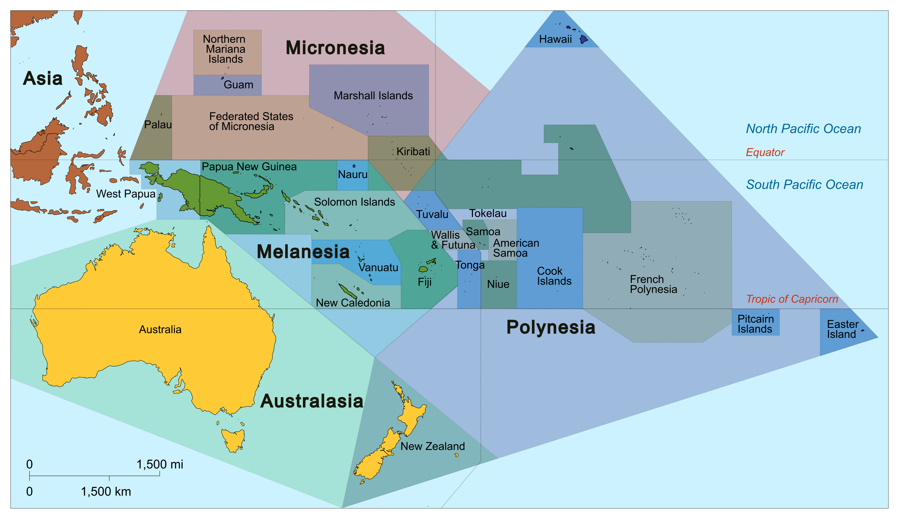

## Journal (5 min)

Choose one option and write silently. We'll hear from a couple of people afterward.

::: {.columns}
::: {.column width="50%"}
**Option A**

Think of a time you tried to communicate with someone who didn't share your language. What did you do to get your message across? What worked, and what didn't?
:::
::: {.column width="50%"}
**Option B**

What have you heard people say about Pidgin (Hawai'i Creole) or other "mixed" languages? Who said it, and what did they seem to think about the people who speak it?
:::
:::

::: {.notes}
~5 min: 4 min silent writing, then 1-2 volunteers share. Option A sets up the simplification/accommodation material; Option B plants the language-attitudes thread that returns in the Honiara section and on Thursday (Hawai'i Creole).
:::

## Reminders

**Writing Assignment 1 Final** is due **Friday, October 23 at 11:59pm**. Drafts and feedback are back, so revise from your comments.

**Midterm Exam** is **Tuesday, October 27**, in class and open-notes (no laptops). The review sheet is coming this week.

**Office Hours**: Wednesdays/Fridays 1:30-2:30pm in Moore Hall 574 or on Zoom

- If you can't make that time, email me to set up a different time.

::: {.notes}
Confirm before class: whether the midterm review sheet is posted, whether feedback is returned on Lamākū, and the Discussion Post #5 prompt and due date. Quiz #3 closed Monday, so it is not on this slide.
:::

## Today's Plan

1. Bridging a language gap: simplification and accommodation
2. What are pidgins and creoles?
3. Pidgins in Pacific history (pidgin Māori, Hiri Motu, plantation pidgins)
4. The Melanesian Pidgins and how Bislama grew into a creole
5. what Solomon Islanders say about Pijin
6. Bislama in Vanuatu's courts and classrooms
7. Looking ahead to Thursday: Hawai'i Creole

# Bridging a Language Gap

## Activity: Make It Easier (4 min) {.smaller}

**In pairs.** Which version of each sentence would be easier to understand for someone who is still learning English? Why?

1. (a) *You can utilize a blade to perforate the exterior.*
   (b) *Use a knife to poke holes in the outside.*
2. (a) *Samson explained that he hadn't seen that Delilah was holding some scissors.*
   (b) *Samson said this: Delilah was holding some scissors. He didn't see her.*

**Then, pairs:** rewrite *"I was supposed to meet him at the farmers market, but the bus was running late."* for a visitor who knows only basic English. What did you change?

::: {.notes}
Examples (1)-(2) are from Meyerhoff, p. 141. The (b) versions use everyday vocabulary and joined or juxtaposed simple clauses. Pull out the strategies students used: shorter sentences, plain vocabulary, dropping function words, adding gestures. Do not name the linguistic terms yet; the next slide does.
:::

## Two Strategies: Simplification and Accommodation {.smaller}

::: {.columns}
::: {.column width="50%"}
**Simplification**

- Plainer, non-technical vocabulary, avoiding dialect words
- Combining simple sentences with *and*/*but* (**coordination**), or just placing them side by side (**parataxis**)
- *That's not my teddy. His tummy is too shiny...*
:::
::: {.column width="50%"}
**Accommodation**

- Speakers **converge** on a compromise between their ways of speaking
- It shows up in speed, volume, vowels, sentence structure, and vocabulary
- You may have noticed that you slow down when talking with someone who talks slowly
:::
:::

> In radical contact, simplification and accommodation can produce **new, distinct varieties**: pidgins and creoles.

::: {.notes}
Meyerhoff, pp. 141-142. The chapter's points: yelling does not help; simplification and accommodation together explain how pidgins emerge. Callback to last Thursday's "Same Language, or Different?" slide: Tupaia and Cook's crew probably relied on simplified, gesture-assisted talk.
:::

## The Ocean as a Connector (optional) {.smaller visibility="hidden"}

- Many parts of the Pacific have been highly **multilingual** for centuries. The contact history is long, but we lack written records
- For many Pacific peoples, the ocean is **not a barrier**: currents connect islands, so people travel and meet speakers of other languages
- Two assumptions: in prehistory, people needed to **communicate across languages**, and they were **not so different from us**. If multilingualism is common today, it was probably common then
- Multilingual speakers choose languages for **social reasons**: courtesy to higher-status listeners, or the majority language in a large group

> **Discuss:** If people have always solved the problem of speaking across languages, what's different about the contact that produced *pidgins*?

::: {.notes}
Meyerhoff, pp. 142. Ties to Day 11 (the sea is often NOT a barrier; Telephone Tree) and to Jourdan & Angeli's "reciprocal multilingualism" later in the lecture. Setup for the next section: what changes in 18th/19th-century contact is the *social conditions* (time, motivation, power), not the ability of humans to communicate.
:::

# What Are Pidgins and Creoles?

## Creoles and Pidgins Around the World {.smaller}

:::{.columns}
::: {.column width="50%"}
**West Africa**

  - Nigerian Pidgin (75 million speakers)
  - Krio (Sierra Leone)

**The Caribbean**

  - Haitian Creole (Haiti, 10-12 million speakers)
  - Jamaican Patois
  - Papiamento (Aruba, Bonaire, Curaçao)
    - blends Portuguese, Spanish, Dutch, and English, along with African and Arawak elements
:::
::: {.column width="50%"}
**Asia**

  - Singlish (Singapore Colloquial English)
  - Chavacano (Philippines)
    - One of the oldest Spanish-based creole languages in the world, primarily spoken in the Zamboanga region of the Philippines, blending Spanish vocabulary with native Philippine languages

**The Pacific**
:::
:::

## Why Didn't Traders Learn the Local Languages? {.smaller}

Meyerhoff (citing Le Page & Tabouret-Keller 1985): three conditions for learning a language well

| Condition | Missionaries | Traders and plantation managers |
|---|---|---|
| **Motivation** | Strong (to convert people) | Profit, not communication |
| **Long exposure** | Years living in the community | Brief encounters, long gaps |
| **Regular use** | Full participation with speakers | Little chance to practice |

- Many incomers also assumed their culture was superior and were **reluctant to learn or accommodate**
- Later, as colonizers increased, locals were expected to accommodate, picking up basic competence in the **traders' language**

::: {.notes}
Meyerhoff, p. 143. The table condenses her argument; do not present it as her table. Emphasize the power dimension: pidgins are not "failed attempts to learn English," they are stable solutions to restricted communication needs. This sets up the colonial ideology material (Honiara) where "broken English" is the stock insult.
:::

## What Makes Something a Pidgin? {.smaller}

Meyerhoff gives three clues, using pidgin Māori as the example:

1. **Relatively stable norms**, even for a short time. You could rely on the same features from one trader to the next, months apart
2. **Restricted domains**: needed for business or trade, not for everyday family and community life
3. **Variation tied to speakers' first languages**: everyone has another dominant language, which can colour things like word order

**Pidgin:** a contact variety used by adults for **restricted purposes**, with no native speakers.

**Creole:** what happens when speakers use it in a **wider range of everyday domains** (jokes, arguments, chores, flirting) and **children acquire it from birth**. Many linguists treat that point, children acquiring a pidgin as a **first language**, as the moment it becomes a creole.

> **Discuss:** Which of these three clues would be hardest to see in the historical record? Why?

::: {.notes}
Meyerhoff, pp. 143-144, for the three clues. Pidgin/creole wording follows Meyerhoff, pp. 145-148: expanded domains plus children's acquisition; in practice, she notes, adult expansion and children's acquisition usually go hand in hand, so it is rarely possible to separate them. Matches the Oct 1 slide on creolization. Bickerton (1981) in the chapter: word-order variation reflecting speakers' L1s (Japanese SOV, Filipino languages VSO, Chinese/English SVO).
:::

## Activity: Read the Pidgin (5 min) {.smaller}

Early 19th-century **pidgin Māori** (recorded by Savage in 1807):

> ***Tungata nue nue kikie***
> *man big big eat*
> 'That man has plenty to eat'

Compare Standard Māori: ***He nui ngā kai a tēnā tangata.***

**In pairs:**

1. What do you notice about the pidgin version? Hint: look for **function words** (determiners, possessives)
2. What does *nue nue* ('big big') do? Where have we seen doubling in the Pacific?
3. Why would a trader find the pidgin version *easier* than the standard one?

::: {.notes}
Example (3) in Meyerhoff, p. 144 (quoting Clark 1990:103, Savage 1807). Features missing from the pidgin: determiners and possessive markers (tēnā, a). Reduplication ('big big') is a common intensifier across Pacific languages, including Melanesian Pidgin (we'll see lukluk in the Bislama text). Link to last Thursday: Tupaia and Cook; Drechsel (2014) suggests it's better to treat this as a general **Maritime Polynesian Pidgin**, not separate Tahitian and Māori pidgins.
:::

## What Does "Simple" Mean? {.smaller}

Pidgins are often called **simple**. Meyerhoff says to be careful:

1. **Simple for adult second-language learners.** Languages with complex sounds or grammar (Russian, tonal Cantonese) are *just as easy for children* to acquire. Pidgins are used by adults for specific purposes, so children aren't learning them as first languages
2. **Fewer productive rules.** Fewer overt function words and often no subordinate clauses: speakers use **parataxis** (chains of bare clauses)

- *The food that is for our dinner is on the table.*
- becomes: *The food is on the table; it is for our dinner.*

3. **Simplifying one thing complicates another:** more **ambiguity**, more **variation** between speakers, and a **processing cost** for decoding differences

> **Discuss:** Is "simple" the same as "broken"?

::: {.notes}
Meyerhoff, p. 145 (Trudgill 2011 for the point about children and complexity). Good moment to prepare the "broken English" attitude material coming up: pidgins are not failed English; they are stable systems that are simple *in specific respects*, for specific speakers.
:::

## Trading Languages Without Europeans {.smaller}

Meyerhoff: trading pidgins existed with **no European input**. Documented examples include trading varieties of **Drehu** (New Caledonia), **Pohnpeian** (FSM), **Fijian and Hindi** (Fiji), **Aleut**, **Chinook**, **Vietnamese**, **Yimas**, and **Tetun**.

**One famous case: Hiri Motu** (Papua New Guinea)

- The **hiri** was the annual trading voyage of the **Motu** people, about **200 miles** across the Gulf of Papua
- **Hiri Motu** was the form of Motu they used on those trips

> **Discuss:** What do trading varieties like Hiri Motu share with pidgin Māori, even though one has no European input?

::: {.notes}
Meyerhoff, pp. 144-145 (Hiri Motu citing Dutton and Brown 1977). Drechsel (2014) on a Maritime Polynesian Pidgin. Answer to the discussion: restricted domain (trade), stable norms, speakers with other first languages.
:::

## Why Did Some Plantation Pidgins Survive? {.smaller}

| Pidgin | What happened | Meyerhoff's explanation |
|---|---|---|
| **Melanesian Pidgin** (Tok Pisin, Pijin, Bislama) | Taken home from Australian plantations; stabilized and developed | Extensive linguistic diversity in Melanesia |
| **Samoan plantations** | Introduced, but did not last | Samoa is essentially monolingual |
| **Hawai'i** | Survived | Demographic and social-psychological reasons: a marker of **"local" identity** |
| **Chinese Pidgin English**, **Unserdeutsch** (pidgin German in colonial PNG) | Did not last | not discussed |

- Pidgin Māori and pidgin Hawaiian faded as locals shifted to pidginized English. In Hawai'i, that pidgin gained enough demographic support to continue; in Aotearoa, shift to English was much more substantial

> **Discuss:** Samoa lacked a language need that Melanesia had. What does that tell us about *why* pidgins survive?

::: {.notes}
Meyerhoff, pp. 144-145. The plantation pidgin used in Australia drew on a vehicular language further south in Australia, then was carried back to Melanesia. Connects to Day 11 (Samoa 1 indigenous language vs. Vanuatu ~100) and to Thursday's Hawai'i reading. Last row's explanation is not given in the chapter; say so if asked.
:::

# The Melanesian Pidgins

## Three Sister Languages {.smaller}

::: {.columns}
::: {.column width="55%"}
- **Tok Pisin** (Papua New Guinea), **Bislama** (Vanuatu), **Pijin** (Solomon Islands)
- Linguists treat them as varieties of one **Melanesian Pidgin**. English is the **lexifier** (the source of most of the vocabulary), but grammar and word-building come from Melanesian languages
- Their history is tied to the **plantation pidgin of Australia**, which drew on a vehicular language further south. Islanders recruited to work **Queensland sugarcane plantations** in the second half of the 19th century brought it home, where it **stabilized** and developed
- In the Solomons, it spread through **mission stations** (the South Sea Evangelical Church on Malaita) and **plantations** where language diversity was high
:::
::: {.column width="45%"}
{fig-alt="Map of the Pacific"}
:::
:::

::: {.notes}
Sources: Meyerhoff, p. 145 (plantation pidgin, lexifier); Jourdan & Angeli (2014), p. 268, drawing on Keesing (1988, 1990) (Queensland, mission stations). Day 11 and Oct 1 already covered the 19th-century plantation/trade origin and urbanization-creolization; the new details here are Queensland and the mission-station route. Schütz's Tok Pisin 3-5 million speakers figure was in the Oct 1 slides.
:::

## Activity: Read the Bislama (5 min) {.smaller}

From the **Bislama summary** of a 2025 article on Vanuatu school policy (Tarihehe & Willans):

> *Atikol ya hem i ripot blong wan stadi we i lukluk hao nao oli putum tugeta venakula edukesen polisi blong Vanuatu long ol selected skul long West blong Ambae.*

**Read it aloud with a partner.** Then:

1. Sound out each word. Which ones can you guess from English?
2. *lukluk* and *putum tugeta*: what are they built from?
3. How would you translate it? Then check the authors' English version on the next slide

::: {.notes}
From the Summary in Bislama in Tarihehe & Willans (2025), Te Reo 68(3): 71. Likely glosses (mine, not from the chapter): atikol = article; hem i ripot = it reports; blong wan stadi = of a study ('belong one study'); lukluk = look, examine (reduplication); putum tugeta = put together; venakula = vernacular; edukesen polisi = education policy; long = in/at; skul = school. Great moment to point out that Bislama is the written "everyday" language of the article summary: even an academic text can be in Bislama. Be careful: Bislama spelling is still variable and not fully standardized.
:::

## Authors' English Version

> This article reports on a study that investigated the implementation of Vanuatu's vernacular education policy in selected schools on West Ambae.

- Notice how much of the Bislama vocabulary is **English-derived** (*stadi*, *polisi*, *skul*), but the **grammar and word-building** are not English: an *i* marker before the verb, reduplication (*lukluk*), and *-um* on transitive verbs (*putum*)
- Question: is Bislama "broken English"? Hold that thought for the next section

::: {.notes}
English text from the paper's abstract (Tarihehe & Willans 2025). The grammatical points (agreement marker i, reduplication, transitive -um) are illustrated in Meyerhoff's examples (5)-(7), pp. 146-147, which the next section uses. This sets up the "broken English" ideology slide in the next section.
:::

# From Pidgin to Creole: Bislama

## How a Pidgin Expands {.smaller}

Meyerhoff's case study: **Vanuatu**. The plantation pidgin brought home from Australia **did not disappear**. Why?

1. **Work migration:** a growing plantation economy within Vanuatu brought people with different first languages together
2. **Social value:** the pidgin seems to have carried connotations of worldliness and experience abroad
3. **From instrumental to affective:** adults moved beyond getting tasks done to expressing **feelings and relationships**. Swearing appears early: *blari* 'bloody' is attested from the early 20th century
4. **Urbanization and intermarriage:** in **Port Vila** and **Luganville**, Bislama became the default town language, sometimes even on the islands in marriages across language groups
5. **National recognition:** after independence, Bislama was named the **national language** partly because it was **neutral**, belonging to no single group

> **Discuss:** Which of these five reasons also applies to Hawai'i Pidgin? Which doesn't?

::: {.notes}
Meyerhoff, pp. 146-148. "Instrumental vs. affective" functions: even task language is affective (if you like me you'll do business with me again). Bridges the Oct 1 "From Pidgin to Mother Tongue" slide, which covered urbanization. New here: the instrumental-to-affective expansion and the neutrality of Bislama as a national language.
:::

## Where Bislama Gets Its Grammar: The Substrate {.smaller}

The speakers' first languages form the **substrate** (*sub* 'beneath' + *stratum* 'layer'). Bislama has features that **don't occur in English** but match the **Eastern Oceanic** languages of Vanuatu:

| Feature | Bislama example |
|---|---|
| **Inclusive vs. exclusive 'we'** | *yumi* 'you and me' vs. *mifala* 'us but not you' |
| **Transitive suffix** *-em/-im/-um* | *singaot* 'call' vs. *singaotem* 'call (someone)' |
| **Reduplication for intensity or number** | *katkat-em bamboo* 'cut lots of bamboo' |
| **'Say' to introduce a clause** | *Mifala i talem **se** Jeni i stap* 'We said that Jenny was here' |

> **Activity (3 min, pairs):** Does English have an inclusive/exclusive 'we'? How do you ask *"Shall we go?"* if the other person is **not** coming?

::: {.notes}
Meyerhoff, pp. 146-147, examples (4)-(7). Tie back to Tuesday last week (Marshallese had two words for 'we', inclusive and exclusive: Bender). The point is that Bislama is not "English with the endings dropped": its grammar is built from the substrate. Example glosses from the chapter: AGR = agreement marker i; TR = transitive suffix.
:::

## What Did Children Add? {.smaller}

- Children who acquire a pidgin as a first language **regularize** variation and add features, including **dialect differences** among groups of speakers
- Evidence from Bislama on **Malo Island:** children made a clearer split between **third-person** pronouns and all others. First- and second-person subject pronouns are **kept more consistently** than in adult speech; both groups often drop third-person pronouns
- But: there is **remarkably little data** on children's creole acquisition, especially for ages 7-15, so it is hard to say any one feature was introduced *by children*

> **Discuss:** Meyerhoff argues adults *and* children both shape creoles. Why might the old story that "children invent creoles" be too simple?

::: {.notes}
Meyerhoff, pp. 147-148 (Figure 1). Do not overinterpret the pronoun figure; the chapter itself says the data are limited. Key claim: in practice adult expansion and children's acquisition go hand in hand.
:::

## Two More Creoles (optional) {.smaller visibility="hidden"}

::: {.columns}
::: {.column width="50%"}
**Zamboangueño (Chavacano)**

- A major **Spanish-lexified** creole in the Pacific region, around **Zamboanga City** (Philippines)
- Shows clear influence from its **Filipino substrate**
- Meyerhoff: the only Pacific creole she knows with **VSO** word order. Most are SVO
:::
::: {.column width="50%"}
**Tayo (New Caledonia)**

- Emerged around a **Catholic mission** near Nouméa, 1855-1880, where speakers of different languages and varieties of French came together, later joined by laborers from India
- French-lexified, with relative clauses that look like those of local languages (Cèmuhî, Nráa Drùbea), **but also like colloquial French**
:::
:::

> **Lesson:** a creole feature can have **several sources**: the lexifier, the substrate, and what is common across human languages.

::: {.notes}
Meyerhoff, pp. 148-150 (Corne 1994; Sankoff 1976). Also remind that the English, French, or Spanish that fed creoles was not the standard but dialectal or colloquial. Skip if time is short.
:::

# Returning to Language Ideologies in Honiara (Solomon Islands)

## Honiara: A Young City {.smaller}

Jourdan & Angeli (2014) study the **language ideologies** around Pijin in **Honiara**, capital of Solomon Islands.

- **Honiara** was created after WWII on Guadalcanal, on the site of a US army base. By 2014, about 65,000 people, more than half under 25
- **71 languages**, plus **English** (official language, language of school) and **Pijin** (de facto national language, no official status)
- **Two generations** of native Pijin speakers. Some children, especially from mixed marriages, **don't know their parents' ancestral languages**; Pijin is their mother tongue
- In schools, **literacy is acquired in English only**, and written public communication is in English

::: {.notes}
Jourdan & Angeli (2014), pp. 267-269. 64,609 is the estimate they report; 36,334 under 25. Pijin has been codified by Christian associations for Bible translation, and a full dictionary exists since 2002 (Jourdan 2002), but few people are literate in it. Honiara connects directly to the Oct 1 "From Pidgin to Mother Tongue" slide (urbanization → creolization): this is an up-close case study.
:::

## Four Language Ideologies {.smaller}

**Language ideologies** = culturally shaped attitudes about what language is, how it should be used, who should use it, and what it's worth. Jourdan & Angeli find four layers in Honiara:

| Ideology | When | Core idea |
|---|---|---|
| **Reciprocal multilingualism** | Precolonial | All vernaculars are equal; neighbors learn each other's languages; multilingual people earn prestige |
| **Hierarchical multilingualism** | Colonial | English on top; vernaculars called "dialects"; Pijin called "broken English" |
| **Linguistic pragmatism** | Throughout, now reshaped | Learn the language that gets you somewhere. Today, that's English as a global language |
| **Linguistic nationalism** | Recent | Local languages should be recognized and used in school; one nation, one people, one language |

::: {.notes}
Jourdan & Angeli (2014), pp. 270-276. Key framing: ideologies accumulate and compete, "like old shells filled with new meanings." Reciprocal multilingualism links back to François (Oct 1): no village outranks another, everyone learns neighbors' languages. Their distinction: *perceptions* (what people say) vs. *ideologies* (the underlying reasoning, often unconscious). Nationalism is described as influenced by European "one nation, one language" ideas; mention purism.
:::

## The Colonial Hierarchy {.smaller}

Colonial language ideology rested on three assumptions:

1. **"True" languages are written**: so unwritten vernaculars (and Pijin) don't count
2. **Purism**: change and mixing are "decay"; real languages are "natural" and unchanging
3. **Language shows civilization**: English was the language of progress; local languages were "backward"

Result: colonials called vernaculars **"dialects"**, called Pijin **"broken English,"** and expected it to be a temporary stage on the way to "proper" English.

> **Discuss:** Think back to *language vs. dialect* earlier in the course. Who gets to decide which one a variety is? Where have we seen the label used as a ranking?

::: {.notes}
Jourdan & Angeli (2014), pp. 271-272, citing Calvet (1979), Keesing (1990), Crowley (2000) on Vanuatu (once English, a written language, entered, local people were labeled illiterate and many devalued their own languages). Note the irony Jourdan & Angeli point out: from a long-term historical view, all languages (English most obviously) were born from contact. Callback: in Chuukic, the 70% 'language limit' is a technical, not a social, criterion.
:::

## Two Stock Phrases {.smaller}

Still part of "common sense" in the Solomons today (and in schools):

::: {.columns}
::: {.column width="50%"}
***Pijin hem broken English nomoa***

'Pijin is just broken English'

Based on the belief that Pijin came from a **failed attempt to learn English**. Many people say Pijin has **"no grammar."** Interviewers found that putting "Pijin" and "grammar" in the same sentence made people laugh
:::
::: {.column width="50%"}
***Pijin spoelem English***

'Pijin ruins English'

Based on the idea of **interference**: that you should speak *either* Pijin *or* "proper" English. People are not supposed to be bilingual in both
:::
:::

> **Discuss:** What evidence from today (pidgin Māori, the Bislama text) shows that Pijin and its relatives do have internal structure?

::: {.notes}
Jourdan & Angeli (2014), pp. 272-273. Interview data: 14 middle-aged professionals and civil servants, 27 Solomon students (19-25) at USP in Honiara and Suva, plus focus groups. The older elite were schooled where speaking Pijin was forbidden and often punished. Young educated Honiarans rarely challenge the stock phrase, even those who grew up with Pijin as a mother tongue. Make sure to name the point: "broken English" misunderstands what pidgins are (stable systems with their own norms).
:::

## What Young Honiarans Say Now {.smaller}

The hierarchy **remains**, but its **meaning has shifted**:

- English is no longer justified as "the language of civilization." Students say it's the language of the **global community**: university, jobs, international communication
- In practice, English is a **gatekeeper**: all national exams are in English, and university degrees must be completed abroad
- Nationalism: some argue Pijin is part of **national identity** and that urban children who speak only Pijin need recognition; others do **not** want Pijin used as the national or school language
- Jourdan & Angeli's puzzle: Pijin has **social legitimacy** (it's everyone's city language) but not **linguistic legitimacy**

> **Discuss:** Can a language be socially legitimate but not linguistically legitimate? Where might this describe *Pidgin* in Hawai'i?

::: {.notes}
Jourdan & Angeli (2014), pp. 274-277. This is a bridge to Thursday's Hawai'i Creole reading and to Discussion Post #5 if the prompt allows. Students' idea of English as a gatekeeper links back to Lynch's 'metropolitan' language and to Oct 1's two-school-system slide. The students interviewed are mostly second-language speakers of Pijin per the examples; the speakers named in the paper's quotes are not identified further, so don't treat them as real individuals in class.
:::

## Activity: Which Ideology? (6 min) {.smaller}

**In groups of 3-4.** For each statement, decide which of the four ideologies it reflects (reciprocal multilingualism, hierarchical, pragmatism, nationalism). Some may fit more than one: argue your case.

1. "If you want a government job, you need English. That's just how it is."
2. "Visitors should learn at least a few words of Pijin. It's polite."
3. "Pijin isn't a real language. It doesn't even have a grammar."
4. "Our school should teach in our own language. That's who we are."
5. "My cousin speaks four languages, and everyone respects her for it."
6. "The old people punished us for speaking Pijin at school, but now I use it with my friends."

**Then:** write a statement about *Hawai'i* you've heard, and decide which ideology it fits.

::: {.notes}
Original statements written for class, paraphrasing the ideologies in Jourdan & Angeli (2014); they are not quotes from the paper. Suggested answers: 1 pragmatism; 2 reciprocal multilingualism (Learning the local language is a mark of respect: p. 271); 3 hierarchical/colonial (the 'no grammar' belief); 4 nationalism; 5 reciprocal multilingualism; 6 hierarchical (older elite) + shift toward pragmatism. Discussion: statements often mix ideologies, which is exactly the authors' point: ideologies accumulate and speakers use them strategically.
:::

# Returning to Bislama at Work and in School

## Which Language Do People Understand Best? {.smaller}

Schneider, Gooskens, Kapelle & Antón-Méndez (2025): an **intelligibility study** in Vanuatu

- **Question:** do well-educated ni-Vanuatu understand spoken **English** as well as spoken **Bislama**, especially in professional settings (courts, business, education)?
- **Background:** about **89%** of written government communication is in English (7% Bislama, 4% French), yet **86%** of ni-Vanuatu respondents in one survey call speaking Bislama very important to national identity
- **Test:** 58 students at USP in Port Vila, compared with 55 Australian university students, who heard English varieties and Bislama sentences and answered comprehension questions
- **Findings:** ni-Vanuatu have much more exposure to Bislama, **prefer** it, feel **more confident** about it, and responded **more accurately** to Bislama sentences than to English ones

::: {.notes}
Schneider et al. (2025), Te Reo 68(3): 20-60. Percentages for government communication are from the 2019 Bulu report (Office of the Ombudsman) as cited in the paper; the 86% figure is from Mudaliar et al. (2024) as cited. The paper emphasizes the legal system, where English continues to dominate (a ni-Vanuatu legal scholar argued for using Bislama in the Supreme Court), and recommends modest strategies for giving Bislama greater prominence.
:::

## Discussion: What's at Stake?

> **Discuss (3 min):** If even well-educated ni-Vanuatu understand Bislama better than English, what does it mean that court judgments, tender documents, and government notices are written in English? Who benefits, and who is left out?

- Bislama is the language **most people speak**. English is the language of **official writing**
- This is the same gap Jourdan & Angeli describe in Honiara: **social legitimacy** without **official legitimacy**

::: {.notes}
Connect to Lynch's 'metropolitan language' (Ch. 7) and the Oct 1 Vanuatu two-parallel-school systems slide. Let students notice the equity argument: speakers of the dominant variety enjoy socio-economic advantages (the paper cites Labov 1966 and Bernstein 1971 for the general point).
:::

## Learning in Which Language? West Ambae {.smaller}

Tarihehe & Willans (2025) tested children in **two primary schools** on **West Ambae** (Vanuatu), in Years 1 and 4, in three languages: **Nduindui** (the local vernacular), **Bislama**, and **English**

::: {.columns}
::: {.column width="50%"}
**What they found**

- Strongest ability in **Nduindui**; **minimal English**; Bislama **mixed**
- Little difference between Year 1 and Year 4: **little new language acquisition** in the first three years of school
- In class, Nduindui carried **spoken** interaction, but **English** was the only language on the board
:::
::: {.column width="50%"}
**What people said**

- Teachers and communities **strongly support** the vernacular policy
- By Year 4 the vernacular was seen as something to **fall back on** when English was hard, not part of a growing **plurilingual repertoire**
:::
:::

::: {.notes}
Tarihehe & Willans (2025), Te Reo 68(3): 71-105. Trilingual picture-based language assessment; classroom observation; teacher interviews; community hunguhungu (talking sessions). Conclusion in the abstract: Nduindui was the most logical language for the principal medium of instruction in Year 1, and students were no more ready to use English for this purpose by Year 4. Ties back to the Oct 1 slide on Vanuatu's school system (Bislama or vernacular in Years 1-2; English or French from Year 3).
:::

## Activity: You Run the Ministry (10 min) {.smaller}

**Groups of 4.** You are advisers to Vanuatu's education ministry. Decide the **language of instruction** for **Years 1-3** and **Years 4-6**.

Use at least **three** pieces of evidence from today or earlier:

- Schneider et al.: understanding of Bislama vs. English
- Tarihehe & Willans: Nduindui, Bislama, and English in classrooms
- Jourdan & Angeli: the four ideologies (who will object, and why?)
- Lynch / Oct 1: Vanuatu has ~100 languages, so which vernacular?

**Report out (1 min each):** your recommendation, your strongest piece of evidence, and the strongest objection you expect.

::: {.notes}
Open-ended policy task. Good tension: with ~100 indigenous languages, vernacular education is hard to scale; Bislama is widely understood but has less prestige and fewer written resources; English and French are gatekeepers for secondary school and exams (and parallel school systems from the condominium). Possible outcomes: Bislama as a bridging language in lower grades; vernaculars in selected communities; explicit English instruction as a subject. Whatever groups pick, push on trade-offs and who is excluded.
:::

# Wrapping Up

## Putting It Together {.smaller}

| Stage | What it is | Example |
|---|---|---|
| **Contact** | Speakers of different languages need to talk | Traders, labour trade, plantations |
| **Pidgin** | Stable, restricted-use contact variety used by adults; no native speakers | Pidgin Māori; Hiri Motu; early Melanesian Pidgin |
| **Creole** | Used in everyday life and acquired by children from birth | Bislama (national language), urban Pijin, Tok Pisin |
| **Ideology** | Attitudes shape status, school, and law | "Broken English"; English as gatekeeper |

Meyerhoff's closing point: in many places, local creoles are still seen as **"bad" examples of English (or French or Spanish)**. People **fail to appreciate how systematic and complex** their structure is, and **fail to recognize their importance as symbols of local and personal identity**.

> **Exit ticket (3 min):** Pick one claim about pidgins or creoles that you believed before today. Did anything today challenge it? What's the evidence?

::: {.notes}
Chapter overview and today's new material in one table. Collect exit tickets or use as next Journal prompt. If time is short, cut the ideology row discussion and just collect the tickets.
:::

## For Thursday

- Read **Ch. 14 - The Origins of Hawaiian Pidgin** (Sakoda & Siegel)
  - Kent Sakoda will be coming to talk about Hawaiian Pidgin on Thursday, come prepared with questions
- Discussion Post #5 due **Wednesday, October 14 at 11:59pm**
- WA1 Final due **Friday, October 23 at 11:59pm**
- Midterm: **Tuesday, October 27**

::: {.notes}
Add the Lamākū link. Teaser question for the reading: what's the difference between how Hawai'i's pidgin and Honiara's Pijin gained speakers?
:::

## Activity: Build a Pidgin (20 min) {.smaller}

**Groups of 4:** two **Tavu** speakers and two **Dezi** speakers. These are **invented languages**: each pair gets a card with 20 words and a word order. Goal: **trade** (fish, yams, pigs, water for knives, cloth, shells).

| Round | Time | What you do |
|---|---|---|
| **1. No shared language** | 4 min | Trade using only your own language and gestures. No English. Note what happens |
| **2. Build the pidgin** | 6 min | Create a trade language of **at most 20 words**. Choose words (Tavu, Dezi, or new) and a **word order** |
| **3. Next day** | 4 min | One Tavu and one Dezi speaker **move to another group**. Trade using **only your pidgin**. What breaks? |

Use the **Pidgin Sheet**: for each concept, write the word *and* its source.

::: {.notes}
Materials: Build_a_Pidgin_Handout.docx (Tavu card, Dezi card, Pidgin Sheet, facilitator notes). Print one Tavu card and one Dezi card per pair. The two languages are built to differ in two ways that matter: word order (Tavu verb-final, Dezi verb-first) and 'we' (Tavu has an inclusive/exclusive distinction, Dezi has one word), mirroring Bislama's substrate features (Meyerhoff, p. 146). Timing: set up 2 min, rounds 4 + 6 + 4, then move to the debrief. Circulate in Round 2 and listen for: whose words win, whether the group chooses one word order, whether they keep kita/kami, and what they drop. Round 3 tests stability (Meyerhoff's first clue for a pidgin). If the room is small, make groups of 3 (one Tavu pair-speaker doubling up) or run two rounds only.
:::

## Build a Pidgin: Debrief {.smaller}

**Compare notes across groups** (5 min). Put these on the board:

| Question | Link to Meyerhoff |
|---|---|
| Whose words did you use, Tavu's or Dezi's? Why? | **Lexifier** and power: who has the advantage in contact |
| Which word order did you pick? Did anyone use both? | **Substrate** influence; variation tied to speakers' first languages |
| Did you keep two words for 'we'? | A feature that survives in **Bislama** (*yumi / mifala*) |
| What did you leave out (endings, little words)? | **Simplification**; fewer function words; **parataxis** |
| What broke in Round 3? | **Stability**: norms must hold across people and time |
| Could this pidgin handle a family argument or a joke? | **Restricted domains** |

> **Discuss:** What would have to happen for your pidgin to become a **creole**?

::: {.notes}
Ties each result to Meyerhoff pp. 143-148: stable norms, restricted domains, substrate influence, simplification and parataxis, and the creole step (everyday use and children acquiring it from birth). Likely patterns: groups pick one language's words for most nouns (often whichever pair spoke first or loudest), drop the inclusive/exclusive 'we' (sometimes keep it), and settle on verb-first or verb-last with variation across groups. Round 3 almost always reveals mismatches in word choice between groups, which is the point: stability takes time and shared use. Answer to the discussion question: wider domains of use (jokes, arguments, household talk) and children acquiring it as a first language.
:::

## Activity Bank (hidden) {visibility="hidden"}

Extra ideas if time allows or to swap in:

1. **Pidgin Charades (5 min):** pairs have no shared words and must explain a concept (e.g., "bus is late") using only gestures and 10 invented "pidgin" words. Debrief: which rules emerged?
2. **Build a Pidgin:** now a full activity in the main deck (see the Build a Pidgin slides and the handout).
3. **Gloss the Text (6 min):** word-by-word glossing of a short Tok Pisin/Bislama/Pijin sentence (bring a printed sample), with pairs finding English sources and Melanesian structural features.
4. **Language Attitude Poll (3 min):** hold up cards for "language," "dialect," or "broken" for different varieties (Hawaiian, HCE/Pidgin, Samoan, "Standard" English) and discuss disagreement.
5. **Honiara Role-Play (10 min):** assign roles (elder, university student, Pijin-only teenager, minister of education) and debate whether Pijin should be taught in schools.

::: {.notes}
Hidden slide. Remove the visibility attribute to show it. These activities need little prep. Pidgin Charades and Build a Pidgin work especially well for experiencing simplification, accommodation, and the emergence of norms.
:::
