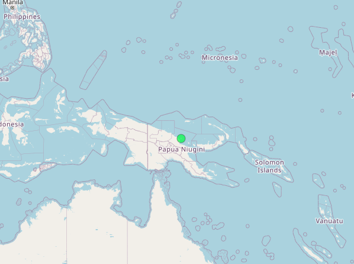
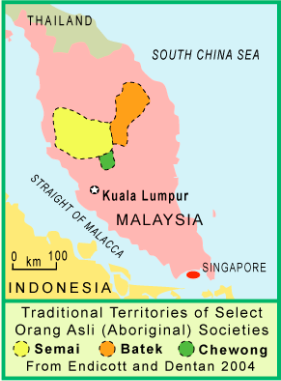
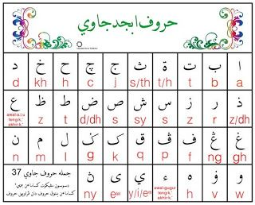
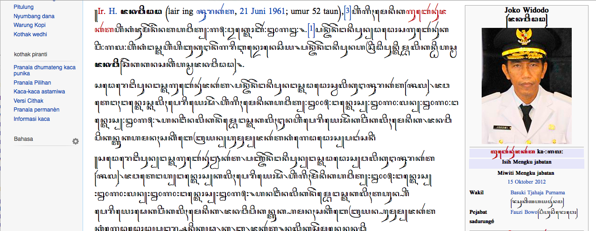
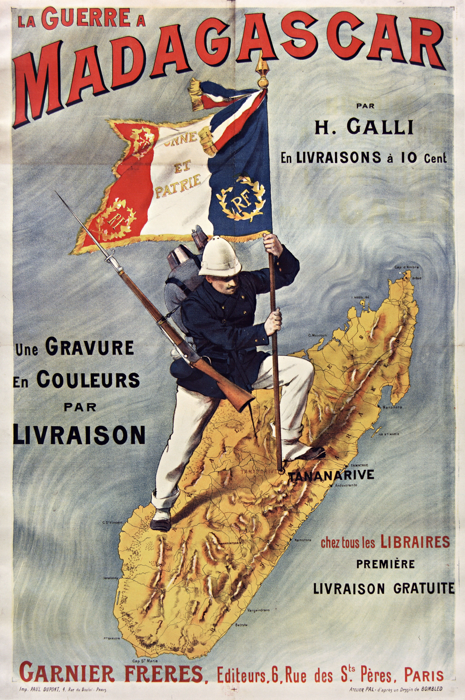

## Reminders

**Writing Assignment 1 Final** is due **Friday, October 23 at 11:59pm**.

**Quiz #4** opens **tomorrow** (Friday, October 23) and closes Monday, October 26 at 11:55pm. It includes **borrowing** (Ch. 15).

**Midterm Exam**: **Tuesday, October 27**, in class, open notes (no laptops). Weeks 1-8. **Borrowing is not on the midterm.**

**Final Paper Topic Idea** due next Friday 10/30

  - *~100-150 words identifying a topic or a few topics that you would be interested in pursuing.*

::: {.notes}
Confirm the review sheet is posted on Lamākū. Borrowing (Week 9) is excluded from the midterm per the syllabus ("through Week 8") but is on Quiz #4, so say both out loud.
:::

## Today's Plan

**Part 1: Finish borrowing (about 20 min)**

1. Review from Tuesday's WOLD lab
2. Language planning: nests, purism, and the Lexicon Committee
3. Putting it together

**Part 2: Midterm review (about 50 min)**

4. Format, rules, and what to put in your notes
5. Quick-fire recap, Weeks 1-8
6. Practice with data: sound correspondences, Bislama, a Hawaiʻi Pidgin timeline
7. Planning an essay together

# Part 1: Finishing Borrowing

## Warm-Up: What Did the Data Say? (3 min) {.smaller}

**In your group** (same language as Tuesday), take 2 minutes to find on your worksheet:

1. Your language's **% clearly borrowed**
2. Its **biggest donor**, and **why** that language was the donor
3. One **surprise**

Remind yourself of what you found, and briefly discuss comparisons with what other groups shared on Tuesday

::: {.notes}
Students need their Tuesday worksheet (Google Doc copy). If a group lost theirs, they can re-open the language page: Hawaiian wold.clld.org/vocabulary/30, Takia 29, Indonesian 27, Malagasy 28, Ceq Wong 26. Expected numbers are on the next slide's notes.
:::

## Report-Out: What Patterns Do We See? {.smaller}

| Language | % clearly borrowed | Top donor and why | Surprise |
|---|---|---|---|
| Hawaiian | | | |
| Takia | | | |
| Ceq Wong | | | |
| Indonesian | | | |
| Malagasy | | | |

> **Discuss:** Which language borrowed the most? Which donor languages are **not** European? What do the eight comparison meanings have in common?

::: {.notes}
Fill in the table on the board as groups report (about 1 minute each). ANSWERS / TALKING POINTS: Hawaiian 12.7% (English, plus Greek and Hebrew via missionary translation, Māori and others via the Lexicon Committee); Takia 23.1% (English, Tok Pisin, neighboring Bargam and Gedaged); Ceq Wong 33.6%, about 95% of its loans from Malay (302 of 318); Indonesian 30.2% (Sanskrit, Dutch, Arabic, Javanese); Malagasy 12.5% (French 89, Malay 45, English 26, Bantu 17). Which borrowed the most? Ceq Wong by percentage (33.6%), then Indonesian (30.2%); Indonesian has the most loans in total (617). Non-European donors: Sanskrit, Arabic, and Javanese for Indonesian; Malay and Bantu languages for Malagasy; Malay for Ceq Wong; Bargam and Tok Pisin for Takia. Common pattern of the eight meanings: cattle, bread, money, school, and tea (introduced things) are borrowed nearly everywhere; mother, hand, and to eat (body, kin, basic verbs) mostly are not. Surprises students may find: Hawaiian words from Ute (kokeiʻa 'prairie dog'), Takia makao 'cattle' from Pacific Pidgin English "bulmakau," Indonesian sapi 'cattle' from Javanese, Malagasy kisoa 'pig' from French cochon, Malagasy akoho 'chicken' from Comorian (Bantu).
:::

## What the Database Shows {.smaller}

| Language | Clearly borrowed | Biggest donors |
|---|---|---|
| Hawaiian | 12.7% | English, Greek, Māori |
| Takia | 23.1% | English, Tok Pisin, Bargam |
| Ceq Wong | 33.6% | Malay (95%) |
| Indonesian | 30.2% | Sanskrit, Dutch, Arabic |
| Malagasy | 12.5% | French, Malay, English |

> **Patterns:** introduced things are borrowed; **body parts and kin words mostly are not**; the donor depends on **who the language was in contact with**.

::: {.notes}
Summary after the report-out. Source: WOLD (checked against the online site for Hawaiian; other values from the downloaded database). Same pattern as Geraghty (p. 170) and Tadmor et al. (2010): nouns first, then verbs and adjectives, then function words. The type of word shows the type of relationship: Ceq Wong's heavy borrowing from Malay shows very close, long contact; Hawaiian's English and Greek loans show the missionary and colonial period. Link back to the cow and beef slide: the animal word and meat word again (Hawaiian pipi from English beef).
:::

---

{fig-alt="Map of Papua New Guinea and neighboring islands with a green marker"  fig-align="center" height="520px"}

::: {.notes}
Takia (WOLD id 29): 23.1% clearly borrowed, mainly English (186) and Tok Pisin (68), then neighboring Bargam (18) and Gedaged (11). Ask: why English and Tok Pisin? Talking points: Takia is spoken on Karkar Island off the north coast of Papua New Guinea; WOLD's contact situations include "Contact with the Western world," "Bible teaching," and "Bilingualism in Bargam." Tok Pisin is the lingua franca of PNG (callback to the pidgin unit), and Bargam is a neighboring language on the island. Check the map marker against Karkar Island (off the Madang coast) before class: the green dot looks like it sits inland on the mainland.
:::

---

{fig-alt="Map of Peninsular Malaysia showing traditional territories of Semai, Batek, and Chewong Orang Asli groups" fig-align="center" height="560px"}

::: {.notes}
Ceq Wong (WOLD id 26): 33.6% clearly borrowed, 302 of the 318 loans from Malay (about 95%). The map shows the traditional territories of Orang Asli (Aboriginal) societies in Peninsular Malaysia (Semai, Batek, Chewong; from Endicott and Dentan 2004); Ceq Wong is an Aslian (Austroasiatic) language of the same region (the map labels Chewong, and Ceq Wong is a closely related name, so check the spelling you want to use). Ask: why would an Aslian language borrow so heavily from Malay? Talking points: Malay is the national and dominant language of Malaysia, and Orang Asli communities live in close, daily contact with Malay speakers (trade, schools, administration). That is intimate borrowing: even verbs are borrowed (about 31% of Ceq Wong verbs). Malay is itself Austronesian, so this is Austronesian vocabulary in a non-Austronesian language.
:::

---

::: {.columns}
::: {.column width="20%"}
{fig-alt="Chart of the Jawi (Arabic-based) alphabet with Latin transliterations" width="100%"}
:::
::: {.column width="80%"}
{fig-alt="Javanese-language Wikipedia page written in the Javanese script" width="100%"}
:::
:::

::: {.notes}
Indonesian (WOLD id 27): 30.2% clearly borrowed, 617 of 2,046 core entries; donors Sanskrit (143), Dutch (106), Arabic (94), Javanese (62). Left: Jawi, the Arabic-based script used to write Malay; it came with Islam, which also brought Arabic vocabulary. Right: the Javanese script on the Javanese Wikipedia (an article about Joko Widodo); the script itself descends from Indian (Brahmic) writing, which is the same contact history that brought Sanskrit words. Ask: what do two writing systems tell us about who Indonesian speakers were in contact with? Talking points: Sanskrit from long Indian trade and religious contact (Hinduism and Buddhism), Arabic through Islam and trade, Javanese from the dominant neighboring language, Dutch from colonial rule. Religion, law, and clothing are among the most borrowed domains in Indonesian.
:::

---

{fig-alt="1890s French poster 'La Guerre a Madagascar' showing a French soldier planting a flag on a map of Madagascar" fig-align="center" height="620px"}

::: {.notes}
Malagasy (WOLD id 28): 12.5% clearly borrowed; French 89, Malay 45, English 26, Bantu 17. The poster, "La Guerre à Madagascar" (a French illustrated book advertisement; the date is not on the poster, so check before you give one), shows a French soldier planting the flag at Tananarive. Ask: how does this image explain why French is the top donor? Talking points: French colonization (WOLD codes about 89 loans as "French colonization"); Malagasy kisoa 'pig' is from French cochon and sekoly 'school' is borrowed, though cattle, money, and mother have native words. Colonial contact brought institutions and introduced things, not core vocabulary. Also point out that Malay and Bantu donors come from much earlier contact (WOLD lists "before the migrations to East Africa" for about 60 loans); the poster shows only the latest layer. A colonial propaganda image: you may want to say that this is how France presented the conquest to its own public.
:::

# Who Decides? Language Planning

## Language Nests and the Purist Turn {.smaller}

**Language planning** = making and enforcing decisions on language use: education, writing systems, translators, and **which words to use for new concepts**.

- In the 1800s, nearly all Pacific language planning was done by **religious organizations**
- Hawaiian and Māori seemed headed for extinction ~50 years ago. Activists set up immersion preschools, **language nests**: *kōhanga reo* (Aotearoa, 1982) and **pūnana leo** (Hawaiʻi, 1983), which grew into schools and universities
- Adults wanted to use the language at **home and work**, so they needed **thousands of new words**. The **Polynesian Languages Forum** (1991) coordinated this
- Most activists wanted to **distance** the language from colonial languages: avoid loans as much as possible, build words by **compounding and expansion**

**Computer:** *kamepiula* (loan) or ***lolouila*** (*lolo* 'brain' + *uila* 'electricity')? **Māori:** ***rorohiko*** (*roro* 'brain' + *hiko* 'spark').

> **Debate (3 min):** Is a "purist" policy good for a small language, when borrowing is a **natural** process?

::: {.notes}
Geraghty, pp. 173-174 (section 11); also see Schütz (1994:361-377) for Hawaiian and Holmes (2001), Harlow (2004) for Aotearoa. Māmaka Kaiao lists *lolouila* ('computer', lolo + uila) alongside *kamepiula*, and Harlow's chapter in Tent & Geraghty (2004) lists Māori *rorohiko*. DISCUSSION POINTS (no single answer): for purism: identity, distance from colonialism, transparency (*lolouila* explains itself), and learnable vocabulary for children in immersion schools. Against purism: borrowing is natural, speeds up coining, and keeps the language connected to the everyday life of speakers who also use English. The next slide shows the Hawaiian Lexicon Committee's own guidelines, a practical middle path.
:::

## How Does a Committee Make a Word? {.smaller}

The **Hawaiian Lexicon Committee** (founded **1987**; kūpuna and native speakers from the start) meets 4-6 times a year. Every word must be approved at **two meetings**. Their dictionary, *Māmaka Kaiao*, records ten strategies:

| Strategy | Example |
|---|---|
| Describe the concept in Hawaiian words | *uila mahu pele* 'geothermal electricity' ('electricity-steam-volcano') |
| Combine words | *poelele* 'satellite' (*poe* 'buoy' + *lele* 'fly'); *hamulau* 'herbivore' (*hamu* 'to chew' + *lau* 'leaf') |
| Shorten and combine | *ikehu* 'energy' (*ika* 'strength' + *ehu* 'lively') |
| Add affixes | *kalaianiau* 'climatology' (*kalai-* 'study of' + *aniau* 'climate') |
| Extend an old word | *haumia* 'pollution' (old word 'defiled, unclean'); *hoʻoili* 'download' (*hoʻo-* 'cause' + *ili* 'transfer'; also 'transplant') |
| **Borrow from another Polynesian language** | *pounamu* 'jade' (Māori); *makahiʻo* 'explore' (*maka* 'eye' + Tahitian *hiʻo* 'look') |
| **Hawaiianize a foreign word** | *naelona* 'nylon'; *kaimine* 'saimin' (Japanese); *kokeiʻa* 'prairie dog' (Ute); *ʻōmā* 'lobster' (French *homard*) |

> **Discuss:** The committee **builds first** but still **borrows**. Is that purism? What would you call it?

::: {.notes}
From the English introduction to *Māmaka Kaiao* (Hawaiian Lexicon Committee; 2003 edition, with the vocabulary created 1987-2000). The introduction lists ten guidelines; the table gives seven. Others: make minor changes to an existing word (adding a kahakō), record words native speakers already use, and use reduplication (*ulialia* 'coincidence'). ANSWER / TALKING POINT: it is a pragmatic mix, not strict purism. The committee prefers Hawaiian resources, then other Polynesian languages, and only then Hawaiianizes non-Polynesian words. This is the "build or borrow" choice made by a community committee instead of missionaries. The component glosses on the table: *poelele* ('flying buoy'), *hamulau* (hamu + lau), *kalaianiau* (kalai- + aniau), *haumia* and *hoʻoili* (existing words with extended meanings) are from the dictionary entries in Māmaka Kaiao; *ika* 'strength', *ehu* 'lively', *hamu* 'to chew', and *ili* 'transfer' are from general Hawaiian knowledge, so check them against Pukui and Elbert before class. WOLD's Hawaiian list includes many committee words as loans (source "Kōmike Huaʻōlelo 2003"), e.g., *puolo* 'music' from Māori *puoro*.
:::

## Activity: You Are the Lexicon Committee (6 min) {.smaller visibility="hidden"}

**Groups of 3-4.** Choose **one** language you know (or Hawaiian, Pidgin, or Samoan) and **one** new concept:

*smartphone · WiFi · podcast · social media · ghost pepper*

1. **Decide:** borrow, compound, extend an old word, or calque?
2. **Propose** the word and why it works
3. **Predict** who will use it, and who will resist

> **Think about:** Is a word "real" if the community doesn't accept it?

::: {.notes}
Hidden: use only if the group is ahead of schedule. Sample answers: smartphone: borrow (adapted to the language's sounds) or compound ('pocket brain'); WiFi: borrow (*waifai*) or compound ('air connection'); podcast: calque or compound ('sound show'); ghost pepper: compound or semantic expansion. A coinage becomes a word only if speakers use it; many committee-coined words never catch on. The missionaries' attempt to add /b d r s t/ to Hawaiian failed: speakers did not accept them (*raisi* is pronounced /laiki/).
:::

## Putting It Together: Borrowing {.smaller}

| Question | Answer |
|---|---|
| What is borrowing? | Sounds, words, endings, structures, meanings copied from another language; not code-switching |
| Why borrow? | **Needed** (new things) or **intimate** (close contact); also **prestige** |
| What are the alternatives? | Compounding, semantic expansion, calques |
| What happens to loans? | Sound adaptation, **semantic shift**, **reanalysis** |
| What gets borrowed? | Nouns > verbs/adjectives > function words; introduced things (WOLD data); body and kin words mostly not |
| Who decides? | Missionaries, communities, language planners: borrow or build? |

> **Exit ticket (2 min):** Pick one loanword (from Tuesday, or one you use). What does it tell us about the relationship between the two languages, and how was it adapted?

::: {.notes}
Terms that could appear on Quiz #4: borrowing, loanword, calque, code-switching, semantic expansion, compounding, semantic shift, reanalysis, etymological borrowing, intimate vs. cultural borrowing. SAMPLE EXIT-TICKET ANSWERS: (a) *pipi* (Hawaiian) from English *beef*: cattle came through contact with English speakers; /b f/ became /p p/ and a final vowel was added; the meaning extended from meat to the animal. (b) *Kula* 'school': a missionary-era loan; a vowel was added after the final consonant. (c) *Pork* in English: French-derived, showing French-speaking elites ate the meat. Accept any loan with a reasonable claim about the contact and a sound or meaning change.
:::

# Part 2: Midterm Review

## The Exam: Format and Rules {.smaller}

**Tuesday, October 27, in class.** Weeks 1-8. **100 points.**

| Part | What it looks like | # of Q | Time |
|---|---|---|---|
| **A. Quick questions** | Multiple choice, true/false, fill-in | 12 | 10 min |
| **B. Short answer** | 2-4 sentences each | 11 | 25 min |
| **C. Working with data** | Word list, a Bislama sentence, a Hawaiʻi Pidgin timeline | 3 | 20 min |
| **D. Essay** | Choose 1 of 3, two to three paragraphs | choose 1 of 3 | 20 min |

- **Open notes:** handwritten or printed. **No** laptops, phones, textbook, or internet
- **Not on the exam:** Ch. 15 (borrowing)

::: {.notes}
Matches the Midterm Review Sheet on Lamākū. If the class period is shorter than 75 minutes, tell students the actual timing. Answer logistics questions here: where to sit, what to bring (pen, notes), makeup policy per the syllabus. Do not describe specific exam questions beyond the review sheet.
:::

## What to Put in Your Notes {.smaller}

**One page per week works well.** For each reading and lecture:

1. **Key terms**, each with a one-line definition
2. **One example** for each concept (a word, a language, a sentence)
3. **The "so what"**: the author's main claim in one sentence

**Two pages worth building:**

- A **timeline** of Hawaiian Pidgin
- A **comparison chart**: Vanuatu vs. Samoa (the three factors for diversity)

> **Remember:** open notes help you *find* an answer, not *write* one. Practice answering **without** looking.

::: {.notes}
From the review sheet's study tips. Emphasize that students who rely on notes without practicing run out of time (75 minutes total, about 20 minutes for Part C).
:::

## Weeks 1-4: Can You Explain...? {.smaller}

::: {.columns}
::: {.column width="50%"}
**Weeks 1-2: Geography and Austronesian**

- Where are Pacific languages concentrated, and why does it matter?
- How far does Austronesian stretch? Where does it come from?
- What is **Oceanic**, and how does it relate to Austronesian?

**Week 3: Historical linguistics**

- **Proto-language**, **subgroup**, **family tree**
- **Shared innovation** vs. **shared retention**: which proves a subgroup?
:::
::: {.column width="50%"}
**Week 4: Sounds and grammar**

- **Phonemes** and typical Pacific sound inventories
- **Inclusive vs. exclusive "we"**: what is it, which languages have it?

**Weeks 5-6: Comparison and diversity**

- **Cognate** vs. **borrowing**; **regular sound correspondences**
- Why "**Papuan**" is a label, not a family
- Lynch's **four categories**; three factors for **diversity**; **reciprocal multilingualism**
:::
:::

::: {.notes}
Self-check slide: give students 2 minutes to find each item in their notes and mark any they cannot answer. Answers (from the review sheet topics and the course readings): Austronesian runs from Madagascar to Rapa Nui and originates in Taiwan; Oceanic is a subgroup of Austronesian; a shared innovation (a change not found in other related languages) is evidence for a subgroup, while a shared retention is just an old feature that several languages kept; inclusive "we" includes the listener, exclusive "we" does not (Marshallese, Bislama yumi/mifala); "Papuan" is a negative label for non-Austronesian languages of the region, not a family; Lynch's categories are indigenous, metropolitan, pidgin/creole, and immigrant; the three factors are time, separation (social and geographic), and social structure. Weeks 1-4 content: check against your lectures; I did not have those decks.
:::

## Weeks 7-8: Can You Explain...? {.smaller}

::: {.columns}
::: {.column width="50%"}
**Week 7: Micronesia and Polynesia**

- **Culture area** vs. **language family**
- Which Micronesian languages are **not** Oceanic? The **Japanese layer** in Palauan
- The **Polynesian family tree**: Tongic, Nuclear Polynesian, Samoic-Outlier, East Polynesian
- **Polynesian expansion**; where was Hawaiʻi settled from?
:::
::: {.column width="50%"}
**Week 8: Pidgins and creoles**

- **Pidgin** vs. **creole**; **lexifier**; **substrate**
- "**Simple** is not **broken**": parataxis, function words, ambiguity
- **Bislama, Tok Pisin, Pijin**
- **Four language ideologies** in Honiara
- **Hawaiʻi:** Pidgin Hawaiian, Pidgin English, the creole (about 1905-1920); Hawaiian, Cantonese, Portuguese, and Japanese influence
- **Attitudes towards Pidgin** 
:::
:::

::: {.notes}
Same procedure: 2 minutes to check notes. Week 8 is the heaviest part of the exam (about 40 points plus two essay options), so make sure to say that. Answers drawn from the review sheet: the Micronesian languages that are not Oceanic are Chamorro and Palauan (see your Oct 6 deck); Pawley's grammatical evidence showed that Polynesian languages do not divide into simple western vs. eastern groups, so geography is a poor guide to subgrouping.
:::

## Quick-Fire Recap (5 min) {.smaller}

**With a partner. 20 seconds each. No notes.**

1. What is the strongest evidence that two languages are **related**, not borrowed?
2. A change shared by some languages but not others is a shared ______.
3. Match: *Hawaiian*, *Tok Pisin*, *English in Fiji*, *Fiji Hindi* to Lynch's categories.
4. Which factor explains diversity if groups stay **apart** for a long time?
5. A pidgin has no ______ speakers.
6. Which language shaped Pidgin's grammar more: Japanese or Portuguese?
7. What do *yumi* and *mifala* show (first person plural pronouns in Melanesian English Creoles; we)?

::: {.notes}
ANSWERS: (1) regular sound correspondences across many basic words (not a few similar-sounding words); (2) innovation; (3) Hawaiian is indigenous; Tok Pisin is pidgin/creole; English in Fiji is metropolitan; Fiji Hindi is immigrant (Fiji Hindi arose from indentured laborers; some textbooks also treat it as a creole-like koiné, so accept a justified answer); (4) separation (and time); (5) native; (6) pidgins can develop with no European input; (7) Portuguese, despite the much larger Japanese group (look up the reasons in your Oct 15 slides and Sakoda & Siegel; I did not include them here); (8) the inclusive/exclusive "we" distinction, probably from the Oceanic substrate languages of Vanuatu, which shows that Bislama's grammar is not English with endings dropped. Note: question 3's Fiji Hindi answer is the one most likely to produce debate. Use five minutes total, then take a few volunteers.
:::

## Practice 1: Sound Correspondences (7 min) {.smaller}

| Gloss | Hawaiian | Samoan | Tongan | Māori |
|---|---|---|---|---|
| fire | ahi | afi | afi | ahi |
| blood | koko | toto | toto | toto |
| canoe | waʻa | vaʻa | vaka | waka |
| five | lima | lima | nima | rima |

**In pairs:**

(a) State **two** regular correspondences between Hawaiian and Samoan.
(b) Hawaiian *kalo* 'taro': predict the Samoan form, and explain.
(c) Are these words **cognates** or **borrowings**? Give **one** reason.
(d) What would make you **suspect borrowing** for one word?

::: {.notes}
This is a practice set, not an exam item. Verify the Tongan, Māori, and Samoan forms against your lecture slides before class (the forms here are standard comparative Polynesian data from general knowledge, not from your decks). ANSWERS: (a) Hawaiian h : Samoan f (ahi : afi); Hawaiian k : Samoan t (koko : toto); also Hawaiian w : Samoan v (waʻa : vaʻa), and Hawaiian ʻ (glottal stop) matches Samoan ʻ in some words. (b) Samoan *talo*: apply k : t; the other sounds match (l = l, a = a, o = o). (c) Cognates: the same correspondences hold across several basic words (fire, blood, canoe, five), which is regular, so it is inheritance from a common ancestor, not copying. (d) Suspect borrowing if a word breaks the regular pattern (for example, Hawaiian *k* matching Samoan *k*), if it names a recent or introduced thing, or if it sits outside basic vocabulary; borrowing can also produce regular matches (see the etymological borrowing example from Tuesday's hidden slides), so combine with other evidence. Tell students to explain their reasoning aloud to a partner.
:::

## Practice 2: Reading Bislama (7 min) {.smaller}

> *Mifala i talem se Jeni i stap.*
> 'We said that Jenny was here.'

> *Yumi go.* ('Let's go: you and me') vs. *Mifala i go.* ('We go: not you')

**In pairs:**

(a) Which words come from **English**? Which grammar is **not** English?
(b) What is the *i* before the verb? What is *se*?
(c) Which "we" is used in the first sentence? Why does that matter?
(d) Someone says "**Bislama is just broken English.**" Answer in two sentences.

::: {.notes}
Example from Meyerhoff, pp. 146-147 (examples (4)-(7)); the second line is built from the *yumi* / *mifala* distinction on the substrate slide (pidgins.qmd), not quoted from the chapter, so check it against your slides. ANSWERS: (a) English-derived: *talem* (tell + -em), *se* (say); not English: the *i* agreement marker before the verb, the transitive suffix *-em*, and *se* used to introduce a clause. (b) *i* is a predicate (agreement) marker before the verb (Meyerhoff glosses it AGR) that matches Oceanic languages of Vanuatu, not English; *se* ('say') introduces a clause, as in many Oceanic languages. (c) *Mifala* is the exclusive "we" (the listener is not included), a distinction English lacks, which shows the substrate shaped Bislama's grammar. (d) Bislama has its own grammar, built from Vanuatu languages as well as English vocabulary, so it is not English with errors; "broken" is an attitude, not a linguistic description (Meyerhoff: "simple" is not "broken").
:::

## Practice 3: From Pidgin to Creole in Hawaiʻi (7 min) {.smaller}

| Date | Event |
|---|---|
| 1835 | First sugar plantation opens. Hawaiians still rule; **Hawaiian** is the language of government and of schooling for non-European children |
| 1852-76 | About 2,000 laborers from China arrive (mostly Cantonese speakers) |
| 1878-87 | More than 10,000 laborers from Portugal arrive |
| 1884-1924 | Over 200,000 laborers from Japan arrive |
| About 1900 | The first locally born Chinese and Portuguese children appear; many are spoken to in Pidgin English as newborns |
| 1920-30 | Locally born children of immigrants equal, then outnumber, the foreign born |

**In pairs:**

(a) Which language was the basis of the **first** plantation pidgin? What in the timeline explains that?
(b) Give **one** piece of evidence that a **creole** existed by about 1920. What makes it a creole, not a pidgin?
(c) A friend says "Pidgin never changed: it's just plantation English." Use the timeline to answer in **two sentences**.

::: {.notes}
Practice item built from the Oct 15 deck (Sakoda & Siegel, pp. 153-157); no Hawaiian or Pidgin reading is needed, so it tests concepts instead of language skills. ANSWERS: (a) Hawaiian: Hawaiians still ruled in 1835, and Hawaiian was the language of government and of schooling for non-European children, so it became the language used to run the plantations (Pidgin Hawaiian came first, then English-based pidgin). (b) Locally born children acquiring it from birth (about 1900 onward, and by 1920-30 locally born children equal or outnumber the foreign born): a creole has native speakers and a full range of functions, while a pidgin is learned as a second language and used in limited situations. (c) It changed in stages: Hawaiian-based pidgin, then English-based pidgin, then a creole spoken as a first language by children who added new grammar (for example *never*, *stay*, *for*). It is its own language with its own grammar, not "English with errors." Optional extension: why did Portuguese influence the grammar more than the larger Japanese group? (Use the Oct 15 deck.)
:::

## Planning an Essay Together (8 min) {.smaller}

**Prompt:** How can linguists use language evidence to work out how Pacific peoples spread across the islands? Use **at least two kinds** of evidence and **two examples**.

| Piece | What goes here | Source to use |
|---|---|---|
| **Thesis** | What language can (and cannot) tell us | |
| **Evidence 1** | Regular sound correspondences: relatedness, not borrowing | |
| **Evidence 2** | Shared innovations: subgroups and the family tree | |
| **Example** | Austronesian from Taiwan; the Polynesian tree; Pawley (1966); Outliers | |
| **Limits** | Geography, culture areas, and "Papuan" are not language families | |

> **Rule of thumb:** each paragraph = one **claim**, one **example**, one **"so what."**

::: {.notes}
Chosen so it is not one of the three exam essay options (Melanesian vs. Polynesian diversity; "Pidgin is just broken English"; Bislama vs. Hawaiian Pidgin). It pulls from Weeks 1-3, 5, and 7. Fill in the table on the board with the class. Sample answers: Thesis: regular patterns in vocabulary and shared changes let linguists reconstruct family trees and the order of settlement, but language evidence must be combined with archaeology and cannot be read off a map. Evidence 1: regular sound correspondences (Hawaiian k : Samoan t, h : f) across many basic words show common descent; a few look-alike words could be borrowing. Evidence 2: a shared innovation, not a shared retention, shows a subgroup; this gives the tree (Tongic, Nuclear Polynesian, Samoic-Outlier, East Polynesian). Example: Austronesian stretches from Madagascar to Rapa Nui and is traced to Taiwan; Pawley (1966) showed Polynesian languages do not split into simple western vs. eastern groups; Polynesian Outliers sit far from where their relatives are. Limits: culture areas (Micronesia, Polynesia, Melanesia) do not line up with language families; "Papuan" is a negative label, not a family; mutual intelligibility is not the same as shared cognates. Check each point against your Weeks 1-7 lectures.

HOW TO RUN IT (8 min). Do not teach the five-paragraph essay: the exam essay is two to three paragraphs, so use one paragraph pattern (claim, example, so what). (1) Read the prompt and underline the verbs (1 min): "use evidence" and "at least two kinds" are the grading criteria; a specific thesis plus specific evidence beats length. (2) Thesis (1.5 min): one sentence that answers the prompt, not one that repeats it. Weak: "Language tells us a lot about how people moved." Stronger: "Regular sound correspondences and shared innovations let linguists reconstruct how Polynesia was settled, but they work best alongside archaeology." Take one or two volunteer attempts. (3) Fill the table with the class (3.5 min): cold-call a pair per row, or give each pair two rows; for each row ask "where in your notes is this?" (open notes help you find an answer). (4) Map it to two or three paragraphs (1 min): thesis + Evidence 1 + example = one paragraph; Evidence 2 + example = a second; limits + "so what" = a third, or folded into the second if time is short. (5) Time check (1 min): the essay is worth 20 points and gets about 20 minutes: about 3 to plan, 15 to write, 2 to reread. The most common mistake is writing without planning, which leads to a repeated point or a missing example.

ALSO SAY: name the evidence ("Hawaiian k : Samoan t" beats "the languages are similar"). Point at the exam's three real options and tell them to spend 2 minutes choosing, not 10. Homework: outline one of the three actual options (or this one) without notes, then check against the review sheet; don't outline an actual option in class, since that would leak exam content. If they finish early: 90 seconds to underline in their notes which row was hardest to fill.
:::

## Your Plan for the Weekend {.smaller}

1. Build the **Pidgin timeline** and the **Vanuatu vs. Samoa chart** for your notes
2. **Before Tuesday:** write **one sentence** for each reading (author's main claim) and **one example**
3. **Practice** one data problem and one essay outline **without notes**, then check
4. **Quiz #4** (borrowing) is open Friday through Monday: do it **after** you have studied

**Questions?** Office hours **W/F 1:30-2:30**, Moore 574. Email: klineal@hawaii.edu

::: {.notes}
Leave 5-8 minutes at the end for open questions. If students ask for a sample question from the exam, point to the practice questions in the review sheet. Reminder: no phones or laptops on exam day; bring pen and notes.
:::

## For Tuesday

- **Midterm Exam**: Tuesday, October 27, in class. Bring your **notes** and a **pen**
- **WA1 Final**: due **Friday, October 23 at 11:59pm**
- **Quiz #4** (borrowing): opens Friday, closes Monday at 11:55pm
- Read **Ch. 17 - Hawaiian Literacy** (Schütz) for the Thursday

::: {.notes}
Per the syllabus, Week 10 (Oct 27/29) reading: Ch. 17 (Schütz), plus Discussion Post #6. Confirm the syllabus dates before posting.
:::
