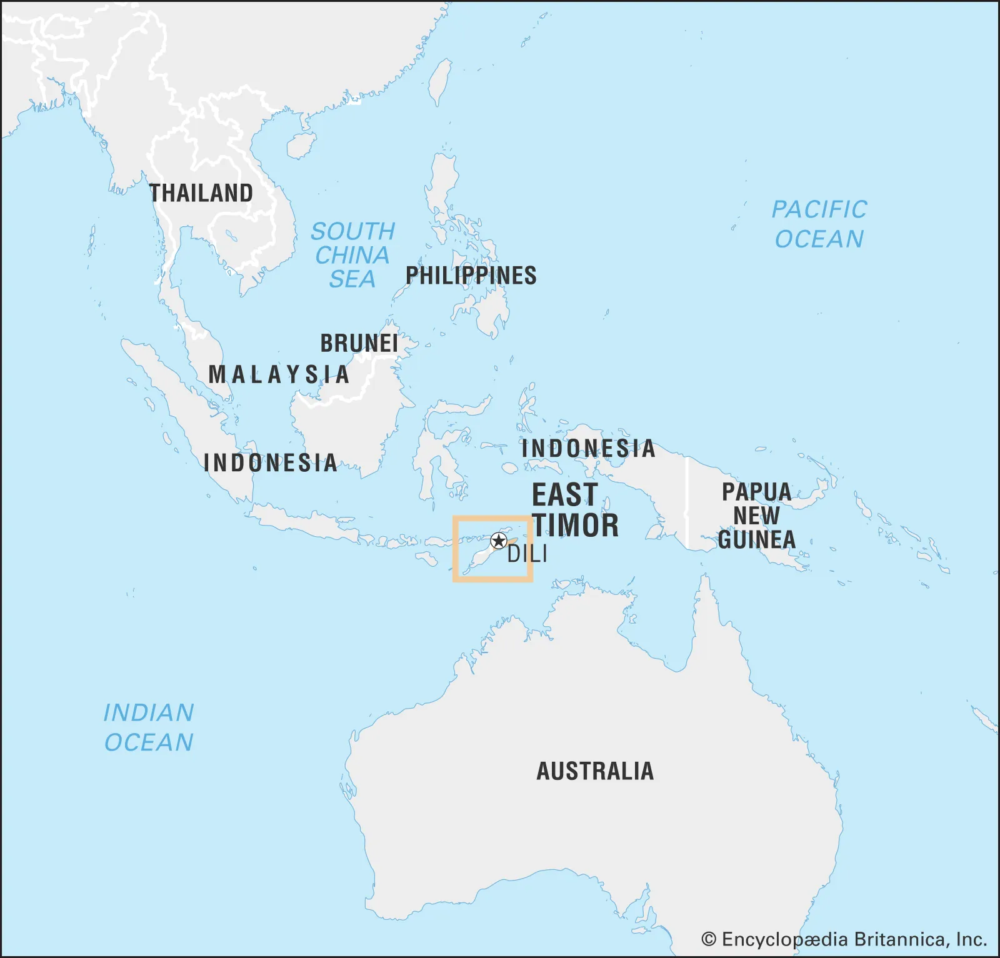
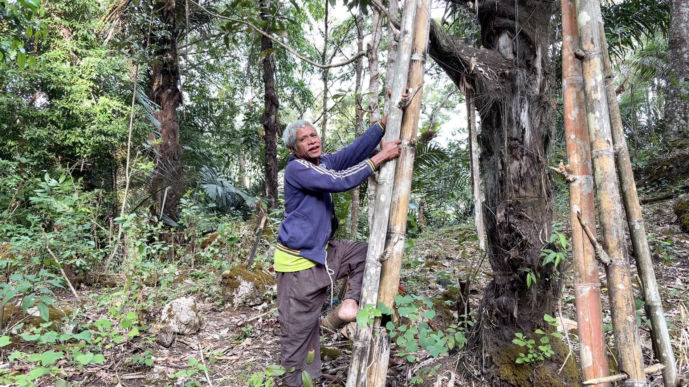
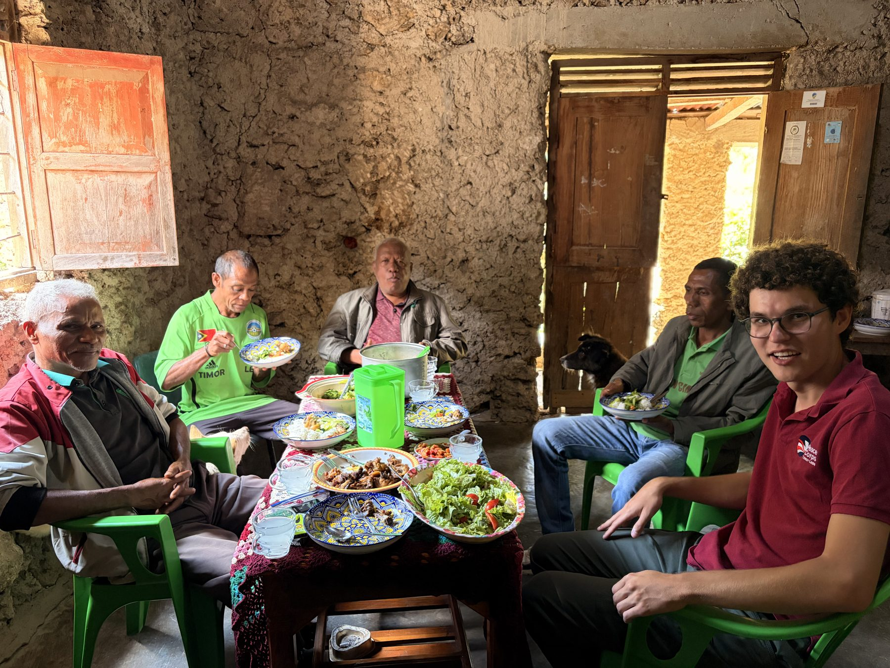
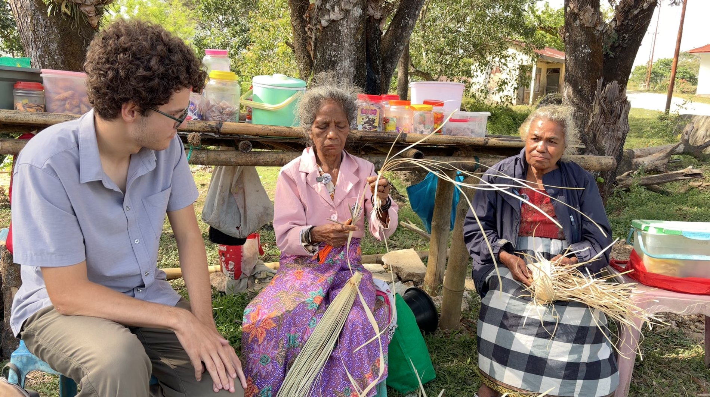
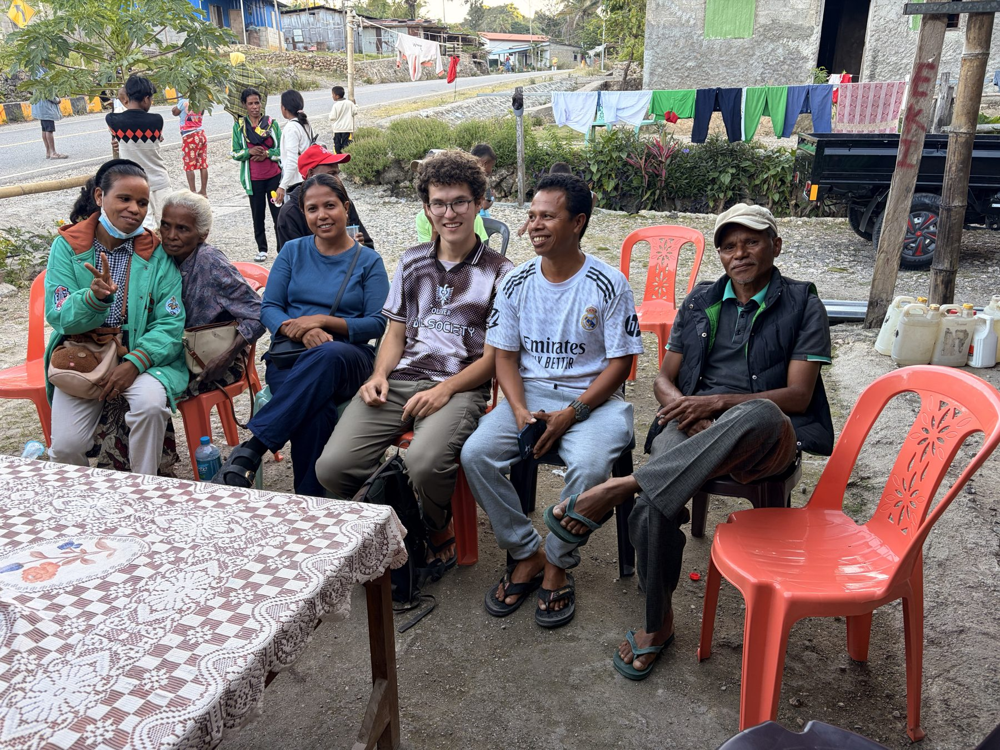

## Reminders {.smaller}

**Monday, November 23, 8:00 am (extended from Friday):** Draft due on Lamākū (at least **1,750 words**, excluding references).

**Week 14:** sign up for a presentation slot (Google Sheet); Discussion Post #8.

**No class Thursday, November 26** (Thanksgiving).

::: {.notes}
All dates are from the syllabus (Week 13 and Week 14 rows, and the Final Paper section). Late components lose 5% per day (syllabus §3.1). Presentations are December 1, 3, 8, and 10.
:::

## Today's Plan {.smaller}

**Part 1: Linguistics at UH Mānoa (about 10 min)**

1. Grace (Ch. 22): why the department focuses on Oceania
2. One example: Rehg and the Pohnpeian grammar
3. Documentation at UHM today, and how you can get involved

**Part 2: Fieldwork (about 10 min)**

4. My work on Midiki

**Part 3: Draft clinic (about 35 min)**

5. Pair up, swap drafts, and give each other feedback

**Wrap-up (about 5 min)**

::: {.notes}
Roughly 60 minutes of teaching plus pairing; adjust to the length of the class period. If time is short, shorten Part 1 (keep "From PLDP to DLPHI") and protect the draft clinic, since the draft is due Monday at 8 am (extended from Friday).
:::

# Part 1: Linguistics at UH Mānoa

## Why Oceania? (Grace, Ch. 22) {.smaller}

From its start in **1963-64**, the department has focused on the languages of Oceania. Grace gives **four reasons**:

1. **The host language** and its relatives: an obligation, given their interest to the people of Hawaiʻi
2. **Convenience:** speakers were in Hawaiʻi, and fieldsites were easier to reach from here than from anywhere else in the US
3. **Prehistory:** how the languages are related is evidence for how the peoples settled the Pacific
4. **Expertise:** most early faculty were already Oceanic specialists

::: {.notes}
Source: Grace, Ch. 22, §2, p. 265. The four reasons are his (the fourth he calls one he "might add"). There is no single answer. Reasons 1 and 2 still apply: Hawaiian and the migrant communities in Hawaiʻi (see DLPHI later in class); reason 3 is the kind of question we met in the weeks on settlement and language families. Reason 4 changed in that today's faculty work across Asia and the Americas too (see "Where We Work Now"). Note that Grace is a founding faculty member writing from memory (his footnote 2 thanks others for their memories), so this is an insider's account.
:::

## Three Regions, Three Needs {.smaller}

| Region | State of knowledge in the 1960s | What the department did |
|---|---|---|
| **Polynesia** | Fairly well known: accurate list of languages, some dictionaries and grammars | Studies of Hawaiian and specific problems; two Outlier languages; Tongan |
| **Melanesia** | Hundreds of languages, many unknown; the greatest diversity | Fieldwork in New Caledonia, Vanuatu, the Solomons, and Papua New Guinea; the Fijian dictionary; the New Guinea project (1975-76) |
| **Micronesia** | Poorly known until World War II | The department's **greatest impact** |

> **Why would Micronesia be where UH made the biggest difference?**

::: {.notes}
Source: Grace §4, pp. 266-270. Answer, from Grace: Micronesia was among the least-known areas; the Peace Corps needed language materials, and then the Trust Territory government, faced with improving education, funded a series of UH projects (the Pacific Languages Development Project, 1970-74, to develop standard orthographies and produce bilingual dictionaries and reference grammars, with linguistic training for Micronesian consultants). He says Micronesian languages went from among the least known in Oceanic to perhaps more adequately described than those of any other comparable area. This is Grace's own assessment. The Fijian dictionary: begun in 1971 by a committee of Fijians and linguists, funded through the interest of the actor Raymond Burr, who owned an island in Fiji; it is monolingual, with Schütz as director and Paul Geraghty as assistant, later editor (pp. 267-268).
:::

## From Grace to Rehg: One Grammar {.smaller}

**The Pacific Languages Development Project (1970-74):** standard orthographies, reference grammars, bilingual dictionaries, and **training for Micronesians**

**Example:** the *Ponapean Reference Grammar* (Pohnpeian), written by **Ken Rehg** with a native-speaker assistant, **for speakers** of the language

Rehg (2014) says it:

- changed how young speakers **viewed** their language (teenagers used to say Pohnpeian "had no grammar")
- is used to teach Pohnpeian to **learners**, including Peace Corps volunteers
- supports teaching of the **standard orthography** and led to a **community grammar** written by two Pohnpeians

> **Is a grammar "documentation" or "description"?**

::: {.notes}
Sources: Grace §4.3, p. 270 (PLDP, seven reference grammars: Chamorro, Palauan, Yapese, Mokilese, Kosraean, Pohnpeian, and Woleaian); Rehg 2014 (LD&C Special Publication 8, pp. 53-67), §5.1 (pp. 58-60): the Pohnpeian grammar was written by Rehg with the assistance of Damian Sohl, a native speaker who participated in the project; drafts were used in a seminar and reviewed by about thirty native speakers over about six years; the three uses on the slide are his three points (p. 60). Rehg's larger argument (pp. 53-57): grammars and dictionaries should normally be in the documentary record, even though Himmelmann (2006) treats the reference grammar and dictionary as a format for description, not documentation; Rehg says one cannot easily separate the two in practice, that at UH the goal is to bring data, documentation, analysis, description, and theory together in one "seamless whole," and that the right choice depends on context (for a language with a few elderly speakers and no interest in revitalization, build the corpus first; if the language might be revitalized, a grammar should have high priority). He also argues that analysis checks the adequacy of the corpus, with his story about recorded narratives that contained no example of a question (p. 56). Rehg also describes a "community grammar" and gives an acronym for what it should be (FINE: focused, interesting, naturalistic, and a fourth letter I did not see in my copy, so check page 61 before using it). Rehg says he does not take credit for the plan: the audience and approach were guidelines for all the grammars in the project (p. 59). Answer to the question: both, in his view; it is a record that serves linguists and the community, which is why he argues against drawing a hard line between documentation and description. Link to Tuesday: Himmelmann (1998, 2006).
:::

## The Authors You Have Read {.smaller}

Grace's list of contributors to the reader (22 people): **every one** has a UH connection (a degree, teaching, or an affiliation):

- **Schütz** (Ch. 17 and Fijian), **Lynch** (diversity), **Meyerhoff** (pidgins and creoles), **Sakoda & Siegel** (Hawaiʻi Creole English), **Guérin & Yourupi** (endangerment), **Wilson** (Hawaiian revitalization), **Benton** (Māori), **Thieberger** (documentation)

Grace also lists **three kinds of contribution:** research, **publishing** (*Oceanic Linguistics*, brought to UH in the 1960s), and **students**: "the multiplier effect."

::: {.notes}
Source: Grace §§5-6 (p. 271) and "Contributing Authors" (pp. 272-273). The topic labels next to each name (Fijian, diversity, pidgins and creoles, and so on) are from the readings and chapter titles I have seen this semester; check them against your reader's table of contents before showing the slide, especially Meyerhoff, Sakoda and Siegel, and Benton. Individual affiliations per the contributor notes: Schütz taught at UH 1962-2000; Lynch PhD Hawaiʻi 1974; Meyerhoff PhD Pennsylvania, taught at UH 1997-2000; Sakoda MA Hawaiʻi 1991 and is outreach facilitator of the Sato Center; Siegel MA Hawaiʻi 1973, directed the Sato Center 2002-2004; Guérin PhD Hawaiʻi 2008; Yourupi MA Hawaiʻi 2009; Wilson PhD Hawaiʻi 1981 and teaches at UH Hilo; Benton PhD Hawaiʻi 1972; Thieberger taught at UH 2008-2010. Answer to the question, per Grace (p. 271): knowledge is cumulative, so every project needs to be able to build on earlier work, which requires being able to find and read it; suitable outlets were scarce when the department started. He says *Oceanic Linguistics* has been published by UH ever since, with a monograph series (39 Special Publications by 2012), and the Comparative Austronesian conference series started in 1974. Link to last week's source hunting: *Oceanic Linguistics* is a journal to search.
:::

# Part 2: Documentation at UHM Today

## From PLDP to DLPHI {.smaller}

| | **1970-74** | **2024 on** |
|---|---|---|
| **Project** | Pacific Languages Development Project | Diaspora Languages Project in Hawaiʻi (**DLPHI**) |
| **Where** | Micronesia (Trust Territory) | **Micronesian communities in Hawaiʻi** |
| **Funding** | Trust Territory government | National Science Foundation |
| **Aims** | Orthographies, grammars, dictionaries, training | Annotated documentation, research, training |

> **What stayed the same, and what changed?**

::: {.notes}
Sources: Grace §4.3 and the DLPHI page (manoa.hawaii.edu/linguistics/research/dlphi). Answer: the focus on Micronesia, on training community members, and on materials that last has continued; what has changed is that the community is now in Hawaiʻi (a diaspora), the methods now include digital archiving and tools such as ultrasound, and the training is aimed at students and community organizations here. Be careful not to overstate the link: the DLPHI page does not say it builds on the PLDP; the comparison is mine and Grace's chapter gives the history. You can say it from your own knowledge of the department.
:::

## DLPHI: What's Happening Now {.smaller}

**An NSF-funded project** to support diaspora language communities, focusing on the **Micronesian diaspora in Hawaiʻi**

- **Why?** Outmigration and rising seas threaten Micronesian languages; the Micronesian population in Hawaiʻi may be as many as **30,000** (nearly **2%** of the state), yet support for Micronesian languages here is almost nonexistent
- **LDTC:** training workshops for specific skills and specific communities
- **MURAL:** undergraduates of Micronesian heritage do their **own documentation project** and present it each year
- **Research:** ultrasound studies of **Palauan** and **Woleaian**; corpus building; typology and grammar

> **Why would a documentation project train community members instead of only recording?**

::: {.notes}
Source: the DLPHI page, "Goals," "Why Micronesia?" and "Projects." The page says the Micronesian population in Hawaiʻi "has swelled to as many as 30,000," nearly 2% of the state, and describes support for Micronesian languages as almost non-existent despite the visible support for the Hawaiian renaissance. The LDTC (Language Documentation Training Center) held a workshop on November 23-24, 2024; MURAL stands for Micronesian Undergraduate Research Apprenticeship in Linguistics and culminates in a public presentation each year; ultrasound projects on Palauan and Woleaian were presented at the Acoustical Society of America meeting in 2025. This is the department's largest current project, as you said; add anything you know that the page does not say (for example, who the other participants are). The NSF award number (2421485) is cited on the page; I could not open the NSF award abstract itself (robots.txt blocked it), so I did not use it. Answer to the question: it builds lasting capacity in the community (the DLPHI goals say so), and echoes what we read on Tuesday: community-based research (Czaykowska-Higgins), Leonard's argument that community members should be core stakeholders, François's example of community-made materials in Vanuatu, and Grace's point about training Micronesian consultants in the 1970s.
:::

## Get Involved: ICLDC 10 {.smaller}

**10th International Conference on Language Documentation & Conservation**

::: {.column}

- **March 4-7, 2027**, Honolulu (Hawaiʻi Imin International Conference Center)
- Theme: **"Arts Sustaining Language"** (storytelling, song, performance, visual arts)
- Hosted by UH Mānoa Linguistics with UH Hilo's Ka Haka ʻUla O Keʻelikōlani; co-chairs **Holton, Pappas, and Solomon**

**Volunteer and get free registration and a free T-shirt:**

- Go to an **orientation session** before the conference
- Work **at least 5 hours** across the conference days
- Fill out the **Volunteer Interest Form** by **Jan 31, 2027**

:::

::: {.column}

{fig-alt="QR code linking to the ICLDC 10 volunteer interest form" width="60%"}

:::

::: {.notes}
Sources: the ICLDC site (ling.lll.hawaii.edu/sites/icldc): dates, venue, theme, co-chairs (Holton, Pappas, N. Haʻalilio Solomon), the optional Hilo Field Study (March 8-9, separately organized with its own registration), and ComputEL-10 on March 2-3 (also separate). Registration for accepted presenters opens Nov. 1, 2026 and registration opens to the general public on December 1, 2026. The volunteer details (free registration and T-shirt, one orientation session, at least 5 hours of work across the conference days, interest form closing Jan 31, 2027) come from the ICLDC Volunteer Coordination Committee's announcement email that you received; the short link go.hawaii.edu/SSV and the QR code are yours and point to their form. The committee asked instructors to share the invitation with students. Questions: icldc@hawaii.edu. Also say that ICLDC was held in Honolulu most recently in March 2025 (theme: diaspora communities).
:::

# Part 3: Fieldwork

## My Fieldwork: the Midiki language {.smaller}

::: {.columns}
::: {.column width="52%"}
**Midiki** is a language spoken in Timor-Leste, Asia's youngest country (independent since 2002)

- Began after living in the Midiki-speaking community for two years as a Peace Corps volunteer
- Work with local leadership to determine goals for the language documentation project
- Find ways to develop materials useful to the community in addition to my own research outputs
- This past summer:
  - 10 weeks, ~15 hours of recordings, 45 speakers, 9 villages
  - All archived in Kaipuleohone Archive [https://hdl.handle.net/10125/737754](https://hdl.handle.net/10125/737754)
:::
::: {.column width="48%"}
{fig-alt="Map of Southeast Asia and northern Australia with East Timor and its capital Dili highlighted."}

<!-- Save the language map as images/timor-languages-map.png, then uncomment:
{fig-alt="Map of Timor-Leste colored by dominant vernacular, with Austronesian and non-Austronesian languages listed, including Kairui-Midiki."}
-->
:::
:::

> **What would you want to record if you were documenting a language today?**

::: {.notes}
I only know what you have told me: the language is Midiki, a lingua franca (Tetun) is replacing it among children, and the testimony in the video was recorded in the summer. Everything in brackets needs your details. The question for students: expect answers like stories, conversations, songs; steer them to the idea from Tuesday that a documentation records a range of communicative events, not only elicited words (Himmelmann 2006).
:::

## Fieldwork in Timor-Leste {.smaller}

::: {.columns}
::: {.column width="50%"}
{fig-alt="A man with gray hair stands in a forest, holding onto bamboo poles and speaking toward the camera." width="90%"}

{fig-alt="Five men sit around a table of food inside an earthen-walled house, with a dog by the door." width="90%"}
:::
::: {.column width="50%"}
{fig-alt="Two women sit under trees weaving palm leaves while the researcher sits beside them, watching." width="90%"}

{fig-alt="Six people sit in plastic chairs outdoors beside a road, smiling at the camera." width="90%"}
:::
:::

::: {.notes}
Photos from your summer fieldwork (file dates July 2026). I do not know the people, places, or activities, so the captions are generic: replace them with who, where, and what was being recorded, and say whether the speakers agreed to be shown. Good talking points: documentation happens in daily activities (work, crafts, conversation), not only in elicitation sessions; what you record and who decides. The ELAN screenshot that used to be on this slide is still on Tuesday's deck ("What Goes Into Documentation?").
:::

# Part 4: Draft Clinic

## Ground Rules for Giving and Getting Feedback {.smaller}

**When you are the reader**

- Start with the **big picture**. Do not fix spelling or grammar today.
- Say what you **understood**: *"I read this as..."*
- Say what **works**, then what is **unclear**. Be specific: point to a sentence or paragraph.

**When you are the writer**

- **Before your partner reads:** tell them **one question** you want help with. *Example: "Is my question too big?"*
- **While they talk:** **listen and take notes**. Do not defend or explain your draft.
- **After:** say back what you heard. You decide which advice to use.

::: {.notes}
These are the guidelines; the next slide is the procedure. Students do better with both: guidelines say what to comment on, and the procedure says how and when. The practices here come from writing-center guides (UMN Writing Across the Curriculum; Grand Valley State University; Caltech Hixon Writing Center): big picture before copyediting, say back what you understood, writer states a question up front, writer listens silently and takes notes, writer decides what to use. Say plainly that a partial draft is fine and that nobody has to apologize for their draft. Skip grammar and spelling: with the draft due Monday morning, the big issues (question, argument, evidence, citations) matter most.
:::

## How This Will Work (about 35 min) {.smaller}

1. **Pair up** (4 min). Have your draft/outline, even if it is not finished. Tell your partner **one question** you want help with.
2. **Round 1, the big picture (9 min).** Read your partner's **introduction**. Try to identify their **thesis**. Then say: *"Your question is ___, and your answer is ___."*
3. **Round 2, the body (9 min).** Read the **first sentence of each paragraph**. Does each one support the answer?
4. **Round 3, evidence and citations (9 min).** Check the **sources and the reference list**.
5. **Make a plan (4 min).** Write down **one change** you will make this weekend.

**In every round:**

1. **Swap drafts.** Both of you **read at the same time** (about 3 minutes).
2. **Partner A** gives feedback (about 3 minutes). **Writer A listens and takes notes.**
3. **Switch.** **Partner B** gives feedback (about 3 minutes). **Writer B listens and takes notes.**

::: {.notes}
Adjust timings to the class period. The structure (say-it-back, topic sentences, evidence) follows the draft criteria in the Final Paper guide: the draft should state the research question, present an argument supported by academic sources with in-text citations, connect to at least one course idea or reading, have a clear structure with body paragraphs that each support one point and point back to the question, and include a reference list in a consistent style. Walk around and read over shoulders; use the time to answer questions about scope or sources. If the room has an odd number, make one group of three. Tell students the overall rhythm once: read, talk, switch, then move to the next round. Announce "time to switch" and "next round" out loud, since pairs will not keep time on their own. Last step: have them write the one change on their draft or in their notes; the closing question on the Wrap-Up slide asks the same thing. Optionally put the Reader's Checklist on screen or hand it out during the rounds.
:::

## What a Strong Draft Has {.smaller}

From the Final Paper guide:

- **Introduces** the language, country, or island and the topic, and **states the research question** clearly
- **Argues** an answer supported by **evidence from academic sources**, with in-text citations
- **Connects** to at least one **idea or reading from the course**
- Has a **clear structure**: each body paragraph makes **one point** and points back to the question
- Includes a **reference list** in one **consistent citation style**

*It does not have to be polished, but it does need to be complete: introduction, body, conclusion.*

::: {.notes}
Directly from the Draft section of the Final Paper guide you have already given students. The draft is worth 25% of the final paper grade, the final paper 45%, and the final paper needs at least 7 academic sources and at least 2,500 words, excluding references.
:::

## Reader's Checklist {.smaller}

**Introduction**

- Can you say the **question** and the **answer** in one sentence each?
- Is the question **one question**, not two?

**Body**

- Does each paragraph make **one point** and back it with a **source**?
- Is there a link to a **course reading**?

**Sources and citations**

- **Academic** sources (books, chapters, peer-reviewed articles, grammars, dictionaries)?
- Each in-text citation matches the **reference list**; one **style** throughout

**Conclusion**

- Does it answer the question and say what is left to find out?

::: {.notes}
Hand this out or leave it on screen. The points about "one question" and academic sources come from the pattern in the preliminary-sources submissions: many questions had two parts or assumed their answer, and several source lists included encyclopedias, tourism sites, or URL-only citations that would not count as academic sources. Do not name students. Remind them of the academic-source definition in the guide: scholarly books, book chapters, and peer-reviewed articles, including reference grammars and dictionaries.
:::

## Common Fixes {.smaller}

| If you see... | Try... |
|---|---|
| A question with **two parts** | Pick the part you can answer well; make the other background |
| A question that **assumes the answer** ("Why is X so ...?") | Ask what the evidence says: "In what ways ...?" |
| **Summary** of sources, with no argument | Add a **claim** to each paragraph, then use the source as evidence |
| A **website** or **encyclopedia** as a source | Find the scholarly source it cites |
| A citation with only a **URL** | Add author, year, title, and publication details |
| No link to the **course** | Name a reading and say how your case fits or changes its idea |

::: {.notes}
Use as a quick reference during the pairing. Everything here is general advice built from the earlier feedback, not from a specific source. If students ask whether Course Reader chapters count among the 7 academic sources, you have not decided yet (it was a question from at least one student), so settle it before class.
:::

## Writing Support and AI {.smaller}

- **Questions?** Office hours **W/F 1:30-2:30, Moore 574**, or email
- **Generative AI (syllabus §3.3):** you may use it to support your thinking and polish your writing, but **not** to generate first drafts or summarize readings
- If you use it, include a brief **statement at the top** of the assignment; undisclosed use to produce substantive content is treated as **academic dishonesty**. *When in doubt, ask me.*

::: {.notes}
Paraphrased from syllabus §3.3 (Generative AI Policy), which I re-read for this deck. Office hours (Wednesdays and Fridays 1:30-2:30, Moore 574) are from the Final Paper guide.
:::

## Wrap-Up {.smaller}

- **Today:** UH linguistics and documentation, my fieldwork, and your drafts
- **Mon 11/23, 8:00 am:** draft due on Lamākū
- **Want to volunteer at ICLDC (March 2027)?** Form closes **Jan 31**: **go.hawaii.edu/SSV**

> **What is one thing you will change in your draft this weekend?**

::: {.notes}
Take 2-3 answers if there is time. Remind them that a partial draft is better than none (Final Paper guide).
:::

## Sources Behind Today's Slides {.smaller}

- Grace, George W. Ch. 22: The University of Hawaiʻi linguistics department and Oceanic linguistics. In *Languages of the Pacific Islands: Introductory Readings*, 265-271.
- Rehg, Kenneth L. 2014. On the role and utility of grammars in language documentation and conservation. In Nakayama & Rice (eds.), *The Art and Practice of Grammar Writing*, LD&C Special Publication 8, 53-67.
- UH Mānoa Department of Linguistics. Diaspora Languages Project in Hawaii (DLPHI): manoa.hawaii.edu/linguistics/research/dlphi
- UH Mānoa Department of Linguistics. Research: manoa.hawaii.edu/linguistics/research
- ICLDC 10: ling.lll.hawaii.edu/sites/icldc
- Himmelmann (1998, 2006), Thieberger Ch. 21, and the other readings from Tuesday's deck

::: {.notes}
Web pages were read on November 18, 2026 (check that they still say the same). The list of places faculty and students work, the volunteer-for-registration option, and the Midiki details come from you.
:::
